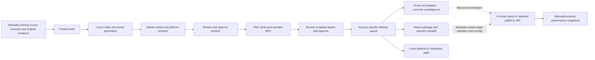

# Architecture and staged delivery

Decision date: 2026-10-10, Asia/Singapore. See [verified progress and architecture in Chinese](progress-and-architecture.zh-CN.md) for current implementation and live-acceptance boundaries.

## Stage one: one Mac and Codex

Automatic source discovery, URL collection, competitor analysis and analytics ingestion are not implemented. The native path exports a package and waits for an operator; it does not execute a browser publisher. Postiz is unconfigured and no platform has passed live publication acceptance.

The small custom coordinator owns evidence, revision approval, account selection, job state and result reconciliation. Maintained upstream components own model execution, media rendering, and API-based delivery. React, Vite, Express and Zod provide the workbench and validated interface. Postiz is called through its documented public API; its AGPL source is not embedded into this product. Broader adapters are deferred until their actual accounts and contracts are verified.

The implementation does not self-host AiToEarn because its current complete stack requires MongoDB, Redis and object storage, while the user's database choice is Supabase. It does not introduce n8n in stage one because the current workflow is small and n8n has a distinct commercial licensing boundary for customer-configurable workflows.

## State and credentials

- Local workspace mode: private `.studio/state.json`, atomic file replacement, exclusive process lock, no automatic replacement of corrupt data. This supports one operator on one machine, with multiple cooperating commands.
- Optional database mode: Supabase PostgREST with a workspace JSON record and optimistic revision compare-and-swap. Enable RLS and revoke anonymous/authenticated table access. Only the local server has the secret key. This schema is a stage-one persistence option, not a completed SaaS tenant design.
- Supabase requires all three environment values; partial configuration fails explicitly rather than silently switching stores. Copying local state into an existing cloud workspace is an explicit operator migration, never an automatic merge.
- Media stays local in stage one, even when job metadata is in Supabase. Cloud storage and a durable render worker belong to stage two.
- Native platform credentials stay in Chrome or approved upstream integrations. Do not export Chrome cookies into this project.
- Codex runs from an isolated temporary directory, without publishing/Supabase environment secrets, with ephemeral structured output and a read-only sandbox. Source excerpts are untrusted data. The generator prompt prohibits tool use; full OS-level tool/network isolation is not a sandbox claim.

## Publishing state and recovery

`scheduled → submitting → queued → published` is the API path. Native delivery becomes `awaiting_operator`. A stopped worker, timeout or unrecognized response becomes `needs_reconciliation`. An API HTTP success is queued evidence, not a live platform post.

Before a non-idempotent request the coordinator persists the attempt and owner. Each request targets one integration. The content key prevents duplicate active/confirmed content to the same account, including across draft edits. Approval binds actual media bytes and content; changes invalidate it. Known parameter/authentication rejection is distinct from an uncertain server/network outcome. There is no automatic blind retry.

The local queue checks every 30 seconds while `npm run dev` runs. This timer dispatches due submissions only; provider reconciliation is manually triggered through the UI or CLI. It catches missed due times on the next dispatch. Global pause persists across restarts. It does not wake a sleeping Mac, claim autonomous operation while the server is stopped, or automatically infer publication from an absent provider search result.

Manual publication receipts record operator-attested evidence. Domain validation reduces accidental wrong-platform links; it does not independently inspect private account content. Provider reconciliation records provider-reported publication. Public visibility and intended-account readback remain live acceptance requirements.

## Stage-two gate and intended migration

Do not start stage two until generation, media review, real publication, duplicate handling, error recovery, account renewal, and restart behavior pass locally for the selected channels. The user must also approve narrowing or changing the initial acceptance platform set; supporting 12 metadata entries is not acceptance of 12 publishers.

After that gate: replace local Codex with a licensed provider-backed generation worker; move assets to Supabase Storage; normalize Supabase tables with tenant ownership and RLS; use durable cloud jobs and bounded retries; obtain production OAuth apps and approved publishing integrations; add billing, measured quotas and deletion/export workflows. Official/API adapters migrate first. Channels that depend on browser login can require an optional companion or user confirmation until an approved independent route exists. No cloud deployment, billing plan, tenant schema, or stage-two generator has been implemented here.
