# Architecture and staged delivery

Decision date: 2026-10-10, Asia/Singapore. See [verified progress and architecture in Chinese](progress-and-architecture.zh-CN.md) for current implementation and live-acceptance boundaries.

## Stage one: one Mac and Codex

```mermaid
flowchart LR
  T[Official regional Google Trends RSS] --> R[Unverified candidates and news URLs]
  R --> A[Independent source verification and excerpts]
  A --> B[Content brief]
  B --> C[Local Codex structured generation]
  C --> D[Master article and platform versions]
  D --> E[Review and approve revision]
  E --> F[PNG cards and narrated MP4]
  F --> G[Review complete assets and approve]
  G --> H[Account-specific delivery queue]
  H --> P[Platform policy and target checks]
  P --> I[Postiz text adapter - currently unconfigured]
  P --> Y[Explicit YouTube official API CLI - authorized]
  P --> J[Native package and genuine human handoff]
  I -. Manual reconciliation .-> K[Provider status or attested platform URL]
  J -. Separate creator-page operation and receipt .-> K
  Y -. Official API readback plus separate viewer acceptance .-> K
  K --> L[Manually entered performance snapshots]
  H --> S[Local artifacts or Supabase state]
```

Regional trend and related news-reference discovery are implemented through the `discover` CLI. Independent article verification/excerpt collection, competitor analysis and analytics ingestion are not automated. RSS observation dates are not article dates, the traffic window is not inferred, country bucket counts are never summed, and lexical country-coverage ranking is not a global popularity score. The native path exports a package and waits for an operator; it does not execute a browser publisher. Postiz remains unconfigured. Two distinct YouTube videos were submitted once each; the previous video was withdrawn to Private, while the new education video has official public/processed readback and intended-channel listing. Historical signed-in playback reached the old video’s end; the new player reached 36/46 seconds; repeated delivery, renewal, restart and the other selected channels remain unaccepted.

The small custom coordinator owns evidence, revision approval, account selection, job state and result reconciliation. Maintained upstream components own model execution, media rendering, and API-based delivery. React, Vite, Express and Zod provide the workbench and validated interface. Postiz is called through its documented public API; its AGPL source is not embedded into this product. Broader adapters are deferred until their actual accounts and contracts are verified.

The implementation does not self-host AiToEarn because its current complete stack requires MongoDB, Redis and object storage, while the user's database choice is Supabase. It does not introduce n8n in stage one because the current workflow is small and n8n has a distinct commercial licensing boundary for customer-configurable workflows.

## State and credentials

- Local workspace mode: private `.studio/state.json`, atomic file replacement, exclusive process lock, no automatic replacement of corrupt data. This supports one operator on one machine, with multiple cooperating commands.
- Optional database mode: Supabase PostgREST with a workspace JSON record and optimistic revision compare-and-swap. Enable RLS and revoke anonymous/authenticated table access. Only the local server has the secret key. This schema is a stage-one persistence option, not a completed SaaS tenant design.
- Supabase requires all three environment values; partial configuration fails explicitly rather than silently switching stores. Copying local state into an existing cloud workspace is an explicit operator migration, never an automatic merge.
- Current media remains in local files, even when workspace metadata uses the optional Supabase JSON store. The planned complete local upgrade moves media to local Supabase Storage and uses a durable local worker in stage one; hosted Storage and Linux/cloud execution remain stage two. See the [latest local-first review](local-first-build-review.zh-CN.md).
- Native platform credentials stay in Chrome or approved upstream integrations. Official YouTube Desktop OAuth credentials live only in private ignored files; authorization uses PKCE/state and a random loopback callback. Upload scopes require explicit user consent and live channel readback. Do not export Chrome cookies into this project.
- Codex runs from an isolated temporary directory, without publishing/Supabase environment secrets, with ephemeral structured output and a read-only sandbox. Source excerpts are untrusted data. The generator prompt prohibits tool use; full OS-level tool/network isolation is not a sandbox claim.

## Publishing state and recovery

`scheduled → submitting → queued → published` is the API path. Native delivery becomes `awaiting_operator`. A stopped worker, timeout or unrecognized response becomes `needs_reconciliation`. An API HTTP success is queued evidence, not a live platform post. Explicit YouTube upload checks the selected channel, saves a private resumable journal before non-idempotent requests, and reconciles the same session/video. It confirms public/processed API state separately from viewer playback. It does not start a second upload after an ambiguous result.

Before a non-idempotent request the coordinator persists the attempt and owner. Each request targets one integration. The content key prevents duplicate active/confirmed content to the same account, including across draft edits. Approval binds actual media bytes and content; changes invalidate it. Known parameter/authentication rejection is distinct from an uncertain server/network outcome. There is no automatic blind retry.

The local queue checks every 30 seconds while `npm run dev` runs. This timer dispatches due submissions only; provider reconciliation is manually triggered through the UI or CLI. It catches missed due times on the next dispatch. Global pause persists across restarts. It does not wake a sleeping Mac, claim autonomous operation while the server is stopped, or automatically infer publication from an absent provider search result.

Manual publication receipts record operator-attested evidence. Domain validation reduces accidental wrong-platform links; it does not independently inspect private account content. Provider reconciliation records provider-reported publication. Public visibility and intended-account readback remain live acceptance requirements.

## Platform policy boundaries

The centralized X policy guard rejects explicit trend-origin briefs and legacy Google Trends provenance on automated Postiz X jobs, at scheduling and each dispatch preflight. Its narrow provenance check is not a complete classifier: the operator must accurately retain source provenance. Native handoff is a genuine human action, not permission for agent-driven X website automation. Reddit's approved App requirement and Xiaohongshu account/topic eligibility remain explicit account blockers. YouTube is Connected after the official grant and exact channel readback; the other three observed accounts remain Blocked and unsubmitted.

Google Cloud project radar-511204 has YouTube Data API enabled, a dedicated Desktop AI-agent client and the specified External Testing user. The exact upload/read-only grant verifies UCVUtH6reLkEuMrUuTh-XgjQ. Original job 489d1309-02d4-47e8-9d0b-3a9fba52b864 submitted revision 7 once; its video aKaJ3qBAhCc is now confirmed Private after Studio Save and API readback. New job 78fb0a72-f850-4bd3-a48b-0f9629e4e264 submitted independent education revision 4 once; [X8dDltMseM4](https://www.youtube.com/watch?v=X8dDltMseM4) is public/processed and listed Public/Published, with signed-in progress to 36/46 seconds. Existing scopes cannot call videos.update (actual 403); privacy was changed in the owner-authorized native Studio workflow without a broader grant. The schema preserves the old receipt as needs_reconciliation rather than inventing a withdrawn status. Credentials and per-job journals remain private, files 0600/directories 0700. No paid trial was started. See [replacement evidence](ai-agent-education-run-2026-10-10.zh-CN.md).

## Stage-two gate and intended migration

Do not start stage two until generation, media review, real publication, duplicate handling, error recovery, account renewal, and restart behavior pass locally for the selected channels. The user must also approve narrowing or changing the initial acceptance platform set; supporting 12 metadata entries is not acceptance of 12 publishers.

Stage one must first implement and verify a single-owner relational Supabase model, local Supabase Storage and durable local jobs. These are prerequisites for the requested local Web workflow, not deferred cloud features. After the gate, reuse those models and migrations in hosted Supabase, replace local Codex with a licensed provider-backed generation worker and macOS-specific execution with Linux workers, add multi-user Auth/membership/RLS, obtain production OAuth apps and approved publishing integrations, and then add production billing/quotas and deletion/export workflows. Current cloud work is feasibility and migration design only. Official/API adapters migrate first. Channels that depend on browser login can require an optional companion or user confirmation until an approved independent route exists. No cloud deployment, billing plan, tenant schema, or stage-two generator has been implemented here.

## Planned Web workflow extension

The 2026-10-10 proposal adds separate master/channel revisions, safe propagation of master updates, job-scoped Web AI instructions, discovery schedules and question runs, asset references, and manually created video projects. These changes have not been implemented. See [product design](web-product-design.zh-CN.md), [technical architecture](web-technical-architecture.zh-CN.md), and [official workflow research](research-web-workflows-2026-10-10.zh-CN.md). The existing live-publishing acceptance gate remains in force before stage-two implementation.
