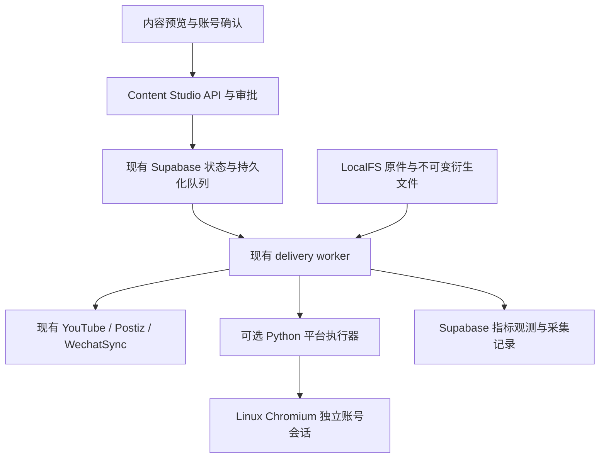

# BeeCMS 功能借鉴与发布执行层迁移计划

日期：2026-10-14（Asia/Singapore）。状态：**待实施的 coding plan**，本文提交不代表功能完成、账号授权、远端草稿或公开发布完成。

## 1. 目标、基线与范围

目标是复用 BeeCMS 在具体平台上的操作经验，增强 Content Studio 的素材准备、账号会话、平台执行和效果采集；保留 Content Studio 的内容修订、审批、Supabase、LocalFS、持久化任务和异常恢复。

本次核对基线：

- Content Studio：`e6fcf2b`，包含 `44e47e4` 引入的 WechatSync 原生文章草稿与 Postiz 服务商草稿。既有草稿连接器和发布治理应复用，不能重新实现一套。参见[当前产品审查](product-review-2026-10-13.zh-CN.md)、[发布生态](publishing-ecosystem-2026-10-13.zh-CN.md)。文档记录的模拟扩展集成验收不等于真实平台验收；`acceptance.md` 中较早的“草稿适配器未实现”描述属于待校正的历史状态。
- BeeCMS：审查对象为开发机 `~/c/beecms`，提交 `375b323` 加工作区修改：`tools/browser.py` 增加 macOS 浏览器路径，`app/services/browser.py` 增加登录检查超时。不是公开的同名 `bookyo/BeeCMS`。上述目录仅用于审查取材，不得成为运行时依赖。
- 本次没有重新实测 BeeCMS 的外部账号、平台成功率或连续运行稳定性。其三个财经平台的步骤实现更完整，不代表异常恢复或通用适配性更强。

默认实施范围分两条线：

1. **通用改进必做**：统一执行结果、物理账号串行、不可变素材衍生、指标采集框架和可观察的失败状态，保持现有渠道兼容。
2. **财经平台迁移按独立试点推进**：先雪球，再格隆汇、股吧。代码、模拟页面测试与容器验证可先完成；新增平台默认关闭，不能自动加入现有内容任务。真实写入须满足平台准入、目标账号核验和用户对具体内容的发布授权。权限未取得时记录阻塞，不切换成猜测的内部 API。

本计划不迁入 BeeCMS 的管理后台、业务数据库、APScheduler、后台发布线程、历史账号登录态；不替换 WechatSync/Postiz/YouTube；不切换 pg-boss，不开始云阶段，不新增自动选股或荐股功能。历史 BeeCMS 数据导入不属于首版。

## 2. 迁移价值与明确取舍

| 能力 | BeeCMS 参考位置 | Content Studio 的落地方式 |
| --- | --- | --- |
| 每账号独立浏览器 | `tools/browser.py` | 账号绑定独立会话，使用 Linux 容器与 Web 人工接管；实际平台 UID 校验优先于页面登录提示 |
| 确定性平台步骤 | `app/adapters/base.py`、三个平台适配器 | 保留 Python 执行器，TypeScript 负责契约、审批和调度；模型不参与每次点击决策 |
| 图片规范化和就绪检测 | `app/services/imageutil.py`、雪球/股吧上传流程 | 用已有 `sharp` 生成平台衍生素材；等待图片进入编辑器和按钮可用，保存具体失败原因 |
| 平台语义字段 | `app/services/symbols.py`、格隆汇股票选择器 | 使用显式股票字段和平台转换，最终呈现纳入预览及审批；不把所有字段拼成纯文本 |
| 一素材多账号与投放快照 | `app/routers/api.py`、`app/models.py` | 复用现有不可变 job snapshot；试点只选一个已核验账号，不扩大现有批量发布接口 |
| 自动效果快照 | `app/services/stats.py`、`scheduler.py` | 通过现有 Supabase 队列运行有截止时间的采集，区分失败、缺失和真实零值 |

禁止原样迁入的行为：未收到响应就再次点击提交；任意异常统一标为可重试失败；仅凭业务成功码标记公开发布；发布时默默压缩或替换已批准素材；缺少指标时填零；多请求后台线程共享账号浏览器。

`config/platforms.json` 目前没有驱动 BeeCMS 的核心发布步骤，新增平台仍需编写和测试适配器。迁移收益来自已知的平台流程，不承诺配置式接入任意网站。

## 3. 目标结构与接口

### 3.1 责任归属

- Supabase 继续是业务状态与修订的唯一权威。发布记录仍使用现有 workspace/job CAS 聚合，不复制到 BeeCMS 的 `posts` 表。
- `pg_cron + pgmq` 继续是唯一调度与队列所有者；采集也走 delivery role。Python 执行器不访问业务数据库、不运行调度器、不后台创建任务。
- 执行器接收单账号、单修订的有界请求，返回事实和证据，由 TypeScript 协调器决定 job 状态。现有 `provider: native | postiz` 保持兼容，新增可选浏览器执行路由字段，不能通过改写旧 provider 值把历史人工任务升级成自动任务。
- 新增 Python 执行代码放在独立 `services/browser-publisher/`，只抽取经批准的适配器、必要辅助函数及依赖。股吧适配器中的 `_account_uid()` 改为输入参数，删除直接读取 BeeCMS ORM 的依赖。
- 会话按不含用户输入路径片段的 `sessionId` 管理，逻辑身份使用 `platform + verified remote account ID`。人工接管和自动执行互斥，不把完整浏览器或任意脚本工具暴露给内容生成 agent。

### 3.2 执行契约

新增 TypeScript Zod 契约及与 Python 一致的 JSON fixtures；使用命名导出、严格类型，不使用 `any`。契约版本从 `1` 开始，未知版本拒绝执行。

| 操作 | 必需输入 | 返回与限制 |
| --- | --- | --- |
| `preflight` | 平台、会话引用、预期账号 UID、内容格式 | 实际 UID、登录/准入状态、具体阻塞项；不提交内容 |
| `publish` | job/attempt ID、修订与内容哈希、预期 UID、不可变素材清单、平台字段、账号租约令牌与截止时间 | 明确拒绝、已接收或未知；每 attempt 最多一次提交动作 |
| `reconcile` | 原 attempt、账号 UID、已知远端 ID 或原提交证据 | 已确认作品、审核/处理状态，或仍未知；查询不到不能证明未发布 |
| `collect_metrics` | job、远端作品 ID、预期账号 UID、采集槽位 | 有效观测或结构化错误；缺失字段为 `null`，不触发任何写入 |

内部 HTTP 仅允许上述操作，采用现有私密配置方式管理服务认证，限制请求大小、超时、平台、会话与文件访问。禁用网络客户端、代理和执行器对 `publish` 的自动重试；连接中断由协调器保留未知结果。

结果使用可判别类型：`rejected`（可证明未产生远端副作用）、`accepted`（存在远端受理证据）、`unknown`（提交结果不明）、`verified`（只用于后续核验）。错误含阶段和稳定错误码，原始响应只保留去凭据后的必要字段。

- `accepted` 映射既有 `queued` 或对应交付状态，不能直接映射 `published`。
- `verified` 必须包含匹配账号、有效作品 ID、规范平台 URL 和回读状态。`published` 要求满足该任务的公开可见性目标；私有作品仍走既有 `delivered/visibility` 语义。
- 原生草稿沿用 `draftReceipt` 与 `draft_saved`，服务商草稿仍明确标注 provider destination；不能拿草稿 URL 当公开链接。
- 无可靠自动回读的适配器保留人工核验及证据来源，不伪造独立确认。

### 3.3 单次提交与账号所有权

在现有 CAS 防线之上，增加 Supabase 持久化账号租约，按平台及经核验的物理账号身份串行，并保留 workspace 权限隔离；不能因建立另一条本地账号记录或另一个 workspace 而绕过互斥。身份未知的老账号不能进入新自动执行器。现有按本地 ID、Postiz integration 或原生 UID 的比较只提供局部保护，实施时需核验并建立跨路由身份映射，不能把显示名称当成同一账号的证明。

- 文章发布、视频发布、保存草稿、浏览器登录接管和指标采集使用同一账号执行锁。调用同一个无账号隔离能力的 WechatSync 扩展时，还需保留连接级单请求互斥。
- 领取、续租、释放采用数据库原子 RPC 和 owner token；租约过期不允许旧 owner 写回结果。公开发布还检查现有暂停开关和修订/素材审批。
- 协调器在外部提交前持久化 attempt 与发送意图。执行器在私密本地目录原子落盘最小提交日志后才点击一次；重复 attempt 只返回已有证据或未知，不能重新执行。该日志是防重放技术记录，不是第二份业务状态。
- 心跳失败或所有权丢失立即停止后续页面操作；已发出的请求不能撤回，保留 `needs_reconciliation`。重新连接、重新生成修订、重绑账号、重启服务均不能绕过未决任务。
- 未知提交形成独立的持久化阻塞，租约过期不清除阻塞；同账号后续写入停止，仅允许持锁核对该原任务。普通指标轮询延后，不能抢走正在编辑或人工接管的页面。历史账号缺少可信 UID 时保留读取、人工交接与核对入口，自动写入须先补齐身份。
- 只有可证明尚未派发且未记录提交意图的失败，或执行器明确证明未产生远端副作用的拒绝，才允许安全重试。协调器已派发、执行器已落提交日志后即进入不确定性边界：即使实际崩溃发生在点击前，重启后缺少未提交证明也必须核对。点击后超时、解析失败、响应缺失同样核对，不使用 BeeCMS 的自动二次点击。

## 4. 分阶段 coding 工作包

所有阶段先完成模拟和隔离测试，真实平台验证另计。阶段完成条件是下表产物及第 5 节相应测试都通过。

### P0：固定来源与兼容基线

- 记录 BeeCMS 提交、选定文件哈希和工作区改动清单；只提取发布相关代码，不复制 `config.ini`、`.env`、profile、日志、数据库、上传素材或未审查文件。
- 当前审查未找到 BeeCMS 根许可证文件。复制代码前核对项目复用授权与依赖许可证并保存来源说明；不能把“能读源码”当作可重新分发。授权未明确时继续通用 TypeScript 改进及模拟执行器，不复制来源代码。
- 保留 BeeCMS 现有 DrissionPage `4.1.1.2` 作为首次兼容验证基线，不顺手升级；Python 使用 3.12。将运行依赖、浏览器镜像及架构固定到可重复构建的版本/摘要，记录 ARM64/AMD64 验证结果。
- 基线回归覆盖现有 YouTube、Postiz、WechatSync、人工交接、视频与文章独立性；新增开关关闭时，旧内容、账号、任务和回执读取不变。
- 产物：来源/依赖清单、版本锁定、基线报告、全为关闭的浏览器试点配置。修正验收文档中过时的草稿实现描述，同时保留历史验收日期。

### P1：统一执行结果与物理账号锁

- 接入点：`src/core/delivery.ts`、`remote-drafts.ts`、`video-delivery.ts`、`draft-connectors.ts`、`model.ts` 以及 delivery worker。必须覆盖 `pipeline.ts` 的 `runDueJobs`/Postiz 提交和核对，以及 `youtube.ts` 的上传/断点恢复入口；只在 UI 调用入口套锁会遗漏真实写路径。提取共享账号身份比较和结果映射，保留现有审批、CAS 与恢复逻辑。
- 新建 `studio_account_execution_leases` 及原子 RPC；先在现有写路径和模拟执行器上验证共享锁，再接入新平台。租约元数据不含凭据。
- 给新路由补充 `executorKind`、版本和目标身份，存入 job snapshot；旧 job 缺省沿原路径执行，不更改已有远端标识或批准哈希。
- 公共接口复用现有发布/继续/核对入口；无账号锁或不受支持的执行路由在发出请求前明确失败，不能降级成另一路自动发布。
- 产物：契约、现有渠道兼容适配、原子锁与模拟故障测试。此阶段不接触真实平台。

### P2：不可变素材预处理与最终预览

- 扩展现有 `src/core/article-tools.ts` 的 `adaptArticleImage` 与 LocalFS registry；当前已通过 `sharp` 生成独立资产，不能重新实现一套图片处理服务。新增 `studio_asset_renditions` 补齐原 asset、原件哈希、平台预设版本、转换参数、结果 asset ID/哈希、尺寸与 MIME 的关联。
- 只对财经图文预设采用 BeeCMS 的首版规则：白底合成透明通道、最长边 1600px、JPEG quality 88；保留宽高比。不能全局套用到其他平台。动画仅在目标显式支持时原样使用，否则提示操作人选择，不能默默丢帧。
- 原件不可覆盖。以原件哈希、完整转换参数及预设版本去重生成衍生文件，完成字节校验后才标为 finalized。审批前生成并预览最终素材；发送前只校验哈希，不再次隐式加工。
- 复用 `POST /api/assets/:id/adapt`，兼容现有 recipe 请求及资产返回结构，增加可选的平台预设输入与衍生关联信息；不新增功能重叠的入口。UI 使用生成结果更新目标平台版本、递增修订并失效受影响的批准；仅创建衍生资产不改内容。
- UI 显示最终图片、尺寸、大小、处理说明及平台字段；不支持的格式或超过目标限制时阻止准备任务。上传过程展示阶段和具体错误，不把固定 sleep 当就绪依据。
- 产物：预设/缓存、不可变衍生资产、平台预览、字节变更失效测试。旧素材路径和历史回执保持可读。

### P3：Docker 浏览器执行器与人工接管

- 新增默认关闭的 Compose profile `browser-publisher`。Python 执行器与浏览器位于 Docker 内网；复用 `SeleniumHQ/docker-selenium` 的 standalone Chromium/Xvfb/noVNC 能力。WebDriver 只管会话创建和销毁，页面操作只交给 DrissionPage，避免双控制器。
- 首版使用一个预配置账号会话槽位、一份私密 profile 和一个任务暂存目录；不在 API/worker 挂载 Docker socket 动态创建容器。后续多账号扩容采用相同槽位契约，不让不同账号复用 profile。
- 验证跨容器 CDP/WebSocket 地址、共享文件上传路径、持久化 profile 和断线重连；镜像仅启动成功不能算兼容通过。原生 ARM64 未通过时保留阻塞，不把模拟运行当作原生验收。
- DrissionPage 采用显式 CDP 地址和仅接管模式，移除宿主 Chrome 路径搜索。选定任务文件通过受控只读目录映射给浏览器，不开放整个媒体库、宿主 home 或任意文件路径。
- 新增会话启动/身份检查/暂停并接管/恢复/关闭接口，统一受本地 API 边界、账号锁和私密凭据保护。远程访问仅通过受控隧道；CDP、WebDriver 和 noVNC 不暴露到公网。人工接管期间停止自动操作，交还后重新检查账号 UID。
- profile 使用独立私密 bind root，不进入 Git、共享盘或普通备份；在 `k` 新建登录态，不从源 Mac 或 BeeCMS 复制浏览器 profile。最小提交日志作为非凭据恢复数据加密备份并恢复，不能因默认不恢复授权而丢失“已发出”的记录。
- 浏览器/执行器无 Supabase service key、模型认证或邮件配置。日志不记录 Cookie、Token、完整页面、用户私有资料或原始网络包。
- 产物：容器、会话配置/控制 UI、最小提交日志、退出/超时取消、模拟编辑器验收。P3 不宣称任何真实渠道已能发布。

### P4：迁移单平台，再扩展两个适配器

- 先实现雪球 `xueqiu` 图文路径。完整更新平台枚举、元数据、格式/字段校验、能力目录、原生 URL、内容提示规则及对应测试；平台提示沿用共享编辑政策，不能绕过题材排除。试点开关关闭时不出现在新任务的默认选择中；已有任务目标列表不变。未验收时保持 `automatic=false`。
- 财经社区图文使用独立格式转换器，不能用 BeeCMS 的正文拼接逻辑替换既有长文/草稿转换。预览和最终发送验证图片与段落顺序、链接、标题及平台特有字段；不支持的富文本结构明确提示并形成可批准的平台版本。
- 提取进入编辑器、输入正文、逐图上传、图片数校验、按钮可用检查、单次提交、响应解析和只读核对步骤。全部等待有超时和具体阶段；目标元素缺失、图片不完整、实际 UID 不符时不提交。
- 财经字段保存在平台 variant 的可选 `finance.symbols`，使用规范市场代码和明确名称，纳入快照与哈希。默认不自动选股；名称未确定时让操作人补齐，不在发布时静默修改已批准正文或调用未审查查询接口。
- 雪球通过故障测试后才复用框架实现格隆汇和股吧。格隆汇必须用实际图片节点/上传状态替换五秒等待，并校验股票节点、帖子 ID 和审核状态；股吧必须核对真实吧代码，不把猜测的 fallback URL 标为已确认。
- 执行器 `publish` 不调用新猜测的私有 HTTP 写接口；只复用已审查的页面步骤及响应观察。接口读取、浏览器提交和平台许可分别核验，不能因 README 声称实测就开放自动执行。
- 产物：三个独立、默认关闭的适配器及模拟页面 fixtures；按平台记录账号准入、内容类型、已实现/已连接/已验收状态。未获许可的平台保留人工交接，不影响其他平台交付。

### P5：自动指标采集与效果反馈

- 新增 `studio_metric_polls`（轮询计划）、`studio_metric_attempts`（采集尝试与错误）、`studio_metric_observations`（有效观测）。关联 workspace/job/远端 ID；不建立第二份发布记录。
- 保留现有 `job.metrics` 中的人工记录，不回写或删除。读取 API 合并人工与自动观测并标注来源；历史数据缺失来源时显示“历史人工记录”。新增字段可选且不影响旧客户端。
- 指标为可空的 views、likes、comments、shares、favorites、clicks，附采集时间、平台口径、适配器版本和来源。接口失败、未找到作品、未提供指标时记录错误或 `null`，不能产生全零成功观测。发现计数下降仍保留真实观测与异常提示，不擅自改成单调递增。
- 仅在已确认的 published/delivered 作品具有远端 ID 且支持采集时创建计划；草稿不创建计划。缺省自动采集关闭，账号能力及用户设置就绪后启用。
- 开启后首个槽位为确认后 1 分钟，之后每 10 分钟一次，16 小时截止；这是最早到期时间，不承诺精确到秒。使用已有 pg_cron 分发过程及 pgmq，增加 delivery role 的 `collect_metrics` operation，人工“立即采集”也只入同一队列。
- 同步扩展 `src/core/editor.ts` 的 operation Zod 枚举、数据库 kind CHECK、角色领取 RPC、worker handler、取消与超时恢复语义。采集属于只读可重试任务，不能复用发布未知结果的写入重试逻辑；重试仍受槽位去重、账号锁和截止时间约束。
- 新增基于 `jobId` 的原子采集创建/槽位去重 RPC，填写文章或视频 `subject_kind/subject_id` 并入队；handler 在读取当前文章或视频修订之前处理。不能直接复用要求当前 draft/expectedRevision 的 `createOperation`/`createVideoOperation`：历史作品采集只依赖冻结 job、远端 ID 和当前有效账号授权，内容后续编辑不应使采集失效。
- `(workspace, job, slot)` 唯一，防止重复分发生成重复观测；错过槽位只采当前一次，不补发历史请求。短暂网络故障延后到下一槽位，429 遵守 Retry-After，登录失效暂停该计划并提示重新登录，截止后停止。
- 新增 `GET /api/jobs/:id/metrics` 与 `POST /api/jobs/:id/metrics/collect`；保留现有人工录入接口。UI 显示趋势、最后有效观测、失败原因、下一次时间和停止/恢复控制；恢复不延长既定窗口，重新开启窗口必须是明确的新操作。
- 先在模拟平台验证全链路，再在获准的试点平台接入。未经核验的来源只显示人工指标入口，不把通用采集框架标成所有平台自动分析。

## 5. 必须执行的测试与验收

| 场景 | 通过标准 |
| --- | --- |
| 正常发布 | 精确账号、批准修订、图片/字段一致；单次提交；受理与公开确认分开 |
| 响应迟到或完全丢失 | 最多一次远端写入；进入核对；点击继续、重启或新修订都不重复写 |
| 并发和旧 owner | 同物理账号的文章、视频、草稿、采集及人工接管不抢占；失去租约的回执不覆盖新状态 |
| 进程退出 | 在派发前、提交日志后但点击前、点击后、收到回执未落库四处注入退出；仅可证明未派发者安全重试，其余保留未知并核对，提交日志可恢复 |
| 账号与权限 | 过期登录、账号切换、disabled 能力、格式不支持在副作用前阻止；没有仅凭登录提示消失就通过的路径 |
| 素材与字段 | RGBA、大图、动画、不完整上传、审批后字节变化、股票插入失败均得到正确预览或明确阻断 |
| 结果确认 | 空 ID、错误账号、猜测 URL、审核中、私有、删除/不可见均不能误标公开成功 |
| 指标 | 真实 0 被保留；失败不生成 0；缺失为 null；重复槽位去重；截止、429、登录失效可解释 |
| 历史作品采集 | 文章和独立视频均可采集；当前内容修订变化不阻断历史 job 的观测；账号身份变化仍阻断 |
| 既有流程 | WechatSync 草稿、Postiz 草稿/发布、YouTube 上传与恢复、人工交接、原内容修订和暂停行为不回归 |
| 备份与回滚 | 原件/衍生文件哈希、job 历史、提交日志一致；恢复默认暂停、不重放未决提交、不复制登录态 |

自动测试优先使用本地模拟编辑器和录制后脱敏的协议 fixtures；发布脚本不得默认指向真实平台。TypeScript、Python 单元/契约测试与构建在容器中运行。所有数据库和浏览器 smoke 使用独立可清理工作区。

运行验收必须在设备 `k` 的 `~/x/content-studio` 完成，遵循[远程测试技能](../.agents/skills/content-studio-remote-testing/SKILL.md)：

1. 核对执行主机、`origin/main`、提交 SHA 与 dirty 状态；按技能使用已配置身份连接，不复制任何私钥。
2. Git 只同步源码。使用私密备份在独立 bind root 恢复，保留源 Mac 实例；依次执行 `sh scripts/docker.sh` 的 `restore/database/migrate/build/start/status`，已有实例先备份。不能声称 fresh clone 已具备运行配置。
3. 验证进程健康、队列、实际浏览器连接及身份各自的结果。容器账号由所有者现场登录；涉及 Google/Supabase/平台人工操作时，先核对 `radarxai@gmail.com` 专用 Chrome 配置和目标平台身份。
4. 先通过超过 60 秒空闲重连、跨容器文件上传、会话重启和上述故障注入，再进行逐账号真实内容验收。公开测试帖须绑定获授权的具体内容/账号；没有授权时保留“真实发布未验收”。
5. 在隔离环境完成 48 小时队列/浏览器/指标运行观察。模拟流量不得冒充真实平台成功率，也不得为凑样本自动产生公开帖子。
6. 记录主机、版本、镜像摘要、架构、执行场景、单次提交数、远端证据、失败和恢复结果。在 `docs/accounts.md` 记录准确操作步骤，在 `docs/acceptance.md` 记录分平台结果。

## 6. 迁移、回滚与完成定义

- 新增数据库表、列、RPC 采用增量迁移，按实施时最新迁移序号追加，不修改历史 SQL；只给现有服务角色所需权限，沿用 workspace 隔离。备份/恢复清单必须覆盖新表、衍生文件和提交日志。
- 不迁移 BeeCMS 原数据库、Chrome profile 或历史发布记录。首版在 Content Studio 显式创建新账号绑定；需要历史导入时另做只读导入计划，禁止导入后自动重发。
- 新路由按平台/账号分别启用。保留旧应用镜像和数据库备份；关闭新功能前停止接收新任务，等待在途动作结束或转为未知，保留账号锁和核对入口。
- 最安全回退是保留兼容新状态的协调器并关闭新执行器。不能直接用旧二进制读取新增平台/执行状态并清空未知字段；必须先通过兼容测试，或在独立根目录恢复旧备份且保持暂停。任何回滚都不能恢复到“尚未提交”后再发一次。
- 首版最低交付为 P0–P3、P5 通用能力及 P4 雪球适配器的隔离验证；格隆汇/股吧按同一标准作为后续独立变更。平台未获准或账号未授权不阻塞已完成的通用能力，但必须保留真实渠道未完成标记。
- 完成报告分列：代码与测试、`k` Docker 运行、账号连接、远端受理、公开可见、指标采集和 48 小时观察。真实平台部分有未通过项时，不能宣称“迁移全部完成”或“比 BeeCMS 更稳定”。
- 建议提交顺序：契约与锁 → 素材衍生 → 容器执行器 → 雪球 → 指标 → 格隆汇 → 股吧 → 真实验收文档；每个提交一个关注点。本文仅提交计划，尚未开始这些功能改动。

## 7. 实施参考

- 项目约束：[AGENTS.md](../AGENTS.md)、[双管线目标](docker-dual-pipeline-architecture.zh-CN.md)、[Docker 生命周期](docker-runtime.md)、[发布生态](publishing-ecosystem-2026-10-13.zh-CN.md)、[平台政策](platform-policies-v2.zh-CN.md)。
- 既有实现：[交付协调器](../src/core/delivery.ts)、[草稿生命周期](../src/core/remote-drafts.ts)、[连接与身份](../src/core/draft-connectors.ts)、[角色 worker](../src/server/worker.ts)、[图片适配](../src/core/article-tools.ts)、[资产登记](../src/core/assets.ts)、[Compose](../infra/compose.yml)。
- BeeCMS 审查入口：`app/adapters/{base,xueqiu,gelonghui,guba}.py`、`app/services/{publisher,stats,imageutil,browser}.py`、`tools/browser.py`、`app/routers/api.py`。实施时重新读取，不能仅照本文复制选择器。
- 上游可行性依据：[DrissionPage 浏览器地址/用户目录/仅接管配置](https://www.drissionpage.cn/browser_control/browser_options/)、[Selenium 官方容器及可视接管](https://github.com/SeleniumHQ/docker-selenium)。这些文档不证明本项目的两个组件已经互通；跨容器 CDP、固定依赖版本和架构兼容以 P3 实测为准。
