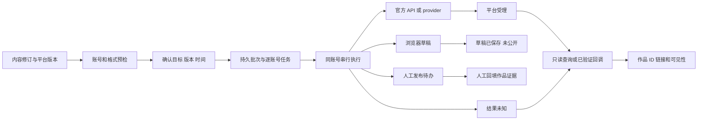

# Content Studio 竞品与架构交互审查

调研与检查日期：2026-10-21，新加坡时间。对象为当前工作区源码及本机运行的 `20261019-workbench-v18`。本轮交付为调研和优化建议，未修改产品代码、运行开关、账号或发布数据。

建议保留现有任务工作台、Supabase 和交付可靠性设计，优先修复跨账号执行阻塞与插件连接生命周期，再补齐单篇排期、准确回执、任务定位和资料可见性。产品竞争力应集中在“有来源的内容生产、品牌一致的平台版本、可核对的跨平台交付”，并用直接的操作流程表达这些能力。

竞品事实依据官方产品、帮助文档和官方仓库；闭源产品未公开的队列、数据库、幂等实现不作推断。网页宣称的平台覆盖不代表本项目的账号、格式及发布权限已经验收。

**1. 竞品中值得采用的功能与交互**

| 产品 | 有竞争力的功能 | 用户如何操作 | 对 Content Studio 的启发 |
| --- | --- | --- | --- |
| Buffer | 全渠道队列、草稿、审批、已发送视图；浏览器保存灵感 | 在一个 Publish 页面按状态和账号筛选；扩展从当前网页选择“保存灵感”或“创建帖子”，复杂编辑进入完整编辑器 | 发布中心按状态组织；插件负责收集与进入任务，减少重复编辑界面。[全渠道视图](https://support.buffer.com/en-us/articles/how-to-use-the-all-channels-view-in-buffer-oqqE4Sdf3T)、[扩展流程](https://support.buffer.com/en-us/articles/buffer-browser-extension-HysfY1nH9E) |
| Hootsuite | 月/周/列表日历、账号与审批筛选、历史发布、原生平台内容回收 | 日历选作品进入详情，编辑、改期、处理审批；通知发布独立显示 Notified，仍需人工完成 | 日历需要完整聚合；状态详情必须能进入准确稿件与账号；“通知已发送”不能显示“已发布”。[官方日历](https://help.hootsuite.com/s/article/manage-content-calendar) |
| Metricool | 发布日历、循环内容 Autolist、RSS 导入、审批状态、人工发布提醒 | 同一规划界面按平台/格式/发布状态筛选；人工路径收到素材与文案后在原生 App 完成 | 定时生成、内容排期、人工提醒分别建模；借鉴循环队列，但应保持内容去重和来源时效校验。[官方状态与日历](https://help.metricool.com/how-to-manage-your-calendar-in-metricool-xhlbw) |
| Planable | 内容预览内评论、审批、版本检查点、比较和恢复 | 围绕同一篇内容讨论与审批，可选择无审批、可选、强制或多级审批模式 | 审核、版本、预览应在同一上下文；个人版先提供简单审核，团队流程按需求增加。[审批与版本](https://planable.io/guides/content-approvals-in-planable/) |
| Postiz | 多渠道编辑与排期、公开 API、OAuth2、Agent/CLI/MCP 接入、数据分析 | 选择渠道、分别配置平台字段，保存草稿/立即发布/指定时间；通过帖子 ID 查询结果 | 继续采用 provider 适配层；每目标独立参数和回执。其 API 返回内部 postId，结果接口另有 state、releaseURL、error。[创建接口](https://docs.postiz.com/public-api/posts/create)、[结果接口](https://docs.postiz.com/public-api/posts/list)、[授权](https://docs.postiz.com/public-api/introduction) |
| AiToEarn | 多账号矩阵、逐平台适配、立即/定时发布、AI 批量生产 | 在一个发布工作区选择账号、校验、排期；自部署可配置 Server Relay 承接平台授权，AI Relay 单独配置 | 将账号、目标格式和交付结果放到一个面板；研究托管授权接入，但逐平台验证覆盖范围。[矩阵工作区](https://www.aitoearn.ai/en/welcome/matrix-publishing)、[官方 Relay 说明](https://github.com/yikart/AiToEarn/blob/main/README_EN.md) |
| WechatSync | 网页正文提取、图片/排版处理、多平台草稿同步、Markdown 导出、CLI/MCP | 在已登录浏览器中提取文章，选择平台，查看各平台同步结果，再进入平台草稿箱检查发布 | 复用成熟草稿能力、保留明确草稿回执。官网的 29+ 是上游覆盖范围，不是当前 managed 模式的启用范围。[官网流程](https://www.wechatsync.com/)、[官方仓库](https://github.com/wechatsync/Wechatsync/blob/v2/README.md) |

需要有选择地借鉴状态颜色：Metricool 的 Published 与 Sent 共用绿色，但其文档明确 Sent 可能仅表示提醒已送出。Content Studio 应把“平台草稿已保存”“待你发布”“平台已确认公开”分开，避免颜色传达错误结果。Buffer 同样将不支持直接发布的格式交给 notification publishing；用户最终还需在原生平台完成操作。[Metricool 状态定义](https://help.metricool.com/how-to-manage-your-calendar-in-metricool-xhlbw)、[Buffer 人工通知流程](https://support.buffer.com/en-us/articles/using-notification-publishing-gvZQiMxVa2)

**2. 跨平台发布的技术实现与状态管理**

| 路线 | 实现方式 | 可以完成什么 | 产品应如何表达 |
| --- | --- | --- | --- |
| 官方 API | OAuth/应用权限 → 账号身份与 scope 校验 → 媒体上传 → 平台字段提交 → 查询/回调 | 在获准账号、格式、用途内直接发布及排期 | “自动发布”，附实际账号、格式、权限状态和最后核验时间 |
| 聚合 provider | 用户连接 provider 中的账号；本系统调用统一 API，provider 处理不同平台契约 | 覆盖 provider 实际支持的发布与草稿操作 | 区分 provider 草稿和平台原生草稿；内部任务 ID 与平台作品 ID 分开 |
| 浏览器扩展草稿 | 利用用户当前浏览器会话，逐平台处理正文、图片及后台草稿接口 | 保存受支持平台草稿；依赖浏览器和登录会话 | “同步到平台草稿，仍需你发布”；连接断开时明确待恢复 |
| 人工交接 | 生成平台文案、素材包、打开平台、收集作品链接 | 覆盖缺少接入或需原生功能的目标 | “待你发布”；复制、打开平台、收到提醒均不等于已发布 |

官方 API 也是异步流程。例如 TikTok 明确提供状态查询和发布事件回调，公开内容还会经历审核，不能把上传或接收成功作为作品已公开的证据。YouTube 上传需要授权 scope，资源另有处理状态和可见性；产品要保存这些事实，而不是只保存 HTTP 200。[TikTok 状态接口](https://developers.tiktok.com/docs/en/content-posting-api-reference-get-video-status)、[YouTube 上传](https://developers.google.com/youtube/data/reference/rest/v3/videos/insert)、[视频资源](https://developers.google.com/youtube/data/reference/rest/v3/videos)

建议采用以下流程，在现有模块内补全，不增加第二队列或定时所有者：



用户状态分三个维度，不能把 batch accepted 映射成发布完成：

| 维度 | 用户状态 | 主要规则 |
| --- | --- | --- |
| 内容 | 待生成、生成中、待审核、可交付 | 编辑形成新修订；旧审批不能默默覆盖新内容 |
| 单账号交付 | 未安排、已排期、提交中、平台处理中、已发布、失败、待核对、已取消 | 发布成功要求对应平台的作品 ID、URL 和确认依据；未知结果先核验 |
| 草稿/人工分支 | 平台草稿已保存·未公开、服务商草稿已保存、待你发布 | 成功同步或交接不能纳入“公开发布成功率” |
| 批次 | 例如“2 个已发布、1 个草稿完成、1 个待处理” | 各账号独立返回结果；保留账号与动作，避免一个总绿色状态 |

建议交付读模型包含：`taskRef / episodeId / subjectId / revision / accountId / action / scheduledAt / timezone / jobId / providerJobId / remoteId / remoteUrl / visibility / verifiedAt / verificationSource / errorCode / nextAction`。`verificationSource` 至少区分平台 API、provider、人工登记；前端据此展示“平台已确认”或“人工已登记”。

业务写入采用稳定 command ID、内容指纹和账号绑定；明确拒绝相同 command ID 的不同意图。跨账号部分失败正常返回。只有确认未发生远端副作用的失败才允许重试；超时、连接丢失、进程退出后的不明结果进入核验。回调需验证来源、去重和事件顺序；本地实例优先使用已有只读轮询，不能为接收 webhook 临时公开无认证 API。

**3. 当前项目已经具备什么**

| 层次 | 当前实现 | 评估 |
| --- | --- | --- |
| Web | React/Vite、React Router、TanStack Query、TipTap、Zod；五主导航和任务容器 | 技术选择适合当前规模，重点是交互收敛和行为回归 |
| 业务 | 任务/期次/修订、稳定来源归属、资料引用、独立文章与视频域、多目标视频 | 保留稳定 ID 与不可变 render，不以路由决定业务身份 |
| 执行 | Supabase、pgmq/pg_cron、角色 worker；批次幂等、账号级租约与提交屏障 | 基础正确，需修复账号 busy 影响整个扫描的边界 |
| 发布 | 发布预检、审核、公开/草稿/人工分支、远端回执、只读自动核验 | 自动核验已存在；旧文档“只有手动核验”不代表当前实现 |
| 文件 | LocalFS 原件与产物，Supabase 保存业务状态 | 保持单一权威物理资产，避免为 UI 重构产生第二份权威媒体 |
| 插件 | V1 草稿执行与 V2 Companion 分离；任务/采集/账号 UI；账号核验和持久日志 | 执行边界值得保留，连接生命周期和 popup 恢复需补强 |
| 运行 | 同一 OrbStack Kubernetes 应用实例与原 Supabase Compose；本轮 9/9 Pod Ready，每个 restartCount 为 1 | 不是两份应用运行环境；“统一部署”不等于把所有角色塞进一个容器 |

现有 PostgreSQL 任务查询与分页已实现，但 `src/core/store.ts:101,127` 的 drafts/accounts/jobs 仍有整工作区 JSON 读取和 CAS 写入。工作区扩大后会增加解析、传输和并发冲突。建议先记录 JSON 大小、CAS 冲突、队列延迟，再按 delivery job/attempt/receipt 分域迁移关系表；不在本轮为追赶竞品重写微服务或引入 Redis、MongoDB、第二队列引擎。

当前 HTTP API 的 Host/Origin 校验适用于本机边界，不是 SaaS 用户认证（`src/server/index.ts:41`）。公网产品化需要独立完成用户会话、workspace 授权、租户隔离、凭据归属和审计；当前本机部署应继续保持既有边界。

**4. 当前平台能力与自动化承诺的边界**

| 目标 | 当前代码路线 | 当前可以如何描述 |
| --- | --- | --- |
| YouTube 视频 | 官方 API/OAuth、上传 journal、状态回读；绑定固定频道 | 已实现特定频道交付通路；当前发布开关暂停，不等于正在无人值守发布；尚非通用多频道产品 |
| X / LinkedIn / Reddit 文字 | Postiz 适配器 | 接口实现存在，需 provider 配置、integration、内容与平台政策满足条件；当前不能据源码宣称账号均可自动发布 |
| 微信公众号 / 知乎 / B站专栏文章 | managed 插件草稿白名单 | 可接入审核后的草稿同步，需实际扩展配对、身份和权限；公开发布仍人工完成 |
| 小红书及其他未启用官方路线 | 平台文稿、素材和人工交接 | 显示“人工发布/复制或导出”，不把上游适配器数量作为已交付能力 |
| 抖音 / 快手 / TikTok / B站视频等当前未接入自动投递的目标 | 独立视频与人工交接 | 生成/渲染能力和自动投稿能力分别列出 |
| Product Hunt | 产品上线资料 | 不能把一般文章直接视作可创建产品的 API 发布任务 |

尤其需要明确：新任务默认 V2 证据生产，schema 和执行器明确禁止 `automatic` 公开发布（`src/ui/task-panel.tsx:19`、`src/core/task-model.ts:49`、`src/core/production.ts:125`）。因此“定时调研生产并送草稿”不等于“定时生产后全自动公开”。优化 UI 应直接显示该限制；未来是否开放某类内容的自动公开，需要单独设计授权范围与验收，不应只换一个按钮名称。

X 自动化也受内容用途和接入方式约束，不能用网站脚本补齐被限制的发布路线；仓库既有趋势内容人工发布要求继续生效。[X 自动化规则](https://help.x.com/en/rules-and-policies/x-automation)

**5. 代码审查中应优先修复的问题**

P1 表示影响正常执行、数据输入保留或处理对象正确性的高优先级缺陷；P2 为重要功能/可靠性缺口；P3 为一致性与维护改进。本轮没有发现需要据此宣称线上数据已损坏的证据。

| 编号 | 优先级与验证 | 问题与影响 | 定位与建议 |
| --- | --- | --- | --- |
| R1 | P1；真实代码内存复现 | A 有已受理待确认任务，A2 到期遇到账号 busy 会终止扫描，B 账号未被执行；同 tick 的 A 核验也被跳过 | `src/core/pipeline.ts:234`、`src/server/worker.ts:28`。逐任务捕获可等待的 busy，继续其他账号；核验独立排队或独立执行。保留账号屏障，不通过删锁解决 |
| R2 | P1；真实代码内存复现 | 插件 30 秒 alarm 重设相同 URL，无条件关闭 Companion；V1 草稿连接仍 OPEN，重连路径不重开助手，采集/任务下线 | `extension/src/background/index.ts:1426,1450`、`extension/src/mcp/client.ts:98,141,277`。配置不变时 no-op，两条连接分别 ensure，alarm 只恢复缺失连接 |
| R3 | P1；浏览器复现 | 新建文章填写后切到发现选题再切回，名称清空且无提示 | `src/ui/task-wizard.tsx:54,69`。表单状态提升到创建容器，按类型保留；需要清空时才提供明确选择 |
| R4 | P1；源码确认条件 | 发布记录只带 task/episode 链接；同一期多篇稿件时默认选第一篇，可能处理错内容 | `src/ui/publishing-page.tsx:134,169`、`src/ui/task-workbench.tsx:295`。链接携带 subject/article/job/target，验证归属后聚焦正确记录 |
| R5 | P2；浏览器复现 | 首页“帮我找选题”打开默认文章创建；“制作视频”打开任务列表 | `src/ui/home-page.tsx:47`、`src/ui/task-workbench.tsx:1176`、`src/ui/task-wizard.tsx:39`。直接使用合法 type 参数，不让新入口绕旧路由 |
| R6 | P2；源码确认 | 新任务发布面板没有单篇“指定时间发布”；自动生产计划不等于已编辑稿件的排期 | `src/contracts/workbench.ts:125`、`src/ui/task-publishing.tsx:107`。增加交付时间与时区，进入预检指纹及批次命令；旧 API 有 scheduledAt，需统一接入新流程 |
| R7 | P2；源码确认 | 月历只显示当前 50 条分页，换页替换整个网格，其他日期易被误认为无排期 | `src/ui/publishing-page.tsx:129,210`、`src/application/task-context.ts:99`。月视图查询按日聚合；日详情才分页 |
| R8 | P2；源码确认 | 批次回执只列“文章 rN + 状态”，不显示账号与动作 | `src/ui/task-publishing.tsx:58`。加入平台、账号安全快照、动作、时间、下一步；重载仍恢复同一批次 |
| R9 | P2；真实代码内存复现 | LinkedIn 3001 字符预检 eligible=true，实际 Postiz 校验拒绝；规则分散 | `src/core/delivery-preflight.ts:179`、`src/core/postiz.ts:43`。共享纯校验函数，预检、审批、最终执行一致 |
| R10 | P2；现场显示与源码确认 | 不支持的草稿路线被概括成“服务连接或执行暂不可用，请检查 Docker”，用户修错问题 | `src/core/delivery-preflight.ts:30,199`。将不支持格式、待授权、身份不符、服务离线分成稳定公开错误码和下一步；保留脱敏 |
| R11 | P2；源码确认 | 尚无期次的新任务可以采集资料，但资料查询依赖 episodeId；图片/知识附件只显示 UUID | `src/ui/task-workbench.tsx:979,1061,1084`。任务级附件可独立查询，返回名称、缩略图、用途；期次快照与未来生产资料分清 |
| R12 | P2；现场与源码确认 | 48 小时观察报告停留 running，最后仅采样 19.77 小时；过期投影未接入 API/UI | `scripts/runtime-observation.mjs:76,114,128`。现有进程生命周期托管，读状态时按新鲜度显示 interrupted；中断窗口不累加 |

R1 的纯内存复现覆盖 `runWorkerOnce()`：A 的核验计数为 0，B 未执行，tick 抛 busy。R2 使用真实 McpClient 与内存 WebSocket/Companion：首次两通道均连接，模拟一次相同配置 alarm 后仅草稿通道仍连接。R9 对同一输入同时调用预检与领域校验。以上均未调用真实平台或写入业务数据。

R12 现场：最后采样为新加坡时间 **2026-10-20 08:55:50**，`accepted=false`；截至本轮检查已陈旧，不能记为 48 小时验收完成。9 个应用 Pod 当前均 Ready，但每个已重启一次。Pod Ready 与持续验收通过是两种不同事实。

**6. Chrome 插件的额外审查与优化**

当前 managed 模式只允许微信公众号、知乎、B站专栏草稿（`extension/src/studio/protocol.ts:3,21`）。上游恢复层包含 29 个适配目标，部分通过浏览器会话、Cookie/CSRF 和平台后台接口工作，不能称为 29 个已获官方授权的自动发布通道。插件 UI 白名单没有公开 publish 命令；公开 API 发布属于服务器交付域。

应保留写前身份复核、`jobId + payload hash + expectedUserId`、先保存 started journal 再写入、重复完成命令返回旧回执、未知状态拒绝重写，以及敏感 URL token 清理。UI 通道和写入执行通道可以共用外观，但不能混合权限。

| 优先级 | 额外问题 | 建议 |
| --- | --- | --- |
| P2 | 停用连接后仍按保存的 URL 判定 managed，“进入独立模式”继续受阻；`HomeNew.tsx:63,156`，`background/index.ts:230,822` | 显式 managed/standalone 模式；断开连接与切模式分开；未核验日志继续保留保护 |
| P2 | `StudioHome.tsx:46` 执行草稿后只提示、不刷新记录，旧按钮仍可点 | 请求后进入进度状态；定期刷新活跃任务，终态停止；未知结果只提供核验 |
| P2 | 任务只取 30 条且丢弃 nextCursor；采集页搜索还影响任务页 | 显示最近/待处理任务，搜索与分页明确，复杂管理进入工作台 |
| P2 | 采集内容和 command ID 只保存在 popup React state | 使用 `chrome.storage.session` 保存短期未提交内容与同一命令；成功后清除。长编辑进入 side panel 或完整 tab |
| P3 | manifest 版本为 2.0.10，About 优先展示的 version_name 仍为“2.0.9 + Content Studio 1.1” | 发布版本单一来源；产品版本、上游开源来源分别展示，并做打包一致性检查 |
| 维护风险 | executor 2000 条 journal 上限包含已完成项，缺少正式归档流程 | 服务端确认已完成后安全归档/压缩；未知项永不自动删除 |

交互建议：三个入口保留为 **采集、待处理、账号**。采集页只需标题/摘录、最近任务选择和“保存到任务”；保存后给“继续采集 / 在任务中查看”。账号卡只显示中文平台名、昵称、实际能力、最近核验、下一步，原始 ID 和协议细节放高级诊断。

配对采用“找到本机工作台 → 确认连接 → 核验账号”的向导。首次信任建立仍需明确用户动作，短时配对码换取凭据，不能把长期 token 放网页 URL 或日志。将 MCP、WebSocket 地址、两通道细节移到高级诊断，同时保留可恢复的旧配对与 journal。全站 host permissions、全站提取脚本和 cookies/DNR 权限应按 managed 模式需求逐步收敛；网页采集优先评估 activeTab+scripting，平台权限按需申请，逐适配器验证后再削减。

React 19/Zod 4 的主应用和 React 18/Zod 3 的插件为独立构建，版本不同本身不是运行缺陷。共享 token 已被两端使用，下一步共享状态语义、错误码和交付 DTO；无需为了版本一致一次性重写上游适配层。

**7. UI 简化方案**

保留五个主入口，改进各自职责。全局发布和资料是跨任务视图；任务内视图由相同读模型按 task/episode 过滤，避免另建一套内容管理。

| 页面 | 建议默认内容 | 收起或合并 |
| --- | --- | --- |
| 工作台 | 今天需要处理、下一次生产/发布、最近任务、一个“新建任务”主入口 | 已完成的新手教程折叠；运行详情进入设置 |
| 任务中心 | 名称、内容类型、计划状态、最新内容状态、待处理数、下次运行 | UUID、技术作业信息；不靠“计划暂停”代表全部内容状态 |
| 任务详情 | 顶部任务名+本期选择+下一步；内容/资料/发布/记录四个标签 | 概览卡并入任务头；单次任务不常驻宽期次侧栏 |
| 发布管理 | 待处理、已排期、平台草稿、已发布；状态筛选与列表/日历切换 | 不在此复制完整编辑器；点击进入精确任务/稿件/账号 |
| 资料库 | 网页、文档、媒体，同卡显示预览、用途、被哪些任务使用 | 设置中的素材/知识库重复入口，以及二次重复资源列表 |
| 设置 | 账号连接、品牌规范、运行配置、诊断 | 专业执行参数默认收起，状态异常时才突出 |

任务详情建议布局：

```text
任务名称                     当前内容/期次 ▾     任务设置
生产：每周一 09:00    发布：审核后安排    下一步：检查平台稿

内容       资料       发布       记录

原稿 / 微信公众号 / 知乎 …             平台效果预览
正文编辑                               字数、封面、格式提示
来源与质量：2 项需检查 ▸                AI 改写 / 素材侧栏

已保存 r6                              [保存] [检查并安排发布]
```

编辑器先呈现内容，质量报告在顶部显示摘要与阻塞项，详情可展开。原稿与平台稿切换保持草稿状态；自动保存若引入，要有保存中/已保存/冲突提示及 expectedRevision，禁止把未保存内容作为已审批对象。现阶段可先保留显式保存，避免为视觉简化引入新的并发语义。

创建流程继续三步，但第三步默认只有“现在生成一次 / 定时生成”。定时才展开频率、时区与下次时间；模型、研究预算进入高级设置。最终摘要使用自然语言，例如“每周一 09:00 研究并生成 → 保存为本地草稿 → 你审核后安排发布”。选择系统自动公开受当前 V2 和平台策略限制时，在该选项旁说明原因。

发布页面改为逐账号选择交付方式的一张表，然后统一确认：

| 账号 | 本次方式 | 时间 | 状态与下一步 |
| --- | --- | --- | --- |
| 已授权 API 账号 A | 自动发布 | 今天 18:00 | 可提交，预览当前修订 |
| 浏览器账号 B | 保存平台草稿 | 内容审核后 | 需要保持扩展在线 |
| 未接入账号 C | 人工发布待办 | 今天 18:00 提醒 | 复制文案、下载素材 |

主按钮显示“确认 3 个目标”；确认面板说明“1 个公开发布、1 个草稿、1 个人工待办”。失败目标不能静默改成其他动作。支持“仅执行已就绪目标”时须展示明确目标清单和未执行原因。

视觉上沿用当前品牌蓝与设计 token，减少大面积空概览和重复卡片。颜色语义固定：灰色未安排、蓝色处理中/已排期、黄色需人工/待核对、红色明确失败、绿色平台已确认；颜色之外必须有文字和图标。移动端将期次改为选择器，发布账号表改卡片，固定底部主动作；焦点、错误提示、加载与空状态保持可访问。

**8. 建议的 coding 结构与演进顺序**

| 范围 | 推荐实现 | 约束 |
| --- | --- | --- |
| 能力模型 | 按 provider、平台、内容类型、账号返回 `supportedActions + requirements + connectionHealth + acceptance` | 不用一个 automatic 布尔值概括全部条件；只读状态不能自动重绑账号 |
| 预检 | 共享纯 `validateDeliveryPayload`，返回稳定 `code / field / message / nextAction` | 预检无副作用；真正执行前再次验证修订、媒体和身份 |
| 提交与核验 | `delivery_submit`、`delivery_verify` 为同一 pgmq 的独立工作类型 | 同一账号 fencing、同一 cron 所有者，保留原任务/journal |
| 发布命令 | intent 增加时间/时区及逐目标动作，版本化契约 | 进入 command hash 和审批快照；旧 V1/V2 输入与哈希兼容 |
| 页面读模型 | episode summary、calendar day summary、resource cards、delivery receipt rows | 有界查询；正文按需加载；不得暴露私有路径/凭据 |
| UI 共用语义 | 在 contracts 中集中状态、能力、错误和下一步映射 | 生产/发布/批次分域，不能把同名 queued 混用 |
| 插件生命周期 | 配置幂等、双通道独立恢复、采集 session 草稿、活跃交付刷新 | 仅重连传输，不自动重放未知写命令 |
| 观测 | 现有 API/worker 管理连续观察，状态 API 计算 freshness | 无需另起容器；中断重开窗口，不补算成功时长 |

YouTube 产品化还需要 `account → connectionId → credentialRef → remoteIdentity/scopes`，每连接独立刷新锁与 journal。当前 `src/core/youtube.ts:16,28,64` 固定频道和单套凭据属于既有本机验收范围；新 journal 版本与旧频道记录必须兼容。此项应在当前单频道稳定性和产品闭环通过后实施。

优先级建议：

1. **可靠性修复批次**：R1/R2、预检一致性、准确错误码、观察陈旧状态。修复后先做隔离回归，再更新现有实例。
2. **发布闭环批次**：单篇指定时间、逐账号动作、完整回执、精确深链接、完整月历与任务级资料。确保一次创作在任务内完成。
3. **UI 与插件简化批次**：四标签、内容优先、创建输入保留、配对向导、采集恢复、待处理列表与共享状态语言。
4. **竞争力建设批次**：品牌规范版本化、平台预览、少量高质量模板、成熟平台授权接入、效果回流。协作审批、社交收件箱和广泛平台覆盖按实际需求推进。

品牌规范建议记录品牌名称、受众、用语/禁用语、引用格式、视觉模板、平台差异规则，生成时固定 `brandProfileRevision`。品牌规则只能收紧既有内容政策，不能覆盖排除主题。对外承诺使用可验证的指标：首次内容完成时间、无需人工的合格交付比例、每篇人工操作次数、误报成功数、重复远端作品数、需核对处理时间。将“插件支持平台数”改为“各账号已验证能力与可完成结果”。

**9. 下一轮验收清单**

| 场景 | 必须满足的结果 |
| --- | --- |
| A 已受理、A2 到期、B 到期 | A2 等待；B 正常；A 继续只读核验；没有额外远端提交 |
| 插件连续多个 alarm / Companion 单独断开 / MV3 重启 | 健康连接保持，缺失连接恢复；业务命令不自动重放 |
| 字数或格式不合格 | 编辑/预检/执行一致拒绝，并定位到具体字段 |
| 创建类型切换 | 输入保留；需要清空时用户明确选择 |
| 同一期两篇内容、每篇多账号 | 任一发布记录准确打开稿件、修订和账号 |
| 单篇指定时间及改期 | UTC 时间、展示时区和审批绑定一致；已提交结果未知时禁止重排重发 |
| 51 条以上月历、多页历史 | 月历每日总数完整，日详情分页；不会误显示为空 |
| 无期次任务先采集资料 | 保存后立即可见；来源与用途明确；不改写历史证据快照 |
| popup 关闭重开、请求超时 | 恢复未保存内容和原 command ID；不会生成重复采集 |
| 服务/观察进程重启 | 明确报告中断；保留旧证据；重新计时而非虚报完成 |
| 混合公开、草稿、人工目标 | 每账号显示真实结果；批次受理不计为公开成功 |
| 真实平台验收 | 独立检查授权、目标身份、内容、远端 ID/链接与可见性；模拟桥接通过不替代该项 |

本轮验证为源码审查、官方文档调研、本机 Web 只读走查、未保存输入复现，以及三项纯内存行为复现。没有重跑全量测试，也没有重新认证真实 Chrome 插件或真实平台写入。上一轮 555 项应用测试通过、52 项插件测试和 8 项模拟桥接集成通过属于历史交付证据，本次发现说明还需要补上述跨模块行为测试。
