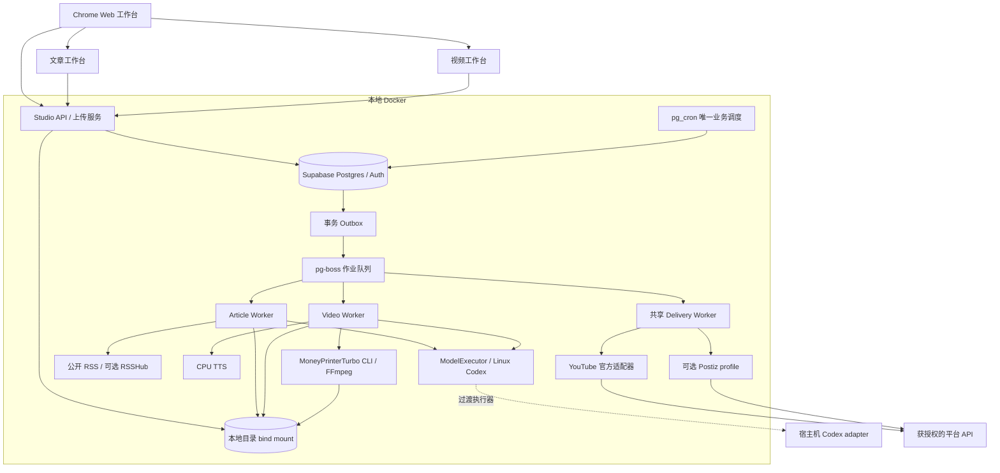
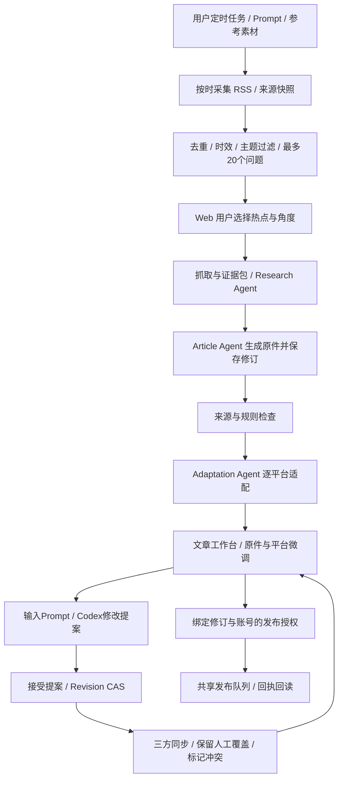
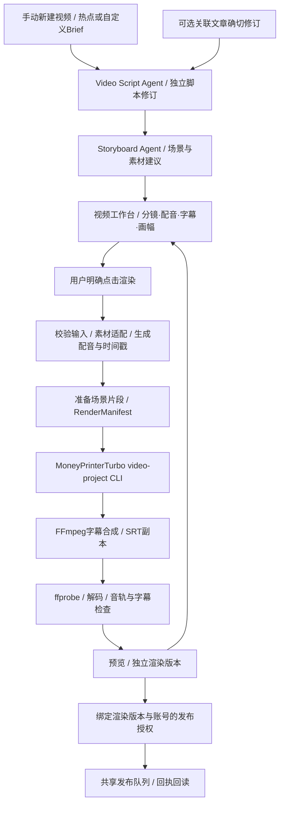

# 本地 Docker、文章与视频双流水线升级方案

2026-10-15 更新：文章五入口、视频多目标及 OrbStack 应用运行已按[实施说明](workflow-kubernetes-video-implementation.zh-CN.md)落地。Supabase／pgmq／pg_cron 仍使用原 Compose；Kubernetes 是可切换的应用运行方式，不改变数据和文件权威。以下保留原架构调研与门槛，实际完成范围以[最新验收](acceptance.md)为准。

调研日期：2026-10-10。项目：Content Studio。本文是本轮需求复核、源码调研和目标架构，不是已部署结果。当前实现以 `2122e43` 为核对基线；升级前重新检查工作区、运行版本和数据。云端只确定可迁移边界，不在本轮实施。

## 1. 建议结论与实施边界

以现有 Content Studio 为产品主干，融合开源库和少量独立服务，不同时部署多个完整 CMS、工作流平台和 Agent 平台。

推荐组合：

- 产品与业务状态：现有 React / TypeScript / Supabase。
- 定时任务：保留 `pg_cron` 作为唯一业务时间调度器；通用作业执行目标为 `pg-boss`，隔离验收通过后替换现有 `pgmq` 消费机制。
- 文章：现有 RSS / Readability / Codex 执行器，加 Tiptap、remark、Sharp；RSSHub 按需开启。
- 视频：独立脚本与分镜工作台，MoneyPrinterTurbo 的本地 video-project CLI 作为渲染后端，Linux CPU TTS 加独立字幕合成阶段。
- 素材：Uppy + tus 断点上传，直接写绑定的本地目录；Supabase 存业务记录和素材索引。
- 发布：继续复用已有 YouTube 官方接口；Postiz 作为可选发布服务，在新增授权渠道能降低维护成本时接入。
- 模型：`ModelExecutor` 统一协议，目标使用 Linux Codex 执行容器；现有 Mac Codex 是过渡执行器，容器登录、权限及真实生成必须单独验收。

文章和视频拥有独立的项目、编辑器、素材视图、工具、修订、作业与审批。共享的是热点证据、物理素材、调度、模型执行预算、账号连接和发布凭据。

“本地”指基础设施与数据由本机管理，模型、新闻和平台接口仍需要网络。Docker 不会在 Mac 关机或休眠时继续运行；恢复后按任务策略补最近一次，不能声称实现离线全天候执行。

## 2. 需求复核：保留什么，补齐什么

| 要求 | 当前源码与运行证据 | 本轮目标 |
|---|---|---|
| 一台 Mac 常驻任务 | API / Worker 由 launchd 启动；本轮只读检查确认本地 Supabase 六个服务正在运行，数据库 PG 17 | API、Worker、上传、渲染迁入 Docker；模型容器另设登录验收 |
| 用户自定义时间与 prompt | 已有 once / daily / weekly、任务配置、持久运行记录与 pg_cron | 保留；增加明确时区、漏执行策略和运行输入快照 |
| 每次发现最多 20 个热点问题 | 已有 0–20 个有来源的问题；现有 Google Trends 覆盖选定国家 | 增加来源覆盖、采集时间、热度依据和去重；不把有限来源包装成“全球第一” |
| 选题后精细生成文章 | 已有研究、原件先落盘、平台逐个 checkpoint、Web 调优提案 | 富文本文章面板、引用与平台规则检查、可控继续执行 |
| 原件同步且保留平台微调 | 已有 base / local / incoming 合并、冲突与 revision CAS | 保留并在 UI 展示自动生成基线、人工覆盖和冲突处理 |
| 视频完全独立 | 已有单独视频记录与手动脚本/渲染，但 draftId 必填且编辑器嵌在文章页 | 视频可直接由热点/brief 创建；文章关联改为可选且绑定具体修订 |
| 上传与复用素材 | 当前整文件 Buffer 上传，私有 Storage 与本地 cache 各有副本 | 本地文件为唯一原始字节权威；断点上传、流式校验、独立素材用途视图 |
| 自动发布 | 已有 YouTube 授权、可恢复会话 journal 与回读，当前整文件 PUT；其他渠道受接口/账号许可约束 | 一个共享发布队列，准确区分可自动、需授权、人工发布、结果未知 |
| 历史与恢复 | 已有历史修订、任务租约、发布恢复、隔离备份恢复 | 故障分类、有限重试、恢复演练、数据与文件一致性检查 |
| 后续云服务 | 已有阶段限制 | Storage / ModelExecutor / Renderer / Publisher 适配器可替换；暂不部署云端 |

`docs/local-system-delivery.zh-CN.md` 记录了上一轮 143 项测试、真实模型生成、MP4 和隔离恢复验证；本轮没有重跑这些检查。当前 Docker 健康状态不等于目标组合已经集成完成。

## 3. 开源能力选择与取舍

以下版本、仓库元数据和源码在调研日核对。Stars 是关注度信号，不是活跃用户数或本机稳定性证明。实施时锁定 tag、包版本、镜像 digest 与 license，不用浮动 `latest`。

| 能力 | 推荐上游与版本 | 采用方式 | 依赖与成本 |
|---|---|---|---|
| 通用作业执行 | [pg-boss 12.37.1](https://github.com/timgit/pg-boss/releases/tag/12.37.1)，MIT，约 4k stars | 嵌入 TS Worker；重试、延迟、死信、心跳；业务 checkpoint 自己保留 | Node ≥22.12 / PG ≥13；使用 Node 24 与现有 Supabase，无 Redis |
| 当前可回退引擎 | [Supabase Queues / pgmq](https://supabase.com/docs/guides/queues) | 迁移前唯一在用引擎；若 pg-boss spike 失败则继续使用它 | 已在项目部署；禁止两套引擎同时消费同一业务 |
| 热点/来源扩展 | [RSSHub](https://github.com/DIYgod/RSSHub)，AGPL-3.0，约 46k stars，调研 tag `v2026.10.10-5d857e3` | 可选 feed profile；只启用选定公开来源路由 | 原生 ARM 镜像清单已检查；首期内存 cache，不额外引入 Redis |
| 正文抽取 | [Mozilla Readability 0.6.0](https://github.com/mozilla/readability)，Apache-2.0，约 11k stars | 继续用已有库与受控抓取 | 已有依赖；失败页面再评估 Trafilatura，而非默认浏览器抓全网 |
| 文章编辑 | [Tiptap OSS 3.31.4](https://github.com/ueberdosis/tiptap/releases/tag/v3.31.4)，MIT，约 39k stars | React 中的富文本编辑器；共享平台预览与引用节点 | 不部署第二个 CMS；不假定付费 AI、协作、版本服务包含在 OSS 中 |
| 文章导出 | [remark / unified](https://github.com/remarkjs/remark)，MIT | 结构化文档转 Markdown / 安全 HTML / 平台文本 | 实施时分别确认各包版本与兼容性，不把 monorepo release 当所有包版本 |
| 图片适配 | [Sharp](https://sharp.pixelplumbing.com/install/)，Apache-2.0 | 封面裁切、缩略图、压缩、方向与格式转换 | Linux ARM64 预编译支持；选 Debian/glibc 镜像，实际构建验收 |
| 断点上传 | [Uppy](https://uppy.io/docs/tus/) + [tus Node server](https://github.com/tus/tus-node-server)，MIT | Uppy 前端，`@tus/server` + `@tus/file-store` 单实例磁盘流式写入 | Node ≥20.19；不需要 Companion 或 Redis；上传完成自行流式 SHA-256 |
| 视频渲染 | [MoneyPrinterTurbo 1.3.8 video-project](https://github.com/harry0703/MoneyPrinterTurbo/blob/v1.3.8/docs/video-projects.md)，MIT，约 129k stars | 固定版本 Python 渲染容器；调用本地项目 CLI、复用未变场景 | FFmpeg / ffprobe、字体、Python 依赖；不是完整的视频编辑工作台 |
| Linux 配音 | [Kokoro-FastAPI 0.9.0](https://github.com/remsky/Kokoro-FastAPI/releases/tag/v0.9.0)，Apache-2.0，约 5.5k stars | CPU TTS 服务；中文默认逐句 WAV + 实测时长字幕 | 源码配置支持 Linux ARM64 CPU，镜像/runtime 未验收；中文逐字时间戳不能假定可用 |
| 更多授权发布 | [Postiz 2.25.0](https://github.com/gitroomhq/postiz-app/releases/tag/v2.25.0)，AGPL-3.0，约 37k stars | 可选 API 服务；保留上游，Studio 控制稿件与审批 | Postgres + Redis + Temporal；上游完整 Compose 更重；ARM 清单已核对但未本机启动 |

Uppy 调研包：`@uppy/core 6.2.0`、`@uppy/dashboard 6.0.1`、`@uppy/tus 6.0.0`；tus：`@tus/server 2.4.5`、`@tus/file-store 2.1.1`。实施时整体检查 peer dependencies、锁定兼容组合。FileStore 的可续传不等于实现了 tus checksum extension，最终内容校验由 Studio 承担。[FileStore 源码](https://github.com/tus/tus-node-server/blob/main/packages/file-store/src/index.ts)

本轮不默认集成的系统：

| 候选 | 不作为首版基础的原因 |
|---|---|
| AiToEarn | 功能多，但 MongoDB / Redis / RustFS / 外部 Relay 与当前 Supabase、本地文件优先冲突；换数据库是大改造，平台图标也不能证明自动发稿能力 |
| TrendRadar / Miniflux | 前者默认 SQLite；两者会重复热点/订阅、调度和历史状态。可以借鉴排名与来源 UX，除非明确替换职责再部署 |
| Temporal | 长周期事件回放与异步信号很强，但首期业务能用 checkpoint 与恢复作业处理；增加运维服务应由实际需求证明 |
| Trigger.dev / Prefect | 都有成熟功能，但引入额外控制面；Trigger.dev 自托管能力不等于 Cloud checkpoint / 非阻塞等待 |
| Windmill 官方 Community Docker | 源码 AGPL 与官方二进制条款有差异，二进制包含专有限制；不能只看 GitHub license 标签作为未来产品基础 |
| LangGraph / 社交 Agent 示例整套 | 示例不是现成的跨平台 CMS；另加执行/持久层增加两套状态。复用有限工具与流程思想，先保留现有结构化模型执行器 |
| Graphile Worker | 很好的 MIT 替代选项，但只选择一个引擎；不同时引入它与 pg-boss |

依据：[AiToEarn](https://github.com/yikart/AiToEarn)、[TrendRadar](https://github.com/sansan0/TrendRadar)、[Miniflux Docker](https://miniflux.app/docs/docker.html)、[Temporal 部署](https://docs.temporal.io/self-hosted-guide/deployment)、[Trigger.dev 自托管差异](https://trigger.dev/docs/self-hosting/overview)、[Windmill 精确版本 LICENSE](https://github.com/windmill-labs/windmill/blob/v1.830.0/LICENSE)、[Graphile Worker](https://worker.graphile.org/docs)。AGPL 组件按各自条款保留署名、来源与对应源码义务；通过 API 隔离是升级边界，不自动消除许可义务。

## 4. 目标架构



图中 pg-boss 是待验收的目标执行层；现状仍是 pgmq。一个 Worker 镜像按 role 运行多个独立服务，不需要给每一个逻辑 Agent 启动容器。文章与视频共享 ModelExecutor 的总并发限制，发布共享账号租约。

首期模块契约：

| 契约 | 输入 / 输出与职责 |
|---|---|
| `ResearchBundle` | 来源 URL、发布时间、抓取时间、摘要、证据定位、coverage；可被两条流水线引用 |
| `TopicBrief` | 任务 prompt 快照、用户选题/角度、受众、附件 assetId、目标平台；不携带密钥或 shell 命令 |
| `ArticleRevision` | 结构化原件、平台版本、引用、生成基线/人工覆盖、修订与工具/模型版本 |
| `VideoRevision` | 脚本、分镜、字幕、配音配置、素材绑定、画幅；可选来源文章的确切 revision |
| `RenderManifest` | 输入修订、场景 hashes、渲染配置版本、输出文件 hashes、探测结果；同输入可复用 |
| `ExecutionStore` | enqueue / claim / checkpoint / cancel / settle；队列迁移不改业务语义 |
| `ModelExecutor` | submit / status / cancel；结构化 schema、图片引用、总预算、有限超时和脱敏结果 |
| `AssetStore` | 流式写入、hash、immutable promote、读取/范围读取、受引用保护的回收；默认 LocalFS |
| `Publisher` | capability / submit / reconcile / cancel-supported；最终 remoteId、URL、可见性与状态 |

以上都是版本化协议目标，不是已经新增的接口。实现时使用 strict TypeScript + Zod；仅在确有第二个实现或隔离价值时抽象，避免提前搭建通用插件框架。

## 5. 文章流水线与 Agent



具体边界：

1. Discovery Agent 做来源归纳与选题建议；确定性的去重、数量上限、主题禁区和来源记录由程序控制。零个有效热点是合法结果。
2. Research Agent 的候选链接经过受控抓取，引用必须对应实际可获取的来源。保留抓取时刻与来源状态，不假定模型搜索结果已核实。
3. Article Agent 使用选题 brief、附件与证据生成原件，先保存原件，再逐平台执行，失败从完成的 checkpoint 后继续。
4. Adaptation Agent 在平台能力描述中处理字数、标题、标签、图片布局和格式。规则须按平台文档更新，不能把平台名称当作统一文本模板。
5. 调优是有限工具调用与修改提案，用户接受时检查 expectedRevision；并发旧提案不能覆盖新稿。

原件同步使用已有 `base / local / incoming` 合并：未手改字段跟随新原件，手改字段保留；有冲突则显示差异供选择。现有合并保护的是 title / text / tags 等完整字段，不能把它描述成已实现段落级 merge。保留“撤销人工覆盖 / 跟随原件 / 保留当前 / 接受新版本”的明确操作。原件更新使已批准旧版本的发布授权失效；不能静默把新稿套用旧授权。

富文本目标以 Supabase 中的 Tiptap JSON + document schemaVersion 为原件权威，引用和图片用稳定 citationId / assetId，导出格式由确定性转换器生成。旧 text 修订保留可读，不做有损 HTML↔Markdown 来回转换；段落/节点级保护是独立后续升级，在通过前继续按已有字段覆盖语义显示。

Agent 不拥有无限自主循环或任意 shell 权限。网络/模型瞬态故障有限重试；内容检查失败最多执行配置内的修复次数，再进入人工处理。任务配置快照保存 prompt、素材 hashes、模型与工具版本，历史任务不随当前设置漂移。

## 6. 视频流水线与 Agent



`VideoProject` 的源可以是热点、独立 brief、上传素材或用户明确选定的文章修订。当前 schema 的 draftId 必填需要通过新 migration 改为可选；现有文章关联保留。文章更新只标记 `source_outdated`，由用户选择“重新提取 / 对比合并 / 保留当前”。不自动新建视频、不自动渲染，也不覆盖用户修改的分镜或已批准视频。

建议首版视频工作台包含：项目与脚本、分镜卡片、每场景素材、旁白/音色、字幕、比例/模板、预览、渲染历史、平台视频规格与发布状态。先做可编辑的分镜卡片和明确输入输出，完整多轨时间轴是后续按实际需求添加的能力。

采用 MoneyPrinterTurbo 的原因是其固定版本本地项目模式已有分镜配置、按变更复用、原子输出和 FFmpeg 截止时间机制，减少自写通用渲染执行代码。它不提供我们需要的脚本/TTS/字幕编排和 Web 视频工作台；准备好的场景与音频由 Studio 提供，字幕另做明确阶段。不能把 CLI 当作全能视频 Agent。

不直接让 MPT 默认 `/videos` API 控制任务：其提交生成新的 task UUID，不能作为 Studio 的幂等提交键；默认内存任务查询也不等于跨重启持久状态。由我们的 Video Worker 管理 renderId、manifest、进程取消与结果提交，只调用可恢复的本地项目入口。具体 CLI 参数、目录和固定 release 的能力在集成 spike 中验收。[上游项目文档](https://github.com/harry0703/MoneyPrinterTurbo/blob/v1.3.8/docs/video-projects.md)

Linux 配音选择 Kokoro-FastAPI v0.9.0 CPU，实际测试中文可懂度、吞吐与冷启动；已有 macOS `say` 仅作迁移保底。该标签支持中文语音，但词时间戳映射明确不能覆盖中文，首版不能靠 caption endpoint 声称实现中文逐字字幕。默认让脚本形成短句，每句合成 WAV，用 ffprobe 实测时长做整句字幕；精细时间戳按需复用 MPT 已安装的 faster-whisper，明确选 multilingual `small`、CPU/int8，预取模型，避免默认下载 `large-v3`。ASR 是转录而非脚本文字的强制对齐，差异须展示复核。[中文时间戳限制源码](https://github.com/remsky/Kokoro-FastAPI/blob/v0.9.0/api/src/inference/kokoro_v1.py)

字幕保留 SRT，烧录使用 FFmpeg / libass + Noto CJK 等字体，检查长中文、标点、折行、安全区与声画时长。MPT 成片与烧录字幕成片分别保留；只改字幕时不重做模型、配音和场景。默认背景音乐关闭，选用音乐必须有明确素材权限。核对 FFmpeg 构建实际 LGPL/GPL 组件和字体/模型/词典各自 license，而非只看 MPT 的 MIT 标签。[FFmpeg 许可](https://ffmpeg.org/legal.html)

MPT 控制流程是 `revise → plan → render → status`。`revise` 每次会创建随机上游 revision，首次返回要保存 `renderId → upstreamRevision` 映射；返回丢失先对账本地 project manifest，不重复 revise。恢复使用同一 revision 的 render retry。上游项目目录、状态、源快照和输出均绑定本地目录，其文件锁与跨容器重启行为要实际验证；本地 APFS bind 是验收目标，不能用不可靠网络锁的同步目录。调用使用固定 argv，不从 Web 接受任意 CLI 参数或 shell 文本。

适配器向 MPT manifest 只传它支持的 `project_id`、`settings`、`scenes` 与可选 `bgm`；每个场景固定 id，footage 必须是预编码片段，图片先转换；旁白场景提供 audio，静音场景提供 duration。我们自己的引用、字幕、prompt、审批等保存在 Studio manifest，不作为未知字段塞给上游。预编码/TTS/MPT/字幕都记录各自输入 hash 和工具指纹，便于只重做受影响阶段。

Kokoro 的 CPU 标签构建声明支持 ARM64，但本轮未拉取镜像或验证 manifest/digest。优先使用经验证的固定预编译镜像和上游锁文件；模型/音色预取并记录 hash。不能将空目录直接挂在 baked model path 后误以为模型仍在。临时音频及时转存 Studio 产物，避免上游临时清理影响结果。[CPU 构建](https://github.com/remsky/Kokoro-FastAPI/blob/v0.9.0/docker-bake.hcl)、[固定依赖](https://github.com/remsky/Kokoro-FastAPI/blob/v0.9.0/pyproject.toml)

Docker Desktop 中不能把 Mac 的 MPS 能力视为 Linux 容器 GPU。初始 CPU 验收先用 720p、30–60 秒、渲染并发 1，再测 1080p；这是拟定验收输入，不是已测得的性能承诺。[Docker GPU 文档](https://docs.docker.com/desktop/features/gpu/)

## 7. 两个工作台、两套素材用途，复用一份物理文件

| 界面/工具 | 文章 | 视频 | 共享部分 |
|---|---|---|---|
| 制作中心 | 原件、平台稿、引用、段落、封面、冲突 | 脚本、分镜、旁白、字幕、画幅、渲染 | 选题证据、状态与历史导航 |
| 素材视图 | 参考图、配图、封面、品牌图 | 图片、片段、旁白、音乐、字幕、字体 | immutable assetId、hash、元数据与引用关系 |
| 调优工具 | 原件/选中段落/平台稿的修改提案 | 脚本/场景/字幕/素材建议的修改提案 | ModelExecutor、预算、提案审核 |
| 作业记录 | 采集、研究、生成、适配、导出 | 脚本、分镜、TTS、渲染、质量检查 | 重试/取消/继续、输入输出审计 |
| 发布管理 | 图文稿及附件校验 | 已完成视频及封面规格校验 | 按账号与修订授权、调度、回执和未知结果恢复 |

Web 导航建议：任务与热点、文章、视频、素材、发布中心、运行记录、设置。Scheduler 可选参考素材；文章与视频新建/调优均可选对应素材。参考素材和发布附件分别选择，避免自动把内部参考图发出去。

素材物理对象按内容 hash 去重，但文章/视频可有不同的名称、标签、用途与关联。删除业务关联不删除仍被另一项目引用的原文件；有未完成上传或渲染使用的文件不能回收。历史列表可按任务、类型、平台、状态、日期和素材筛选。

## 8. 本地文件与数据库的权威边界

默认 `STUDIO_DATA_ROOT=<project>/.studio/data`，可改为用户指定的非同步本地目录；所有容器统一 `/data`。`.studio/` 已忽略且禁止提交。不使用 Google Drive 同步目录放运行数据或活跃数据库。

- 图片、音频、片段、MP4 的原始字节与产物：LocalFS 是权威；Supabase 保存 assetId、相对 objectKey、hash、类型、尺寸/时长、大小与引用。
- 任务、审批、修订、平台覆盖、运行状态：Supabase 是权威；文章 Markdown / JSON / HTML 和视频 manifests 是可校验的 immutable 文件导出。
- 不把数据库状态和可修改 JSON 文件同时当作业务主记录。文件失效可从业务修订重建；原始素材丢失则不能靠数据库凭空恢复。
- 不保存宿主机绝对路径作为持久协议；本地与云迁移依赖稳定 objectKey，而不是 Mac 用户目录。

目标物理目录：

```text
.studio/
  data/
    assets/originals/<hash-prefix>/<sha256>.<ext>
    assets/derivatives/<recipe-version>/<sha256>/
    uploads/incoming/<upload-id>/
    sources/<source-id>/<snapshot-id>/
    articles/<article-id>/revisions/<revision>/
    videos/<video-id>/scripts/<revision>/
    videos/<video-id>/renders/<render-id>/
    renderers/mpt/projects/<video-id>/
    runs/<run-id>/steps/<step-id>/
    deliveries/<delivery-id>/
    work/<run-id>/
    cache/models/
    infra/supabase/pgdata/
    infra/postiz/uploads/                 # optional profile
    backups/<backup-id>/
  secrets/                              # separately scoped mounts
```

应用媒体、上传元数据、数据库持久文件和可选发布器文件默认绑定本地目录。密钥和授权文件是独立私有路径，不能因为共用 `/data` 暴露给所有服务。Renderer 对 originals 使用只读 mount，只能写自己的 work/outputs；ModelExecutor 只接收所选参考图，不读取整套私有数据。

上传路径：tus 接收分块 → 真实文件签名/大小限制 → 流式 SHA-256 / 必要 ffprobe → 同文件系统临时文件 atomic rename → metadata finalize。半成品不进入素材选择器。文件与 DB 不是同一事务，使用 pending/finalized 状态与重启扫描完成修复；重复 finalize 不重复登记。

上传与缓存设置容量/保留上限；过期半成品按明确 TTL 清理。正在上传、渲染或被历史/发布引用的原文件不属于可随意清理 cache。

Storage 迁移先按 assetId 对账，读取现有 Storage 与本地 cache、验证 hash，把稳定 objectKey 映射到 LocalFS，再切换读取。旧副本只有在引用完整、备份和恢复通过后才可清理。旧 OAuth/上传 journal 在原私有位置保留，单独验证迁移，不混入媒体公开目录。

## 9. Docker 部署与依赖组织

| 服务/进程 | 默认启动 | 持久数据 / 访问 |
|---|---|---|
| Supabase 必要 DB / Auth / REST / gateway | 是；保留当前业务/API契约 | PGDATA 本地绑定为最终目标；DB 只在内部网络/受限 loopback |
| API + Web + tus intake | 是 | `/data` 指定子目录；上传为单实例 |
| Article Worker | 是；与其他 role 共用镜像 | 文章/source 输出；不持有发布权限 |
| Video Worker | 是 | 视频状态、受控工具调用；不能隐式创建渲染 |
| Delivery Worker | 是 | 最小发布凭据与 journal；一个共享账号串行域 |
| ModelExecutor | 目标 Linux 容器；需验证独立登录 | 私有认证路径与选定输入；总模型并发初始 1 |
| MPT / FFmpeg renderer | 视频 profile | 只读素材、独立 work/output；渲染并发初始 1 |
| Kokoro CPU | 视频 profile | 固定模型缓存、内部网络，完成配音可复用 |
| RSSHub | 按来源需要开启 | 首期无需持久业务状态；内存缓存可丢 |
| Postiz + Redis + Temporal | 按授权渠道需要开启 | 上游自己的上传目录与状态；资源和迁移须独立验收 |
| Studio / Mailpit 等运维 UI | debug profile | 开发时开启，不作为业务自动化依赖 |

原有 Supabase CLI 使用 Docker named volumes，不能在方案中称它们已经变成用户目录 bind mount。最快迁移路径先将应用 Docker 化、暂留 CLI 数据库；最终本地验收则必须完成数据库持久目录绑定。

数据库绑定方案采用 [Supabase 官方 self-host Docker 配置](https://supabase.com/docs/guides/self-hosting/docker) 做经验证的最小服务组合，避免在 Supabase 之外部署一个新 PG。当前真实镜像为 `ghcr.io/supabase/postgres:17.6.1.075`，不能盲用不同大版本默认 Compose 并直接挂载现有 PGDATA。

转换须在新路径/新端口建隔离 Supabase，锁定匹配版本、扩展和 service configs，经逻辑 dump/restore 与 auth/storage/queue 对账后切换；旧实例保留为暂停的回退点。未验证前不改真实数据库目录。Docker Desktop 下 bind PGDATA 的 UID、权限、性能与崩溃恢复是独立验收项。[Bind mounts](https://docs.docker.com/engine/storage/bind-mounts/)

实现注意：

1. `index.ts` 当前监听 127.0.0.1。容器内 API 监听 0.0.0.0，宿主机映射仍限 127.0.0.1；不能把页面服务默认暴露公网。
2. `database.ts` 当前仅接受 localhost HTTP，容器 `http://kong:8000` 会被拒绝。添加明确内部服务 origin allowlist，保留浏览器与后端密钥边界，不简单删除校验。
3. `pg-boss` 使用后端直连 Supabase PG，而非 REST/service-role 作为 SQL 连接。先验证 schema migration 权限与 worker 最小运行角色；只限制连接预算，不引入另一数据库服务。
4. 不安装宿主机 node_modules 到 Linux 容器，不挂载 Mach-O Codex 二进制；分别构建 Node ARM64、Python ARM64 镜像。
5. TTS、MPT、FFmpeg 依赖各自锁定，不把 Python renderer 塞进业务 API 进程。允许复用一个 renderer 镜像中的提取工具，只有实际质量收益才加入。
6. Postiz/Temporal 若复用同一 Supabase 实例，使用隔离逻辑数据库/schema/角色；配置、权限、升级和备份仍需验证。不是拿一个连接字符串就默认可用。不能复制其独立 PG 服务作为默认依赖。
7. 当前公开新闻抓取拒绝私网 URL。RSSHub 内部 feed 走单独、明确配置的 trusted origin adapter；不能为它放开任意私网 research URL。

本轮确认机器为 ARM64、16 GiB RAM、8 逻辑 CPU，Docker 29.2.1；还有其他工作负载，不能假定整机资源可独占。初始模型并发 1、渲染并发 1、网络读取小并发；TTS/渲染阶段尽量串行释放峰值内存。记录各服务 RSS、总峰值、磁盘吞吐和运行耗时后再设置内存/CPU限额，保证宿主机余量。Postiz profile 不纳入第一轮最小容量承诺。

## 10. Codex 与 Agent 执行边界

当前已有 `codex exec`、隔离工作目录、只读 sandbox、JSON schema、Zod 验证与图片输入，继续保留。官方支持脚本化非交互执行；认证需在实际执行环境准备并保护。SDK 可用于以后会话控制，但不替代持久作业状态。[OpenAI 非交互模式](https://developers.openai.com/codex/noninteractive/)、[认证](https://developers.openai.com/codex/auth/)、[TypeScript SDK](https://developers.openai.com/codex/sdk/)

首选目标是 Linux `codex-runtime` 容器独立安装 CLI，在私有认证目录登录后执行 `model.execute` 作业；无需依赖打开 Codex 桌面聊天窗口。这里不能直接继承 Mac 桌面 session、Keychain 或 Chrome profile。本轮没有做容器登录，也没有验证额度/模型/图片/取消兼容性，因此不能声称已经实现。

过渡 fallback 是现有 Mac 执行器主动领取模型请求、运行受限 Codex、回传 schema-checked 结果；不开放任意 shell HTTP 端点、不挂载整个 home/Chrome/`.codex`。若只能用此 fallback，Web、队列、文件与渲染可以 Docker 化，但“完整执行已容器化”验收仍未通过。

模型作业也有固定输入修订、总预算、超时与取消；认证过期/额度不足进入 `waiting_operator`，在 Web 给出恢复动作，不无限自动重试。后续云服务替换为受支持 API 模型执行器，单用户 ChatGPT 登录不能自动推广成多人 SaaS 的授权基础。

账号/平台操作继续使用 Chrome profile `radarxai@gmail.com`。此要求是运营与调试身份，不意味着把浏览器登录当 API OAuth，也不把 Chrome profile 全量复制到容器。

## 11. 稳定性：任务、文件、审批与外部副作用

### 11.1 唯一调度与事务 Outbox

保留业务 schedule 表和唯一 `(scheduleId, dueSlot)`。`pg_cron` 只做短事务：冻结输入、创建 run、写 outbox。Node drainer 在同一短数据库事务调用 `boss.send(..., { db })` 并标记送达；不开启 pg-boss 的另一套业务 cron，也不把联网工作放进事务。[事务适配器](https://pgboss.io/api/adapters)

Drainer 使用 `FOR UPDATE SKIP LOCKED` 领取 outbox 行，业务 eventId/jobKey 稳定且唯一，保存 eventId→queueJobId 映射；`send` 与 delivered 标记使用同一连接/事务。若 `send` 返回 null（去重或队列策略拒绝），必须确认对应作业确实存在或保留待处理错误，不能无证据标记已送达。多个角色进程启动不能导致事件丢失或重复推进。[send语义](https://pgboss.io/api/jobs)

本机恢复时按任务的 skip/latest-once 策略处理遗漏；保存时区与原 dueSlot。改时间、禁用、取消和手动运行均需明确语义。用户一旦选择热点才进入文章/视频创作，除非另行开启了具体自动选题策略；不能把定时抓热点理解成默认自动发布。

### 11.2 分阶段持久化、有限重试、取消

| 作业 | 初始执行策略 | 失败后的行为 |
|---|---|---|
| 抓取 | 小并发，超时/大小/重定向限制 | 网络瞬态有限指数退避；无权限/不支持来源进入可解释错误 |
| 模型生成/调优 | 两条流水线共用模型并发 1 | 瞬态有限重试；schema/内容问题有限修复；auth/额度等人工恢复 |
| 渲染 | 并发 1，同输入 manifest key | 同 key 检查已有结果与场景 checkpoint；取消终止子进程，迟到结果不得提交 |
| publish-submit | 一个共享队列、每账号串行，`retryLimit: 0` | 明确未提交可由业务判断继续；未知结果转 reconcile，不能重新发帖 |
| reconcile | 单独恢复作业 | 回读已有 session/remoteId，有限轮询；需要人处理时释放租约 |

pg-boss 负责通用作业，不提供任意 Agent 代码的自动历史回放。按“完成一阶段 → 原子保存业务结果/下阶段 outbox”推进，首版不创建庞大依赖 DAG 后依赖通用 dead-letter redrive 自动恢复。[作业与依赖语义](https://pgboss.io/api/jobs)

保留业务 CAS、owner token、expiry fencing。pg-boss 的失败心跳网络请求不会必然终止正在执行的任务；结果提交及发布前必须确认当前所有权。旧 lease 的进程即使晚返回，也不能写覆盖新尝试。取消传播 AbortSignal 至 Codex、TTS 请求和 FFmpeg，退出宽限后停止子进程树。[Worker 文档](https://pgboss.io/api/workers)

等待选题/审批/冲突时持久化 waiting 状态并释放 Worker，不用长时间 sleep 占着 job。用户动作校验修订后再排后续作业。

### 11.3 发布副作用只有一个所有者

共享 deliveryId / accountId 租约覆盖文章与视频，不能在两个队列各自串行后误认为实现全局账号锁。发布前固化批准版本、附件 hash、平台、账号、可见性与 intent；保存上游 session/任务 ID 后再轮询。

队列不能保证远端 API exactly-once。应用通过相同意图、journal 与回读避免重复；接口没有幂等键且提交结果不明时，停在 unknown/reconciliation_required 而不是重复发帖。

Postiz 开启时，Studio 负责内容和时间，首次优先立即提交由 Studio 到期的 delivery；不同时让 Postiz Temporal 对同一内容再定时。若以后把一个 future delivery 的调度转交 Postiz，必须明确唯一所有者与撤销/回读协议。[Postiz API](https://docs.postiz.com/public-api/introduction)

YouTube 保留既有官方授权、可恢复上传 session、journal 与回读；当前代码读入完整视频并单次 PUT，需要另外增加流式 hash、受限分块和 session offset 恢复。其他渠道按真实 capability 显示。X 趋势内容、Reddit app、国内平台新闻资格等继续遵守 `docs/platform-policies-v2.zh-CN.md`。无头浏览器或 Codex 模拟点击不是绕过官方授权、平台规则或封号风控的通用方案。需要人工原生发布时准确展示并记录回执，不称为自动发布。

LocalFS / localhost 不满足依赖公共 HTTPS 拉取媒体的平台。优先使用支持 multipart/resumable 上传的获授权接口；如果渠道只支持 URL pull，则在功能状态中明确缺少公开 delivery-media 能力，而不是静默暴露整个素材目录。[Postiz 上传配置](https://docs.postiz.com/self-host/configuration/uploads)

### 11.4 备份与可观测性

沿用现有暂停应用/调度/发布的备份策略，适配新 bind root：逻辑 DB dump、文件 hash manifest、实际素材与产物、独立加密授权/journal。复制正在运行的 PGDATA 不是有效备份方案。恢复到新路径/端口，默认暂停，不复制引擎活跃 claim 直接重放；从业务 run 状态重建可继续作业，未知发布先对账。

开启 Postiz profile 时，备份必须覆盖 Studio、Postiz、Temporal persistence/visibility 的全部已启用逻辑数据库/schema、必要 roles/grants 和 bootstrap 配置；共享同一个 PG 实例不代表当前单数据库备份已覆盖它们。恢复验收逐 profile 检查，密钥仍单独加密。

Web 显示 runId、stage、attempt、最近心跳、错误分类、下一步动作、输入/输出修订、模型/渲染耗时与资源；保留脱敏操作日志，不保存原始 Codex聊天/session。Health/readiness 不等于业务成功；`restart: unless-stopped` 可恢复进程退出，但不自动重启只是 unhealthy 的进程，内部调用需超时与人工可见故障状态。

## 12. 目标项目目录与现有文件映射

```text
content-studio/
  apps/
    web/src/features/
      discovery/
      articles/
      videos/
      assets/
      publishing/
      runs/
    api/
    worker/                         # role: article / video / delivery
    model-runner/                   # Linux Codex; Mac transition adapter
  packages/
    domain/{discovery,article,video,delivery}/
    contracts/                      # schemas, revisioned input/output
    workflow/                       # ExecutionStore + pg-boss adapter
    storage/                        # LocalFS + optional Supabase provider
    models/                         # ModelExecutor adapters
    sources/                        # RSS, Readability, optional RSSHub
    article-tools/                  # Tiptap document, remark, Sharp recipes
    video-tools/                    # storyboard, TTS, captions, manifests
    publishing/                     # YouTube, optional Postiz, reconciliation
  services/
    renderer/                       # MPT pinned CLI wrapper
    tts/                            # CPU image/config integration
  infra/
    compose/{base,video,rsshub,postiz,debug}.yaml
    images/
    upstream-lock.json              # selected tag/digest/license/config
  supabase/migrations/              # additive only
  tests/acceptance/
  docs/
  .studio/                         # ignored bind data + scoped secrets
```

该树是目标组织，不代表这些空目录已创建。最快落地先在现有 `src/` 中建立对应边界，不先做大规模 monorepo 搬迁。

| 当前文件 | 渐进改造 |
|---|---|
| `src/core/tasks.ts` / `task-model.ts` | 保留业务 run/checkpoint；拆出 discovery、article、video stage handler |
| `src/server/worker.ts` | 按 capability/role 消费；ExecutionStore 适配；迁移完成后移除被上游替代的通用队列代码 |
| `src/core/assets.ts` / `artifacts.ts` | LocalFS + tus finalized registry；复用已有 atomic snapshot 机制 |
| `src/core/editor.ts` | 保留三方合并和 CAS；增加结构化文档/平台格式转换 |
| `src/core/generation-engine.ts` | 固定 ModelExecutor 输入/输出与取消；运行环境替换不改修订逻辑 |
| `src/core/media.ts` | 分离 macOS 兼容 adapter 与 Linux renderer / TTS / caption stages |
| `src/ui/editor-panel.tsx` | 文章专用面板；抽出独立 videos workspace，不继续堆在一个编辑器 |
| `src/core/delivery.ts` / `youtube.ts` / `publication-journal.ts` | 单一 delivery owner、授权版本、共享账号租约和回读保持 |
| `scripts/local.mjs` / `service.mjs` | 分阶段改为 Compose lifecycle / readiness；先保留已验收 backup/restore 行为 |

先做新接口/新 migration 和适配器，验证后再移文件。禁止改写已应用 migration、生成空功能包或用 TODO 伪装已实现能力。

## 13. 迭代顺序与本地验收门槛

| 阶段 | 交付 | 完成标准 |
|---|---|---|
| D0 基线冻结 | 记录现有行为、DB/image版本、真实账号 capability；隔离备份 | 恢复到新目录可读旧稿/素材/修订/journal，调度与发布暂停 |
| D1 本地文件优先 | LocalFS、流式/tus、原 Storage 对账与双工作台素材视图 | 大文件断点/重启/重复 finalize 正确；hash/引用一致；无整文件大 Buffer 峰值 |
| D2 Docker 基座 | API与分 role Worker、renderer；Supabase bind 迁移；模型容器 spike | ARM原生镜像、loopback、权限、readiness、数据库恢复通过；真实模型含图片输入通过 |
| D3 队列复用 | pg-boss隔离验收、Outbox、按作业有限重试、公共发布队列 | 杀进程/网络断开/旧lease晚回/取消/重启补时均通过；只有一个调度器和执行引擎 |
| D4 文章体验 | Tiptap、引用、平台预览、覆盖/冲突/调优 | 原件改动自动适配；手改保留；旧提案/旧授权不能覆盖或发布新版本 |
| D5 独立视频 | 无文章也能建项目，分镜、CPU TTS、MPT项目CLI、字幕与质量检查 | 真实脚本→素材→配音→MP4；重启复用相同scene；修改文章不自动渲染；取消不留误完成 |
| D6 发布与持续运行 | 先YouTube官方，增加分块上传/流式hash，按收益决定Postiz；恢复面板 | 大视频内存与中断续传；账号匹配；真实远端ID/URL/状态；未知提交不重发；全profile备份恢复 |

D2 内模型登录若需要人的认证动作，先完成可执行环境并在 Web 显示精确步骤，再由账户所有者操作；不能把已有 Chrome 登录算作容器认证。The deployed runtime must be entirely containerized; native tooling is migration/recovery only and cannot satisfy final acceptance.

D3 必须先 spike 再决定切换：新独立 schema 验证包安装/migrations、事务 enqueue、死信、延期、心跳、取消与旧尝试 fencing；先单类切换，暂停并 drain 旧队列，从业务 run/step 状态重建，不复制引擎内部表。若无法通过有界验收，则保留 pgmq/pg_cron 为唯一引擎，只补缺失的有限重试与资源隔离。

D4/D5 可并行；不要等大型目录重构完成后才交付 Web 功能。升级每步都保留上一条可运行路径及隔离回退数据。

拟定最终稳定性验收是至少 48 小时受控定时运行，加以下故障演练；它是要执行的目标，不是本轮已完成结果：

- 抓热点关闭浏览器仍继续；任务数量 0–20、来源覆盖和 input snapshot 可追溯。
- kill Article Worker 后从原件/平台 checkpoint 继续，保留手改和历史修订。
- kill Renderer/DB 或断开网络，恢复同一 renderId，检查所有输出 hashes 和音画完整性。
- 上传大文件中断与服务重启能续传；最终 hash 一致，未完成上传不可选。
- 同账号文章/视频同时到期只按共享锁顺序提交；提交未知只能 reconcile。
- Mac休眠/恢复执行明确 latest-once/skip策略，不无限回放积压。
- 不丢旧稿、不重复发帖、不把失败视频标完成；auth、配额、磁盘不足均给明确恢复状态。
- 新目录恢复，调度默认暂停，hash、引用、修订与 pending deliveries 对账正确。

D0–D6 通过且用户本地确认前，不开始云端部署。

## 14. 云端可行性与迁移方案（只研究）

保持同一产品、数据契约和业务流水线，替换运行与存储适配器：

| 本地 | 后续服务端 |
|---|---|
| Local Supabase PG / Auth | Hosted/self-hosted Supabase；先补workspace/user权限、RLS与服务账号 |
| LocalFS objectKey | Supabase Storage / 合适对象存储；分批迁移、hash 对账、签名访问 |
| Linux Codex / Mac transition | API-backed ModelExecutor；租户预算、额度与合法授权独立设计 |
| 单机 CPU renderer | 同接口容器 Job / 独立渲染节点；按实测扩容，不预先指定 GPU供应商 |
| 本机账号授权 | 面向 Web 的正式 OAuth回调、scope、密钥隔离和平台 App审核 |
| 单实例调度/队列 | 唯一活跃调度、按tenant/account全局约束；依旧可用 pg-boss，未必需要 Temporal |

云迁移前先暂停旧调度和提交，导出业务与文件 manifest、校验新数据，替换 provider，重新建立账号许可，再启动唯一新执行实例。待恢复任务从业务 checkpoint 继续；旧实例不能与云端同时发布同一内容。

多用户权限、计费、配额、公开媒体分发、生产 Web OAuth、审核、升级/恢复责任，是云端新增工作。容器可迁移不意味着生产 SaaS 已完成，第一阶段不用这些工作阻塞本地验证。

## 15. 核验清单与证据范围

The original architecture preflight covered source/runtime inventory and upstream research. Subsequent implementation and executed evidence are recorded in [Docker runtime delivery](docker-runtime.md); historical native acceptance remains separate.

Implementation includes pinned dependencies, Compose role services, LocalFS/tus, independent video, rich articles and streaming publication recovery. Actual ARM bilingual CPU TTS/MPT rendering and isolated legacy recovery have executed evidence. Authenticated Linux Codex structured/image execution, automatic model catalog refresh, trusted public-source fetching and all eight isolated pg-boss spike contracts have now passed in Docker. The final source passed 176 tests, strict TypeScript and a production build. Docker/Chrome article, scheduling and recovery workflows have executed evidence; final image identity/fresh-render and requested-profile Chrome checks passed, while the 48-hour burn-in remains pending; pg-boss production cutover gates remain incomplete and the runtime retains pgmq/pg_cron. Postiz onboarding and new live publication are outside this coding acceptance.

关联文档：

- [当前本地实现与验收](local-system-delivery.zh-CN.md)
- [上一轮可运行开源产品调研](research-github-runnable-2026-10-10.zh-CN.md)
- [既有本地阶段验收与云迁移限制](local-first-build-review.zh-CN.md)
- [平台政策与自动化限制](platform-policies-v2.zh-CN.md)
- [账号配置与阻塞项](accounts.md)

本文件是新目标架构，取代旧文档中“默认Storage副本、宿主机API/Worker、文章内嵌视频”的目标选择；历史运行与验收事实仍以原交付记录为准。
