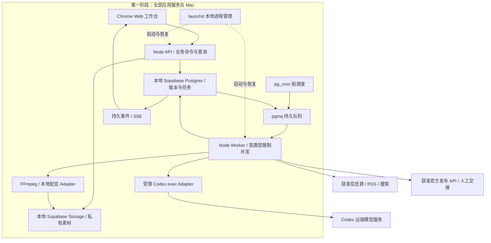

# Content Studio：本地优先建设复审与实施基线

> 历史方案基线：下文记录实施前的检查状态。当前已搭建的本地系统、操作命令与实际验收结果，以 [本地系统交付](local-system-delivery.zh-CN.md) 为准。

复审日期：2026-10-10（Asia/Singapore）。代码基线：`39d36fb`。本轮交付是需求复审、当前代码/本机依赖检查和官方技术资料复核；没有搭建新的 Supabase 实例、迁移真实数据或部署云服务。以下“确定”指选定工程方案，“待验收”表示尚未实现或尚未实测。

## 1. 本轮确定的边界

**先在一台 Mac 上完成可长期使用的 Web 系统，再讨论云端实施。** Web/API、关系数据库、素材存储、任务状态和执行进程都在本机。Codex 的模型服务、公开信息源和平台发布 API 仍需要网络；“本地部署”不意味着离线大模型或离线发布。

当前先完成技术调研与建设方案；后续按本文件 L0–L5 实施并取得本地证据。云端本轮仅确定目标架构、兼容约束、迁移路径和上线门槛，不创建云资源、付费服务或生产部署流水线。

本文件更新上一版中“本地版默认连接 Supabase 云开发项目”的建议：**第一阶段基线改为 Supabase CLI + Docker 的本地 Supabase**，同样采用 Supabase Postgres/Storage，避免第一阶段先写一套文件系统业务、第二阶段再重写存储。已有 `.studio` 与可选 Supabase JSON 模式保留为旧版本和迁移输入，不能假称已完成结构化升级。

所有 Google、Supabase 和测试平台账号操作继续使用 Chrome profile `radarxai@gmail.com`，操作前核对身份；登录、OAuth 授权、应用审核和发布权限分别记录。本地 Supabase 初始化不需要先登录或关联 Supabase 云项目。[Supabase 本地开发](https://supabase.com/docs/guides/local-development)

## 2. 需求冻结：这次建设必须完成什么

| 需求 | 确定的产品行为 | 验收结果 |
| --- | --- | --- |
| 自定义热点 scheduler | 用户配置 prompt、来源、时区、时间、素材、1–20 输出上限；可立即执行、暂停和看历史 | 关闭网页后仍按计划执行；睡眠/停机后按策略补最近一次或跳过；不会补出无上限任务 |
| 每轮热点问题 | 来源采集、事件去重、题材过滤后返回 0–20 个可回答的问题 | 每个问题有来源、时间和证据缺口；来源失败和零结果如实显示；不制造“全球第一” |
| 精细创作 | 选一个问题，补充 prompt、受众、目标平台和图片，再深入研究与写稿 | 先保存原稿，再独立生成平台稿；失败平台可单独重试，不丢原稿 |
| 原稿和平台版本 | 原稿、平台稿各自独立修订；“保存并同步”自动更新派生草稿 | 未微调稿自动跟随；人工修改保留，冲突展示；旧 AI 结果不能覆盖新编辑 |
| Web 向 Codex 下指令 | 指定原稿/平台/选区/视频稿范围和素材，查看进度、差异，接受或拒绝 | 修改被写入正确业务对象及新修订；不是仅返回一段聊天文字 |
| 独立视频稿 | 点击“创建视频稿”才生成旁白/分镜；点击“渲染”才产生音视频 | 选择 YouTube 等目标只生成发布文案；原稿修改不自动创建、渲染或重做视频 |
| 素材管理 | 统一素材库；scheduler、创作、调优、视频均可上传或选择图片 | 图片以稳定 assetId 引用；参考图确实送入视觉模型；成品配图单独指定 |
| 历史与发布 | 历史修订、发布快照、目标账号、实际远端 ID/URL、当前观察状态 | 可回答“当时发了什么、现在是什么状态”；已发布快照不会被新稿覆盖 |
| 本机运营 | 安装、启动、停止、升级、诊断、备份和恢复 | 一次安装后正常业务从 Web 完成；启动不依赖 Codex 聊天窗口或某个终端一直打开 |

保留项目现有题材排除规则和共享提示词策略 `src/core/content-prompts.ts`。发现、写稿、图片、标题及视频都应用同一规则；导出的 prompt 不等于已经实现 scheduler。详细交互继续见 [Web 设计](web-product-design.zh-CN.md)。

## 3. 现状：已验证基础与真正的差距

| 部分 | 本轮核查 | 尚缺的本地交付 |
| --- | --- | --- |
| React/Vite + Express + TS/Zod | 已存在，可复用 | 分离长任务和 HTTP；按内容项目组织 Web 工作区 |
| Codex | 生成器优先定位 bundled binary；实查 `0.162.0-alpha.2`，支持 image、JSON 事件、output schema | 持久异步运行、图片实际输入、范围调优、取消、版本检查和使用量记录 |
| 数据 | `.studio/state.json` 或 Supabase 单行 `state jsonb` + CAS | 关系化项目/修订/任务/素材/发布模型；当前没有本地 Supabase config |
| 热点 | 地区 RSS CLI 和共享 discovery prompt builder | Web 计划、事实材料提取、问题生成 worker、运行收件箱；现有 30 秒 timer 只派发发布 |
| 视频 | FFmpeg + macOS 语音，可产生真实 MP4 | 独立视频实体和分镜、异步渲染、显式素材绑定；目前生成器仍会预写视频旁白 |
| 发布 | 官方 YouTube OAuth、上传 journal、读取状态已有实现和真实运行记录 | Web 接入 YouTube 上传/对账；凭据续期、完整生命周期、其他渠道独立验收 |
| 本地运维 | 有 `npm run dev`、doctor 和测试 | Docker 启动、配置/版本锁定、进程管理、持久 worker、备份恢复和升级演练 |

已有记录显示两个不同 YouTube 视频各提交一次，旧视频已转 Private，新的教育视频取得 public/processed 读回和正确频道列表证据。这是已保存的发布时点记录，本轮没有重新登录或重新核实实时可见性；不是全部渠道或完整 Web 系统验收。参见 [既有验收证据](acceptance.md)。

本机实查：macOS 15.7.3，机器架构 arm64，16 GiB 内存，约 106 GiB 可用磁盘；当前 Node 26.4.0 进程报告 x64；Docker 29.2.1、Supabase CLI 2.75.0 已安装，Docker socket 不存在，服务未运行。PATH 中的 Codex 快捷方式失效，但应用使用的 bundled binary 能执行；因此不能把快捷方式报错误报为应用完全无法生成。

这些依赖检查只证明已安装情况，不证明本地 Supabase、pgmq、Storage 或负载已经运行通过。官方本地排障建议为 Docker 分配至少 7 GB 内存；本机启动后需测内存压力，先限制模型并发和视频并发各为 1，必要时避免两类重任务同时执行。选择并锁定经过验证的 Node/CLI/镜像版本；评估原生 arm64 Node 后再调整，不以架构推断替代性能测试。[本地工作流与资源要求](https://supabase.com/docs/guides/local-development/cli-workflows)

## 4. 修正后的本地技术架构

采用模块化单体和一个初始 Worker 进程；任务类型包括 research、master、adapt、refine、render、publish、reconcile。不要为了未来云部署先拆成多套微服务。平台发布按账号串行；视频任务以后可拆到独立进程。数据库保存业务真相，pgmq 保存待处理的 jobId；SSE 只负责通知。

**本地 Supabase。** 保留仓库已有 migrations，通过新增迁移建设关系表；本机项目有独立 project_id、端口和持久卷。只对 loopback 暴露，使用官方推荐的绑定本机 Docker network 方式并检查实际监听。标准 CLI/Docker 路线为基线；官方 native runtime 仍属实验能力，不作为首版依赖。安装文档、命令和配置必须按本机已验证版本编写，不能直接套用最新文档里的实验命令。[本地开发](https://supabase.com/docs/guides/local-development)

**队列与调度。** migration 显式启用并验证 pgmq/pg_cron。短 dispatcher 在一个数据库事务里锁定到期计划、生成唯一 schedule slot、建立 Run、推进 nextRun、入队；模型和 FFmpeg 在 Node 中执行。初始 Worker 用受限服务器数据库连接和业务函数访问队列，不向浏览器暴露队列管理。若将来经 Data API 消费，需要单独配置并授权 `pgmq_public`，不能把云 Dashboard 的默认体验当成本机已配置。[本地 Queues](https://supabase.com/docs/guides/queues/expose-self-hosted-queues)、[PGMQ](https://supabase.com/docs/guides/queues/pgmq)、[Cron](https://supabase.com/docs/guides/cron)

**素材。** 从本地完整版本开始就使用私有 Supabase Storage，库中存资产 ID、对象键、hash、MIME、尺寸、用途及来源。Worker 下载到临时目录后才传给 Codex/FFmpeg；临时绝对路径和限时 URL 不能成为持久业务 ID。本地用户浏览器可访问 localhost 素材，远端模型/发布商通常不能访问该 URL：优先上传 bytes/文件或由 Worker 传递，不为方便 provider 读取而暴露本机数据库或永久公开素材。

**Codex。** 采用现有 `exec`，通过 `--json` 读取允许的进度事件、`--output-schema` 约束候选结果，选中的图片通过实测支持的 `--image` 输入。输出经领域校验后才落新版本，模型不能直接改数据库或获得发布凭据。Web 不直接连接 CLI/app-server。官方 app-server 目前仍标注不支持 production workloads，先不引入为基础依赖。[OpenAI 非交互模式](https://learn.chatgpt.com/docs/non-interactive-mode)、[CLI 参数](https://learn.chatgpt.com/docs/cli/reference)、[App Server](https://learn.chatgpt.com/docs/app-server)

**本地身份。** 本地 Supabase 栈包含 Auth，并检查服务健康；应用第一阶段固定一个本地 owner/workspace，API 仅监听本机并检查来源。数据库/Storage 从第一阶段就有 workspace 归属和禁止匿名访问的策略。云端多用户登录、成员关系和完整 RLS 验收留到第二阶段，但今天不能把所有业务行做成无归属的全局数据。

## 5. 必须补齐的工程约束

### 5.1 原稿联动不丢手工修改

保存新原稿的事务同时完成：新增修订、更新当前指针、标记依赖稿过期、撤销受影响审批、暂停未提交发布、入队适配。未编辑字段自动更新；锁定字段保留；自由正文按旧自动稿 B、当前手改 L、新适配稿 N 比较，冲突进入待合并。首版允许字段/段落级保守合并，不承诺任意语义改写自动无损。全部同步结果都带输入版本，迟到结果只能成为候选。

独立修改某个平台不应作废不依赖它的其他平台审批；原稿事实变化则立即影响所有依赖稿，直到证明某个派生对象不受影响。已确认开始外部提交的任务继续按原快照对账，数据库事务不能撤销已发送的网络请求。

### 5.2 来源获取和事实证据是一个实际阶段

先复用现有 RSS，再增加允许访问的官方/行业来源；URL 抓取、重定向、类型、大小、超时和内网地址都校验。正文提取可复用 Mozilla Readability 等成熟组件，但它只提取正文，不获得转载权，也不核验事实。[Readability 官方仓库](https://github.com/mozilla/readability)

保存 canonical URL、发生/发布/抓取时间、可支持的短摘录、内容 hash 和关键事实引用。多个转载不算多个独立证据；模型生成的来源链接必须属于实际取得的材料。来源不足可返回零问题或“需要补充证据”，不能仅凭新闻标题展开完整报道。保持已确立的题材排除规则，不因热度高而绕过。

### 5.3 发布结果与当前可见性分开

当前代码把“已知转 Private”和“不知道是否发成功”都放在 `needs_reconciliation`，需要修正。建议拆分：

| 维度 | 记录什么 |
| --- | --- |
| submission | 未提交、提交中、平台接收、明确拒绝、结果未知；记录尝试及远端 ID |
| processing | 上传/转码/审核中、完成、失败；保持平台原始状态映射 |
| visibility | public、unlisted、private、deleted、unknown，以及观察时间和证据来源 |
| publication event | 某稿件曾按某账号发布、后来转私密/删除等不可变事件；保留原回执 |

“私密”不自动推断为用户撤回；只有对应动作和读回证据才记录 withdraw 事件。403/404、空列表或无法观看不自动等于 deleted，只有确定的平台证据才能确认删除。每个 adapter 单独声明能否上传、定时、读回、编辑或改可见性。原稿保存不会自动调用远端编辑/删除。现有 YouTube upload/read-only 权限不足以任意修改作品，实际 403 已有记录，不能假定账号 Connected 就支持所有动作。[YouTube 状态读取接口](https://developers.google.com/youtube/v3/docs/videos/list)

### 5.4 可靠恢复和本地运维属于交付

任务有租约、心跳、fencing token、输入修订和结果 checkpoint。允许重试的生成/采集任务有限重试；取消要停止本地子进程并持久记录。发布结果未知时必须对账，不重新上传。pgmq 的可见性和再投递机制不保证外部发帖恰好一次。

交付需要提供经过验证的 setup/start/stop/status/backup/restore/upgrade 操作；这些是待实现的命令契约，目前不是已有 npm scripts。launchd 启动 API/Worker 前等待 Docker/Supabase 健康，使用明确可执行路径，不依赖交互式 shell 环境。pg_cron 是唯一计划到期调度入口，launchd 只管理进程；不再加一套 Mac cron 重复触发。重启不能意外同时拉起两个派发者。用户正常操作在 Web 进行，账号授权跳转和系统首次安装交互除外。

真实本地业务实例与可重置测试实例使用不同 project_id、端口和卷。`db reset --local` 只用于确认目标后的可抛弃测试实例；真实本地业务使用备份后的增量 migration，不执行 reset 或 `stop --no-backup` 作为普通启停。缺少这一隔离不能称为可持续迭代。

备份必须包含业务数据库、素材对象及对应 hash 清单；数据库备份不含 Storage 文件。凭据采用受限加密恢复或重新授权；含 session URL 的上传 journal 必须独立受限、加密备份恢复，不能以重新授权代替。journal 丢失时，相关发布保持待对账并检查既有作品，禁止重新上传。这些敏感材料不混进普通导出/Git/共享笔记。恢复到隔离本地实例并核对数量、hash 和发布回执；恢复默认暂停发布，已有未知外部副作用继续对账，不自动重放队列。[Supabase 备份边界](https://supabase.com/docs/guides/platform/backups)

## 6. 实施顺序与每步退出条件

以下是依赖顺序，不是工期承诺；每步完成后更新验收证据，不能仅凭页面存在勾选。

| 阶段 | 建设范围 | 必须取得的证据 |
| --- | --- | --- |
| L0 本地运行基线 | 启动 Docker；锁定 CLI/config/端口；本地 Supabase DB/Auth/Storage/扩展；统一诊断、启停和备份基础 | 不连接云项目即可启动；DB/Auth/Storage/pgmq/cron 真正可用；关网页不影响后台；停/启动数据仍在；监听仅本机 |
| L1 数据与素材 | 关系化内容/修订/任务/资产/发布表；旧数据迁移演练；稳定 assetId；发布状态拆分 | 旧稿/历史/素材可读且 hash 一致；并发 CAS 正确；原件不可变；Private 不再假报未知；上传→读取→引用可完成 |
| L2 编辑与 AI | 原稿先落库、平台逐个适配；Web 指令与差异；字段锁/冲突/原稿同步；真实图片输入 | Web 改原稿自动更新未微调稿；手改不丢；迟到结果不覆盖；图像识别样例正确；模型取消和失败有持久状态 |
| L3 热点闭环 | 配置 scheduler、收集材料、问题列表、选题转项目 | 用户时间实际触发；0–20 上限由服务端执行；重复触发唯一；停机后补跑策略正确；证据不足不编造 |
| L4 独立视频 | 独立脚本/分镜/素材/旁白配置；显式渲染；成片预览与版本 | 文章生成不创建视频；从 Web 手动生成真实有画面/声音/字幕 MP4；更改脚本只使旧片过期；崩溃可恢复 |
| L5 本地运营与逐渠道验收 | Web 发布/对账/日历/历史；账号续期；备份恢复；升级演练 | 获准渠道完成真实内容、目标账号、ID/URL/可见性验证；人工路径明确标注；运行异常、重启和恢复不丢稿或重发 |

首个纵向样例：上传两张允许使用的产品截图 → 建热点任务并立即运行 → 选择一个有来源的问题 → 输入精细 prompt → 生成原稿和四个平台草稿 → 微调一个标题 → 更新原稿并检查联动 → 手动创建一个视频稿和成片 → Web 完成获准的 YouTube 发布及读回 → 其他平台按实际权限完成原生人工交接或记录阻碍 → 恢复备份后核对历史。该样例不自动创建新公开帖子，实际发布仍绑定具体内容、账号和授权。

每个阶段按一个真实 Web 用例纵向交付所需表、API、Worker 和页面，不先建完所有表后才接界面。参考图片的验收包含输入 manifest 与一张内容可人工核对的截图；仅作最终配图的图片不应偷偷送入模型。视频验收还要检查选定图片确实出现在指定场景。

补充故障验收：保存原稿时已有待发任务、生成过程中改稿、同一计划双触发、Worker 中途被停止、媒体不完整、授权过期、外部已接收但本地超时、任务取消、断网、睡眠跨执行时间、恢复旧备份。这些测试优先于扩大平台数量或增加更多模型。

系统功能完成与渠道准入分别显示。不能把某个平台权限受限算成系统已自动发布，也不能把平台规则问题藏成普通技术失败。第一阶段总体通过仍遵循 `docs/acceptance.md` 的选定渠道验收门槛；未经用户明确改变，不缩小此前要求的平台集合。

## 7. 如何保留现有数据并迁移

1. 先备份并冻结旧数据写入，生成可复核的迁移清单；不删除 `.studio`，不改动远端平台作品。
2. 保留旧 draft/job ID 的映射和原快照、hash、回执；补充新项目与修订关系。缺失自动适配基线的旧平台稿标为 baseline unknown，首次同步给出候选而非强行覆盖。
3. 文件按内容 hash 登记资产并上传本地 Storage；旧快照中的路径保留在 legacy snapshot 中，通过映射解析新资产，不为了换路径篡改历史批准 hash。
4. 在隔离本地实例 dry-run，验证稿件/任务/资产数量、引用完整性、文件 hash 和发布历史。导入旧状态和初始化新实例均默认暂停发布。
5. 在受控写入窗口切换至单一新存储；不长期维持 JSON 与 DB 双写。失败回切仅在确认新侧未产生未合并写入/外部副作用后进行；不能用恢复旧 DB 当作撤销远端发布。

## 8. 云端只确定可行性与迁移方案

目标方案：同一 React/Node 工程 + Supabase 托管 Postgres/Auth/Storage + Linux 持续 Worker + 模型 API；不依赖 Mac、macOS `say`、个人 Codex 登录或 Chrome cookies。Render Web Service/Background Worker 是当前推荐候选，选择依据是现有 Node/FFmpeg 长任务形态；地区、内存、实际费用和平台可达性待本地负载测量后确定。本轮没有购买或部署。[Render Worker](https://render.com/docs/background-workers)

| 能力 | 第一阶段本地 | 第二阶段目标 | 今天必须稳定的契约 |
| --- | --- | --- | --- |
| 数据 | 本地 Supabase 关系表 | 托管 Supabase 同一 SQL 迁移序列 | workspaceId、实体 ID、修订、唯一约束、事务边界 |
| 文件 | 本地 Supabase Storage | 托管 Supabase Storage | assetId、对象键/hash/用途；不持久化绝对路径 |
| 模型 | Codex exec | 合规模型 API worker | 事实包、图片输入、scope、expected revision、结构化候选与用量 |
| 调度 | 本地 pg_cron/pgmq + Node | 托管 Supabase Cron/Queues + Linux Node | job payload schema/version、唯一 slot、租约、恢复语义 |
| 视频 | FFmpeg + 本地语音 | Linux FFmpeg + TTS API/可用引擎 | 分镜、字幕、声音参数、输入/output manifest |
| 身份 | 单一本地 owner | Supabase Auth + 工作区成员/RLS | 每行/每资产归属，服务器授权边界 |
| 平台授权 | 本人 Desktop OAuth/获准方式 | 生产 Web OAuth 与各用户授权 | account/credential 引用、scope、失效/续期、能力声明 |

保持少量明确接口：GenerationEngine、AssetStore、ContentRepository、Publisher、SpeechEngine；业务规则和 SQL 事务不各写“本地版/云端版”两份。Auth、密钥、OAuth 回调和公共域名配置按环境分开。Desktop OAuth 成功不表示生产 Web OAuth 和平台审核已经完成。[Google Web Server OAuth](https://developers.google.com/identity/protocols/oauth2/web-server)

持续发布路径确定为：**本地开发与测试 → 同版本的本地 Linux 兼容检查 → 云 staging 验证 → 指定版本发布 production**。现在保留这一约束，云端资源和 CI 部署任务等第一阶段验收后再实施。数据库迁移进入 Git；生产使用受控 CI 执行，不从普通本地开发命令默认写生产；无需为了采用官方范例额外创建 develop 分支，可沿用项目 main 与明确发布版本。[Supabase 环境管理](https://supabase.com/docs/guides/deployment/managing-environments)

代码/SQL 的持续晋级与真实内容数据的迁移是两件事。开发和生产数据库隔离，测试 seed 不带真实账号凭据/待发任务；不建立自动双向同步。首次上云如果需要带走现有作品，执行一次选择性业务数据导出、对象拷贝、数量/hash/血缘验证和账号重新授权。`db push` 不会搬运媒体、凭据或应用服务配置。已应用的 migration 通过新增文件继续演进，不原地重写历史。

切换前停止旧 scheduler/consumer，只在新环境核验后启动唯一一组。不要复制正在消费的 pgmq 内部队列行；待执行任务以产品 job 为依据重建入队，保留业务幂等键；提交结果未知的任务继续对账，不作为新发布重放。本地默认密钥、Auth session 和 Chrome profile 不复制成生产凭据。 首次迁移保留 workspace/内容/asset ID，但必须将本地固定 owner 映射到新授权的 Supabase Auth 用户，重建成员关系和所有权引用并验证 FK/RLS；不能假定本地 owner UUID 已存在于云端 auth.users。

schema 升级采用先新增兼容字段/表、部署兼容读写、回填、验证后再移除旧结构；旧任务 payload 带版本并能被兼容 Worker 读取。升级前停止新派发并处理在途任务，尤其已开始外部发布的任务必须保留恢复信息。应用可回退不表示可以直接回滚已发生的数据/外部副作用。

## 9. 复用取舍与本轮结论

继续采用成熟组件处理编辑器、SQL/存储、正文提取、模型调用、FFmpeg 和获准发布接口，项目只维护内容血缘、人工微调策略、任务状态和发布证据。暂不整体 fork 发布平台，也不增加 n8n/Temporal/Redis 作为第二套任务和内容真相。

再次核验 Planable 的 Sync ON/OFF 是分组复制与定制机制，不能据此承诺“原稿 AI 重写后无损保留所有平台人工修改”；这个差异仍需本项目实现并测试。[Planable 官方说明](https://help.planable.io/hc/en-us/articles/21715379593756-Sync-ON-OFF)。Postiz 可作为经核验的发布 adapter，其 API 不替代本项目内容主库、版本关系和账号准入。[Postiz API](https://docs.postiz.com/public-api/introduction)

**技术路径可行，当前最需要的是执行 L0–L5，而不是继续扩展云端选型。** 第一项实际搭建工作是使本地 Supabase 和持久 Worker 可安装、可启动、可恢复；随后完成原稿/平台稿与素材的纵向链路。完成该链路后再扩大热点来源和获准渠道。本轮没有把方案、已有单平台成功或工具已安装标为整套系统搭建完成。
