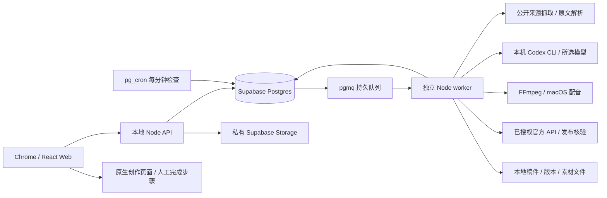

# Content Studio 本地系统与验收

更新日期：2026-10-10。第一阶段只在本机运行；云端继续保留在可行性和架构阶段。

## Current Docker entry point: 2026-10-11

Open **http://127.0.0.1:14310** in the verified owner Chrome profile. All deployed services run in Docker. On an already configured private bind root, use:

```sh
sh scripts/docker.sh start --root /absolute/private-root
sh scripts/docker.sh status --root /absolute/private-root
```

See [portable Docker setup, migration, backup and recovery](docker-runtime.md) and [Docker account authorization](accounts.md) before moving to another computer. The Web port can be configured during setup/restore. Automatic scheduling and publication have separate controls and remain paused after restore until explicitly enabled. LocalFS handles new media; CPU speech/rendering and Linux Codex execute in containers.

**The native 4310, npm, launchd and private-Storage instructions and architecture tables below are historical recovery evidence. Do not use them to start the deployed application or a second instance.** A first-machine clean installer without captured Supabase configuration is not supported yet; the Docker reference describes the supported capture/transfer boundary.

## Historical native runtime and acceptance

在 Chrome 的 `radarxai@gmail.com` 配置文件打开 `http://127.0.0.1:4310`。项目目录为 `/Users/kwt/x/content-studio`。

```sh
npm run local:setup
npm run build
npm run local:start
npm run local:status
```

数据库为本机 Docker 中的 Supabase，项目 `content-studio-local`，API 55421、Postgres 55422。现有云端 `radar` 项目和其他本机 Docker 项目不作为这套服务的数据库，也不因本项目的启停而停止。首次安装需下载较大的官方镜像；日常启动复用本地镜像和持久卷。

API 与 worker 分别由 macOS launchd 托管。关闭浏览器不取消运行中的任务。定时执行需要 Mac 保持唤醒、Docker 运行，研究与模型调用需要网络。错过的周期只补最新一个有效时间点，不积压补发大量旧内容。

## 已实现的产品流程

| 环节 | Web 操作与结果 |
| --- | --- |
| 创建任务 | 标题、prompt、读者、角度、来源、Codex 模型、目标平台、参考图片 |
| 执行频率 | 同一任务切换一次、每天、每周；一次可选指定时间，留空为手动运行 |
| 发现选题 | 按任务 prompt 研究公开来源，输出最多 20 个候选问题；无可靠证据时可以为零 |
| 内容创作 | 先生成原稿，再逐个平台适配；原稿和已完成平台都有独立检查点 |
| 本地文件 | 原稿、各平台 Markdown、来源和结构化内容包可下载；每次修订保留快照 |
| Web 编辑 | 手改原稿触发平台同步；各平台独立微调参与三方比较，保留手改并展示冲突 |
| Codex 调优 | 选择原稿或单个平台、输入 prompt 和参考图片，先查看建议再接受 |
| 素材库 | 上传图片/视频，按稳定素材 ID 引用，实际文件保存到私有 Storage 和本地缓存 |
| 独立视频 | 手动创建视频脚本，编辑解说，再手动渲染并附加；选择视频平台本身不会制作视频 |
| 发布 | 选择目标账号，授权当前具体修订；下方分别显示各平台状态与后续步骤 |
| 恢复 | 创作失败从已有阶段继续；发布结果不明时先核验既有远端记录，再决定是否可重试 |

热点发现提供有来源的候选问题，不声称掌握所有平台的实时全球排名。正文生成使用抓取原文或用户提供的已核对摘录；用户摘录本身不代表系统独立核实。视频目前为图片/文字卡片加本机语音的可复现 MP4，电影级生成视频留给后续独立提供方。

## 技术架构



任务、运行、版本、素材、编辑操作、视频项目各有数据库表。旧稿件、账号和发布账本保持已有工作区 CAS 存储契约，以便保留历史和不可变发布快照；此轮没有把它包装成已完成的多租户云端架构。

每次运行保存当时的任务配置。队列使用租约、心跳和拥有者标识；重复领取不能提交过期工作。定时唯一槽位防止 cron 重复创建同一次执行。原稿更新和适配任务通过持久操作与修复扫描衔接，进程崩溃后不依赖浏览器重新触发。

Codex 在独立临时目录中执行，关闭 shell、插件、账户发布等非必要能力；研究阶段按需启用搜索。外部内容视作资料，不能改变发布权限。浏览器不接收 Supabase 管理密钥。URL 抓取限制协议、地址、重定向、响应大小和超时。

## 发布能力与账号边界

- YouTube：官方 API、频道核验、可恢复上传日志、实际处理状态回读；需要已授权的频道和真实视频。私密/不公开列出的完成上传与公开发布分开记录。
- X / LinkedIn：仅在配置和核验 Postiz 集成后走受支持的文本接口。热点相关 X 内容使用原生页面交付。
- 小红书、Reddit、公众号及其余未授权接口：Web 提供目标入口、标题/正文复制、素材下载和编号步骤，由账号所有者在平台完成发布，再保存真实回执。
- 已有远端标识或上传会话的失败任务展示核验操作，避免再次创建内容。人工勾选步骤、账号已登录、打开创作页都不会自动标记为发布成功。

浏览器登录不等于平台已经授予程序发布 API 权限。各平台的账号/App 审批后续可以逐个接入；不使用验证码绕过、指纹伪装或模拟随机人类动作作为产品依赖。

X 字符校验采用官方推荐的 `twitter-text`：中文/emoji 计权与 URL 缩短规则不能用普通字符串长度替代。[X 字符计数文档](https://docs.x.com/fundamentals/counting-characters)

YouTube 在发出上传请求前检查标题、最终描述的 UTF-8 字节数和禁止字符，描述包含实际来源与披露说明。[YouTube Video 资源约束](https://developers.google.com/youtube/v3/docs/videos)

## 验收证据

各项状态只在实际执行后更新，不能用构建成功替代真实流程。

| 验证项 | 本次证据 |
| --- | --- |
| 完整真实创作 | `gpt-6-luna` 从 W3C 原文和选中图片生成原稿、小红书、Reddit、X、YouTube 四个平台版本；同一运行一次完成 |
| 无来源 URL 的真实研究 | `gpt-6-luna` 实际触发网页搜索，再独立抓取 W3C 原文，6,666 字符，无警告 |
| 真实选题发现 | 独立任务从 W3C 来源产生 2 个有来源问题；没有伪造“全球最热”排名 |
| 频率切换 | 同一任务一次→每天→每周→一次，prompt、模型、平台、图片和来源保留；实际 SQL 验证到期执行、去重和运行中改频率 |
| 本地 Supabase | Auth、私有 Storage 实际字节、匿名访问拒绝、pgmq 收发、pg_cron 实际触发均通过；6 个容器端口仅绑定 127.0.0.1 |
| 文件与视频 | 稿件与修订快照可通过 API 下载；独立手动视频实际生成 19.23 秒 MP4，1080×1920，H.264/AAC，抽帧确认选中图片进入画面 |
| 编辑与恢复契约 | 真实数据库恢复/并发检查通过；真实模型完成 r3→r4 四平台同步，保留小红书手改标题并标出冲突，再审阅并接受仅改小红书标题的建议得到 r5，原稿及其他平台未变 |
| Chrome 表单 | 指定 Chrome profile 已检查一次/每天/每周字段切换和中文布局；本轮完整点击链路尚未完成，不能以 API 验收冒充 |
| 发布交接与继续 | r7 附加图片和独立视频；小红书/Reddit/X 各创建 1 条人工发布记录、5 个步骤；内容包和素材可下载，继续操作复用原 job、不增加提交 |
| 既有 YouTube 状态回读 | 只读核验两条已有视频：旧视频 `delivered/private`，新视频 `published/public`；各自仍为原有 1 次上传，远端 ID 不变 |
| 回归 | 143/143 自动化测试通过，无跳过；严格 TypeScript、生产构建和本地 HTTP smoke 通过 |
| 最终升级与重启 | `local:upgrade` 对 001–006 实际执行无变更迁移，生成最新完整备份；build/start/HTTP smoke 通过，r7 和三个等待人工发布的 job 保留、attempts 均为 0 |
| 隔离恢复 | 全新实例恢复 15 个 Storage 对象、109 个媒体文件、76 个稿件文件和 9 张业务表，数量/hash 一致；7 个稿件下载、8 个运行下载及新旧媒体路径 HTTP 验证通过 |

真实内容样例：任务 `cfc3cc5a-efa1-494d-8d58-87dbdc080c3e`，运行及稿件 `3cd64477-541d-4032-86f5-ddb81eeb4fea`。内容主题为 W3C 图片替代文本；视频为显式手动创建的独立项目。所有本轮验收均保持外部发布暂停，没有增加公开测试帖。最终稿件为 r7：r4 完成同步，r5 接受精调，r6/r7 分别附加视频和图片。Web 的“发布记录”可以看到三个待人工完成的渠道任务；准备启用官方接口发布时，先核对记录，再恢复队列。

## 数据恢复与后续迭代

```sh
npm run local:backup
npm run local:restore -- /absolute/backup-folder --target /new/isolated-folder
npm run local:upgrade
```

备份暂停本项目应用和调度，保存数据库、实际 Storage 字节、本地稿件、运行文件、媒体及校验清单。受限制的授权/上传日志另行加密；密钥留在备份外。默认恢复保留不含凭据的上传会话存在标记，防止已有上传被误判成未发送；解密私有状态需显式使用 `--restore-private`。恢复使用全新隔离目录、端口和持久卷，默认暂停，不复制活动队列和租约，不重放远端发布。加密包已在内存中通过解密与完整性校验，没有保留明文；完整 `--restore-private` 流程和全 Auth/全服务归档恢复未作为本次已通过项目。详情见 [运行维护说明](../scripts/README.md)。

本次真实恢复实例还验证了：0 个活动队列消息、0 个队列租约、0 个启用的本项目 cron；2 份不含凭据的上传日志标记以 0600 保存，实际阻止新的上传且没有网络调用。验证后仅停止隔离实例，保留恢复数据；主实例继续运行且发布暂停。

最新备份：`.studio/backups/2026-10-10T09-46-36.630Z`，包含 15 个 Storage 对象、109 个媒体文件、104 个稿件/运行文件和 2 份受限上传日志。隔离恢复演练使用此前一致性快照（76 个稿件/运行文件）；没有把新旧备份数量混为一次结果。最终 API/worker 已重新启动，数据库、pgmq、cron 健康，示例任务的定时执行仍停用，外部发布仍暂停。

第二阶段继续沿用任务、运行、内容版本、素材和发布回执契约。需要实施的迁移包括多用户身份与 RLS、账户 OAuth 保管、托管 Postgres/Storage、常驻云 worker、模型 API、云端 TTS/渲染、部署与恢复演练。当前未部署云端生产服务。方案依据见 [本地优先建设复核](local-first-build-review.zh-CN.md) 和 [技术架构](web-technical-architecture.zh-CN.md)。


## Subsequent portable Docker implementation

The deployed target now uses Docker for all local services. See [Docker runtime delivery](docker-runtime.md) for current source contracts, actual ARM bilingual CPU render and fresh D0 recovery evidence, supported private backup transfer and remaining acceptance gates. Historical native runtime/model/publication evidence above is not Docker acceptance. Authenticated Linux Codex structured/image execution has passed in Docker. Final source verification passed 176 tests, strict TypeScript and a production build; live PostgreSQL cancellation/schema checks and Docker public-source fetching also passed. Docker/Chrome acceptance now includes source-backed article generation, merge-preserving synchronization, scoped refinement, scheduled discovery and upload restart recovery. Final rebuilt-image acceptance passed with all 13 services, a fresh standalone Sol-generated script and decoded/download-hash-verified video, the separate model catalog, read-only YouTube verification and the requested Chrome profile. The 48-hour burn-in is still pending.
