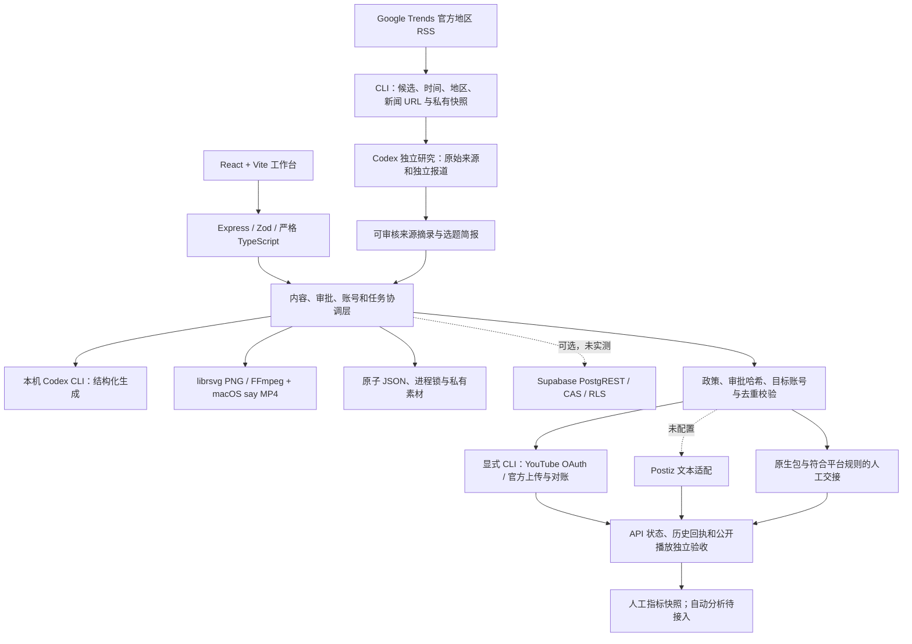

# Content Studio：当前进度、技术架构与功能架构

核查日期：2026-10-10（Asia/Singapore）。本轮以当前代码、真实 Codex 生成、实际素材、官方 RSS、Chrome 账号界面和 83 项测试核查；研究结论与真实平台验收分别记录。

## 当前结论

第一阶段仍未完整验收，第二阶段未开始。目前已能通过本机 Codex完成地区热点采集、基于已核验资料生成四平台内容、图文和配音视频制作、审批及发布任务协调。**自动事实研究仍需 Codex 单独执行；当前真实发布数为 0。** YouTube 官方上传模块已实现并通过模拟契约测试，尚需真实 API 启用和 OAuth 授权。

| 当前实际状态 | 核查结果 |
| --- | --- |
| 本地服务 | `http://127.0.0.1:4310`，本轮重新启动并通过 HTTP 冒烟 |
| 存储 | 本地 `.studio`；Supabase 适配未真实接通 |
| 内容库 | 2 份真实草稿；本轮新闻草稿包含 X、Reddit、小红书、YouTube 四版 |
| 当前新闻素材 | 4 张 1080 × 1440 PNG；47.96 秒 1080 × 1920 H.264/AAC 配音 MP4、8 个场景 |
| 新闻草稿 | 修订号 7，检查文本、素材后内部审批完成；审批不代表平台许可 |
| 已核验身份 | YouTube RadarXAI、X @radarxai、Reddit u/radarxai26、小红书 ziv |
| 用户发布授权 / 真实 OAuth / 任务 / 已发布 | 用户已同意发布及本次 YouTube API 条款；0 / 0 / 0；四账号仍为 Blocked，平台准入另行核验 |
| 自动采集实测 | US/IN/GB/ZA 四个 Google 官方 RSS 成功，39 个候选；保留快照和地区信息 |
| 真实平台提交 | 尚未发生，暂无平台 ID 或公开作品 URL |

## 内容分析和发布的实际边界

**热点发现已自动采集。** `studio discover US,IN,GB,ZA 24` 请求官方 RSS，保存候选、相关新闻 URL、地区、RSS item 时间、抓取时间和流量桶。24 是客户端条目新鲜度，不是官方流量窗口；按选定地区覆盖数和字母顺序排序，不能证明全球最火。RSS 标题未核实，不会直接转换成事实或自动批准稿件。本轮皮莱选题来自更早的网页热度与官方新闻核验，后续 RSS 快照并未包含该词，二者没有混用。

**内容研究仍在应用之外执行。** 本轮由 Codex 单独浏览原始公告和独立报道，保存 8 个来源后再调用现有生成器。生成器只读取资料摘录，不浏览；自动打开新闻、提取正文、事实账本、语义事件聚类和竞品分析尚未集成。本轮工作流可由本机 Codex 编排，但不是无人值守事实研究引擎。

**创作和素材已真实完成。** 本机官方 Codex CLI生成主文章与四个平台版本，随后编辑核验。素材为原创文字信息卡和普通合成旁白视频；没有 AI 现场画面、纪实镜头或真人声音仿冒。新渲染器按词换行、按段落和句子分页；小红书将来源放到第四张卡，配文和旁白原文完整保存。

**发布器实现不等于真实账号通过。** Postiz 仍只接入 X/LinkedIn 文本且未配置。新增 YouTube Desktop OAuth、频道核验、官方 resumable upload 和对账 CLI；只接受指定频道和审批过的真实 MP4。上传前记录日志，未知结果只检查原 session/video，不新建第二次上传。真实 Cloud/API/OAuth 与公开播放验收仍待完成。原生发布包仅交接给符合规则的操作方式。

**政策已影响执行。** X 自动追热点被集中规则阻止，包括调度、派发和最终提交前复核；原生包必须由真人发布。Reddit agent 需要批准 App；小红书本次新闻/国际法题材的账号资格仍待核验。可见鼠标或无头浏览器不能替代权限或豁免内容规则。账号与政策详见 [接入记录](accounts.md)、[最新政策报告](platform-policies-v2.zh-CN.md)。

## 技术架构

OAuth 采用 state、PKCE 和随机回环端口；凭证及上传 session URL 只存 ignored 私有文件。上传期间绑定同一授权 token，拒绝更换账号后的误投；并发对账跳过过期响应，不覆盖新发布结果。Mac 需保持唤醒，服务的 30 秒定时器仅派发已有任务；不会主动发现选题、轮询所有发布状态或唤醒 Mac。YouTube 上传须显式 CLI 调用，不由定时器自动执行。

## 功能架构与完成程度

| 模块 | 已实现与本轮验证 | 剩余工作 |
| --- | --- | --- |
| 业内调研 | Hootsuite、Feedly、Predis、OpusClip、Repurpose、Postiz、Buffer、AiToEarn、n8n 的一手资料 | 供应商真实账号与效果比较 |
| 热点发现 | 四地区官方 RSS、相关 URL、部分失败与时间/流量语义保存，真实采集成功 | 更广地区、语义事件去重、多来源综合评分 |
| 事实研究 | 本轮由 Codex 独立核实并保存来源简报 | 集成文章收集、证据提取、事实核验与更新流程 |
| 内容创作 | 真实主稿和四个平台版本 | 原创多模态画面、品牌与受众反馈 |
| 编辑审批 | 内容/媒体哈希、版本及账号绑定 | 用户在每次发布前的真实最终控制 |
| 图片与视频 | 4 PNG、48 秒 MP4；画面抽查、音视频轨道及音量检查 | 真人完整观看/收听与持续质量验收 |
| 账号 | 四个公开身份已核验并登记 | API/OAuth、App 审批与内容资格 |
| 发布与恢复 | 官方 YouTube CLI、Postiz 文本、未知结果日志、并发/去重保护 | 一次实际提交、处理、频道列表及公开播放验收 |
| 效果复盘 | 人工指标录入 | 自动采集、内容效果反馈与成本记录 |
| 云端产品化 | 尚未开始 | 第一阶段验收后改为模型 API、Supabase Storage/多租户、云端任务 |

## 本轮验证和资料

- 83/83 项测试通过，0 跳过；严格 TypeScript检查及生产构建通过。
- HTTP 冒烟通过：真实本地服务、素材字节、目录/来源限制和文档接口。
- 新契约测试覆盖 RSS/XML/超时、X 政策阻止、YouTube token 更换、存储先行、丢失响应、活跃上传者、并发过期对账、可见性变化与 OAuth 回调。所有 Google/Postiz/Supabase 契约采用模拟请求，不能代替真实账号验收。
- [第二轮业内调研](research-industry-v2.zh-CN.md)、[平台政策](platform-policies-v2.zh-CN.md)、[本轮新闻证据](news-topic-2026-10-10.zh-CN.md)、[实际运行报告](news-run-2026-10-10.zh-CN.md)。

阶段二继续保持未开始。剩余关键链路是获准的真实发布和可见性验收，而不是继续增加未授权平台图标。
