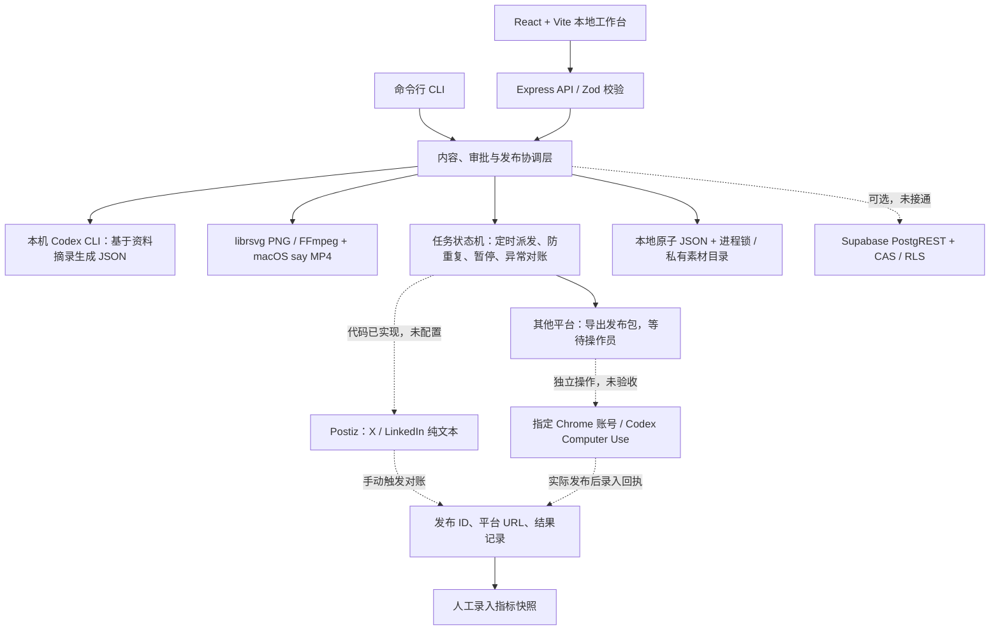
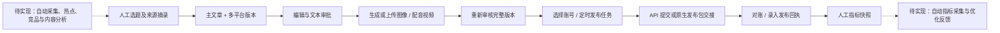

# Content Studio：进度、技术架构与功能架构

核查日期：2026-10-10（Asia/Singapore）。代码基线：`6bdabde`。本次核查读取代码、验收记录、实际本地状态及运行中的状态接口，并经过独立复核；本次文档更新未重复运行历史测试。

## 当前结论

目前是**可运行的本地内容生产工作台**。基于输入资料的生成、编辑审批、素材渲染和发布任务管理已经实现；**自动内容调研和真实多平台发布闭环尚未完成**。第一阶段未通过完整验收，第二阶段尚未开始。

| 当前实际状态 | 核查结果 |
| --- | --- |
| 本地服务 | `http://127.0.0.1:4310` 正在运行 |
| 存储 | 本地 `.studio/state.json` 和素材目录 |
| 真实生成的草稿 | 1 份，包含 X、小红书、YouTube 版本 |
| 已附加素材 | 3 张实际存在的小红书 PNG 卡片 |
| 草稿审批 | 修订号 3，附加素材后审批已失效，等待重新审核 |
| 已连接账号 / 发布任务 / 已发布内容 | 0 / 0 / 0 |
| Postiz | 未配置 |
| Supabase | 迁移和适配代码已提供，真实项目未接通 |

“支持 12 个平台的账号元数据”不表示已经实现或验收 12 个平台的发布器。

## 已经能自动分析和发布了吗？

**内容分析：目前仅能综合你提供的资料。** 输入主题、受众、角度、来源标题、URL 和摘录后，Codex 可生成带来源的主文章及平台版本。URL 目前只是引用信息，不会自动打开或抓取；生成器明确禁止浏览和工具调用。热点发现、竞品账号分析、视频理解、内容结构评分、自动选题和事实独立核验尚未实现。

**内容生成：已经通过真实 Codex 调用验证。** 当前真实草稿由本机已有 Codex 登录生成。PNG 图文卡片可实际生成；配音 MP4 渲染器也通过了音视频结构测试，但它是静态卡片加旁白的幻灯片视频。当前 YouTube 草稿尚未附加 MP4，完整视觉与旁白效果仍待业务验收。

**自动发布：目前还不能在你的账号上完成。** 已实现 Postiz 的 X、LinkedIn 纯文本提交适配，但凭据和授权账号均未配置，尚未真实提交。图片、视频尚未接入该 API 路径。其他平台目前生成发布包并进入操作员交接状态，需要另行执行平台创作者页面操作；服务没有后台浏览器自动上传器。

**结果和复盘：目前仍有人工环节。** Postiz 状态对账由按钮或 CLI 手动触发，定时器只派发到期任务；原生发布需要录入实际 ID 和 URL。系统不独立检查账号内容列表或公开可见性。观看、点赞、评论和点击指标需要人工录入，尚无自动采集及优化反馈。

## 技术架构：第一阶段的实际实现

| 层级 | 已实现内容 | 实际边界 |
| --- | --- | --- |
| 工作台与接口 | React、Vite、Express、严格 TypeScript、Zod | 本地单操作员，监听回环地址；不是在线 SaaS |
| 生成层 | 隔离临时目录调用本机 Codex，结构化输出校验 | 依赖本机 Codex 登录；不自动收集资料 |
| 素材层 | 1080 × 1440 PNG，1080 × 1920 配音 MP4，已有文件上传 | 依赖本机渲染工具及 macOS 语音；没有 AI 视频画面生成 |
| 审批层 | 草稿审批绑定内容与素材字节；发布任务绑定已审批版本及目标账号 | 内容或素材修改需重新审批；目标账号变化使原任务校验失败 |
| 调度层 | 每 30 秒派发到期任务、持久化暂停、防重复、异常恢复 | 需要 Mac 保持唤醒、服务持续运行；没有自动发布结果轮询 |
| 发布层 | Postiz 文本适配、原生素材包与回执状态机 | 当前账号和 API 均未接通，未发生真实发布 |
| 存储层 | 原子本地 JSON；可选 Supabase 工作区 JSON + 版本 CAS | Supabase 未实测；素材仍在本地，未迁移 Supabase Storage |
| 复盘层 | 发布任务关联指标快照 | 人工录入，未自动采集或自动决策 |

核心自研代码管理证据、版本、审批、目标账号和任务状态。Codex、渲染工具和上游发布服务承担各自能力。研究文档已评估业内产品与开源路线，但未把所有调研对象都接入代码。

## 功能架构

| 功能模块 | 当前完成程度 | 验证情况 |
| --- | --- | --- |
| 业内方案调研 | 已整理国际、国内方案及平台接入边界 | 研究资料已保存；不是集成验收 |
| 自动内容调研 | 未实现采集、分析、选题工作流 | 无真实流程可验收 |
| 基于资料生成内容 | 已实现 | 真实 Codex 生成 1 份主稿和 3 个平台版本 |
| 内容库、编辑、版本审批 | 已实现 | 本地 UI 与核心测试已验证 |
| 图文卡片 | 已实现 | 当前草稿有 3 张真实 PNG |
| 配音视频 | 已实现基础渲染 | 测试确认真实视频和音轨；成品视觉、旁白待验收 |
| 账号接入 | 元数据管理已实现，平台授权未完成 | 已连接账号为 0 |
| 定时与发布可靠性 | 队列、状态机和保护逻辑已实现 | 本地测试已验证；真实账号、平台处理和恢复待验收 |
| API 发布 | X / LinkedIn 纯文本适配已实现 | 凭据未配置，仅契约模拟测试 |
| 其他平台发布 | 发布包和人工交接已实现 | 未接入后台上传器，真实发布未验收 |
| 效果分析 | 指标记录已实现 | 人工录入；自动复盘未实现 |
| 云端产品化 | 未开始 | 由第一阶段验收门槛控制 |

## 验收证据与缺口

已有验收记录显示：32 项测试、TypeScript 检查、生产构建通过；HTTP 冒烟验证覆盖真实本地服务、私有目录素材交付及路径限制。测试中的 Postiz 和 Supabase 请求采用模拟 HTTP，不是用户真实账号或真实 Supabase 验收。本次为代码与运行状态复核，没有重跑测试。

Chrome 使用 `radarxai@gmail.com` 的要求已写入项目 `AGENTS.md` 和运行说明。账号阻碍及交接方式见 [账号接入记录](accounts.md)。此前没有完成任何平台账号注册或真实发布，不能把登录页面、平台注册入口或授权准备当作发布成功。

## 第一阶段剩余工作的顺序

1. 补齐内容研究工作流：明确内容领域及可信来源，接入允许的收集路线，保留来源和时间，形成可审核的分析结果，再把分析交给生成器。不能将人工来源摘录视为已经完成自动分析。
2. 完成账号授权，并打通真实 API 发布：配置 Postiz，完成 X / LinkedIn 纯文本提交、平台结果读取、正确账号及可见性验证；再扩展媒体提交和自动结果对账。
3. 对小红书、公众号、Bilibili、TikTok、YouTube、快手等逐个平台完成实际接入和发布验收。当前原生包交接需要真实操作；维护中的国内适配方案尚需实测后选择。
4. 验证持续运行：定时任务、Mac / 服务重启、登录失效、结果不明、重复提交保护和恢复；逐平台记录真实指标并完成重复生产发布周期。
5. 如启用数据库，连接并验收独立 Supabase 项目；现有迁移文件不代表数据库已部署。若缩小初始验收平台范围，需要用户明确同意。

第一阶段通过上述门槛后，第二阶段再将生成器替换为可独立运行的模型 API、将素材迁移到 Supabase Storage、建立多租户表和 RLS、使用持久化云端任务，并完成生产 OAuth、计费及配额。**这些是后续设计，尚未实现。**

## 项目资料

- [总览与运行方式](../README.md)
- [方案研究汇总](research.md)、[国际方案](research-international.md)、[国内方案](research-china.md)
- [技术细节与阶段门槛](architecture.md)
- [验收记录](acceptance.md)、[账号阻碍与交接说明](accounts.md)
