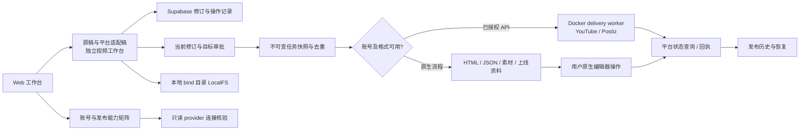
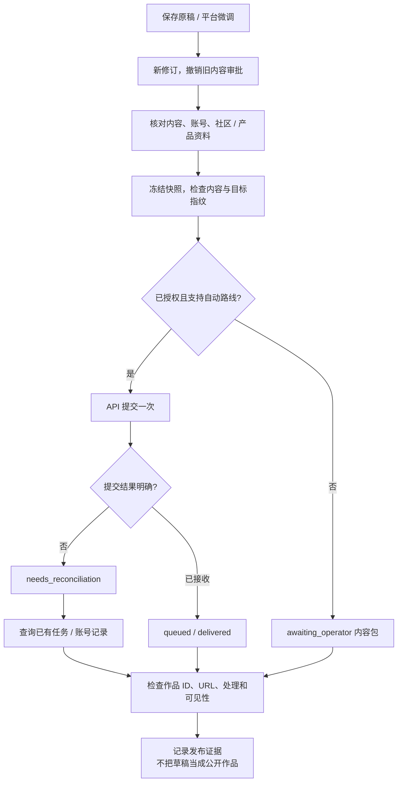

# 六平台发布能力升级与本地验收

调研与实施：2026-10-11；最终部署核验跨至 2026-10-12，Asia/Singapore。基于[多平台发布调研](https://chatgpt.com/c/6acba447-2820-83ec-9fa6-f48c2f3b26b7)与[竞品和浏览器发布报告](publishing-competitors-and-codex-browser-2026-10-11.md)。

本轮交付的是可用的本地能力升级：Reddit 的 Postiz 文字适配、Product Hunt 产品上线资料、知乎专栏稿件、Bilibili 文章与视频分流、逐账号能力矩阵及不可变发布内容包。六个平台的本地流程已通过 Docker/Supabase 验收。**本地验收不等于六个平台已经获得发布权限；本轮没有提交新的外部内容。**

## 1. 已实现能力

| 能力 | 当前实现 | 验收边界 |
| --- | --- | --- |
| 平台覆盖 | 平台标识增加 Product Hunt、知乎；优先展示 Reddit、Product Hunt、公众号、知乎、小红书、Bilibili | 可选题、生成/编辑适配稿及创建原生交接任务；平台账号许可另行核验 |
| 逐账号能力矩阵 | Web「平台与账号」按文章/视频显示路线、自动提交、远端草稿、阻塞项、原生入口与依据 | 浏览器登录、操作人记录和 provider 查询分别说明；未接入格式显示未接入 |
| Reddit 文字 API | 复用现有 Postiz adapter，按官方文档提交 self post、单一 subreddit、标题和 flair | 需已获准的 App/provider、匹配 integration、实际账号授权及社区规则；没有本轮真实 API 投递 |
| Reddit 目标治理 | 保存社区名、规则 URL、核对时间、App 接入依据、必需 flair | 接入依据属于操作人声明，系统不能将其当成 Reddit 审批查询结果 |
| Product Hunt | 产品 URL、名称、Tagline、介绍、Maker 首条评论在 Web 单独编辑并绑定稿件修订 | 不把普通热点文章伪装成产品；无真实产品资料时阻止创建发布任务；没有 launch 写入 API |
| 原稿同步 | 适配时传入已有产品资料；手工修改的上线资料保留，并显示冲突 | 当前上线资料作为一个对象合并；不自动覆盖手工编辑 |
| 国内文章 | 公众号、知乎、小红书沿用原生交接；Bilibili 文章明确走专栏入口 | 不声称已安装扩展或保存远端草稿；独立视频制作仍须显式创建 |
| 发布内容包 | 每次任务保留版本、账号、文案、素材、上线字段快照；下载安全转义的 HTML 与 JSON | HTML 为本地平台文字稿文件，不包含自动远端图片上传/同步能力 |
| 恢复与去重 | 同批次重复操作复用任务；Reddit 标题/社区、产品资料变化进入内容指纹；结果未知先核对 | 不自动重发结果不明的提交；回执不接受编辑器/草稿链接 |
| Postiz 连接检查 | Web 可查询 integrations、选择匹配平台、只读检查指定连接 | 检查只更新核验时间，保留 Blocked 状态，不自动解除内容或权限阻塞 |

Reddit 规则核对的七天有效期是本项目的运行保护策略，**不是 Reddit 官方公布的统一期限**。每次实际投递仍需检查规则、权限和内容用途。变更社区或其他目标设置会使旧发布审批失效。

## 2. 实施依据与选路

- Reddit：采用 [Postiz 文档中的 Reddit settings 契约](https://docs.postiz.com/public-api/providers/reddit)，未引入猜测的后台接口。[Reddit Responsible Builder Policy](https://support.reddithelp.com/hc/en-us/articles/42728983564564-Responsible-Builder-Policy)要求获准访问及相应 App 身份；登录个人账号不能替代这些条件。
- Product Hunt：[API 默认只读](https://api.producthunt.com/v2/docs)，有限写入权限需平台批准；[上线流程](https://help.producthunt.com/en/articles/479557-how-to-post-a-product)针对真实产品和个人账号。本轮实现原生上线资料包，不宣称已有产品创建 API。
- Product Hunt 回执兼容旧 `/posts/<launch-slug>` 与明确指定 launch 的 `/products/<product-slug>?launch=<launch-slug>`，仍拒绝普通产品页。实际链接形式参照 [Product Hunt 官方页面](https://www.producthunt.com/products/producthunt?launch=launch-day-by-product-hunt)；URL 语法识别不替代独立公开可见性核验。
- 国内文章：[WechatSync](https://github.com/wechatsync/Wechatsync)值得作为后续扩展/CLI 草稿适配器试点；它的草稿能力与公开发布是两步。**本轮未安装或集成 WechatSync，未申请微信/Bilibili 官方应用权限。**
- 容器浏览器：现有 Docker Linux Codex 用于内容生成。本轮 Chrome 测试使用宿主机 Computer Use；没有新增 Docker Chrome/CDP/MCP 发布服务，也没有转移 Chrome 登录态。相关设计保留在竞品报告 P3，以平台许可、会话隔离和可接管登录为前提。
- 全量 Postiz 自托管未安装。本轮扩展的是现有薄 API adapter，服务 URL/密钥仍需配置；避免额外数据库/队列权威与维护负担。

## 3. 本地技术架构



继续复用现有 Compose：本地 Supabase、API、article/video/delivery workers、Linux Codex executor、TTS、renderer。业务状态和修订权威在 Supabase，素材首选 LocalFS。未增加新运行依赖或数据库；新平台字段为兼容的可选 JSON 字段，本轮不需要新 SQL migration。文章与视频没有合并为一条作业流程。

新增目录职责：

```text
src/core/publishing-capabilities.ts  # Route, format and access checks
src/core/structured-output.ts       # Strict wire schema and domain normalization
src/core/article-package.ts         # Escaped immutable article HTML
src/core/postiz.ts                  # Existing provider + Reddit self posts
src/ui/capabilities-panel.tsx       # Account/format capability matrix
src/ui/launch-fields.tsx            # Product launch fields
src/ui/editor-panel.tsx             # Versioned editing and refinement
src/ui/publish-panel.tsx            # Immutable kit and receipt UI
tests/publishing-capabilities.test.ts
tests/publishing-http-smoke.ts
```

发布作业图：



## 4. 已执行本地验收

| 检查 | 本轮结果 |
| --- | --- |
| 严格 TypeScript | `npm run typecheck` 通过 |
| 单元与工作流回归 | `npm test`：187 通过、0 失败 |
| 生产构建 | `npm run build` 与 Docker API 镜像构建通过；现有 Tiptap directive 与主包约 506 kB 警告不阻止构建 |
| Docker + 实际 Supabase HTTP | 独立 QA workspace，六个可丢弃账号、六个平台适配稿、六个交接任务；九类契约检查通过 |
| 内容安全与回执 | HTML 转义、Origin 保护、拒绝 Product Hunt 编辑器作为发布链接通过 |
| 去重 | 相同批次第二次发布返回相同六个任务 ID |
| 真实 Linux Codex | Sol 模型生成 453 字原稿、知乎/Bilibili 各 465 字文章适配，格式、空媒体和来源 URL 通过；此前发现的可选字段 schema 拒绝已修复 |
| Chrome 身份 | 可见窗口为 `coding (radarxai@gmail.com)` |
| Chrome 能力页 | 六个平台文章路线可见；视频未接入格式明确区分 |
| Chrome 稿件保存 | Web 修改 Maker 评论；r1→r2；发布任务仍保留 r1 评论，六个任务仍是等待人工、零外部投递 |

QA 地址为临时 `127.0.0.1:14311`，使用独立 Supabase workspace 和容器临时文件路径，测试数据不代表真实账号。正式地址为 `http://127.0.0.1:14310/`。测试不能拿真实工作区执行；`tests/publishing-http-smoke.ts` 在 accounts/drafts/jobs 非空时拒绝运行。

本轮执行了真实原稿与知乎/Bilibili 适配生成，但没有执行新的真实热点采集、其余四平台实际模型稿质量或公开发布验收；现有 Docker 内容生成、原稿同步、显式视频渲染验收见 [Docker runtime](docker-runtime.md)。新增渠道提示与字段通过 schema/merge/HTTP/Web 验证，真实平台稿质量仍需在已登录账号与实际产品/社区中验收。

### 真实模型验收发现并修复的问题

新增可选 `format/launch` 在 JSON 输出 schema 中未列为 required，真实 CLI 适配阶段被拒绝，原稿阶段仍可成功。按 [OpenAI Docs：Structured Outputs](https://developers.openai.com/api/docs/guides/structured-outputs?api-mode=responses)将可选字段映射为必需且可为空的 wire 字段；返回后只移除原本可选、不可为空的 null，再执行原始 Zod 校验。真正可为空的内容评估结果保留 null。直接执行与 Docker remote executor 使用同一转换，新增本地/远端与递归引用回归测试；修复后的实际生成通过。错误分类仅返回安全诊断，不输出原始日志或凭据。

## 5. 账号实测与下一步

| 平台 | 本轮 Chrome 观察 | 下一步 |
| --- | --- | --- |
| Reddit | 已登录，头像菜单显示 `u/radarxai26` | 接入获准的 Postiz/Reddit App，选择有权限的测试社区，登记规则与 flair；没有真实批准不能启用自动发布 |
| Product Hunt | 2026-10-12 根据用户 `approve` 完成 Google Continue；已登录 `coding open / @coding_open`；`/posts/new` 显示产品 URL 表单和 Complete onboarding 提示 | onboarding 第 1/2 步仍要求本人确认已满 16 岁；本地登记 native/Blocked。随后需要真实公开产品 URL 和上线资料；无发布 API 授权、远端草稿或公开 launch |
| 微信公众号 | 本轮未登录；此前 Computer Use 明确拒绝 `mp.weixin.qq.com` | 由公众号管理员在允许的环境扫码；提供非敏感账号类型/权限说明，评估官方 API 或可用草稿扩展；不绕过工具限制 |
| 知乎 | 专栏入口跳到登录；可见手机/扫码/微信方式，没有 Google 入口 | 本人在已打开 Chrome 标签完成短信或 App 扫码，再核对身份与专栏编辑器 |
| 小红书 | 已登录创作后台，显示 `ziv` 和图文/视频入口 | 核对账号内容资格、AI 标识及平台许可；登录状态不是自动发布授权 |
| Bilibili | 创作入口跳到 passport 登录，手机/App扫码等方式，没有 Google 入口 | 本人完成扫码/短信；核对 UID、文章与视频投稿权限后再做远端草稿/作品验收 |

不要把密码、验证码、cookies、tokens、身份证件发到聊天或仓库。账号缺口和可恢复操作见 [accounts.md](accounts.md)。

## 6. 后续实施顺序

1. 完成 Product Hunt 年龄声明/onboarding，以及知乎/B站扫码节点与真实身份核验；仍缺资格的渠道显示 Blocked/Needs login。
2. 优先 Reddit：一个获准 integration、一个允许测试的社区、一个内容版本，真实提交一次并读取作品 ID/URL，验证删除/拒绝/不明结果的恢复。
3. Product Hunt：仅对真实产品生成上线包，先在原生页面保存并读取草稿，再按产品发布日期上线；不以新闻稿测试产品 launch。
4. 微信/知乎/B站文章：先验证一个可用账号和扩展许可，再试点 WechatSync 草稿桥接；图片映射、草稿 ID、读取和人工发布状态逐项验收。
5. 浏览器任务仅在平台允许的范围内引入 Docker 浏览器 + MCP，补会话隔离、登录接管、账号锁和提交前日志；不把模拟真人作为权限或反封号机制。
6. 本地长期运行、账号续登、备份恢复和各渠道真实发布稳定后，沿用相同协议迁移云端；本轮不部署云服务。
