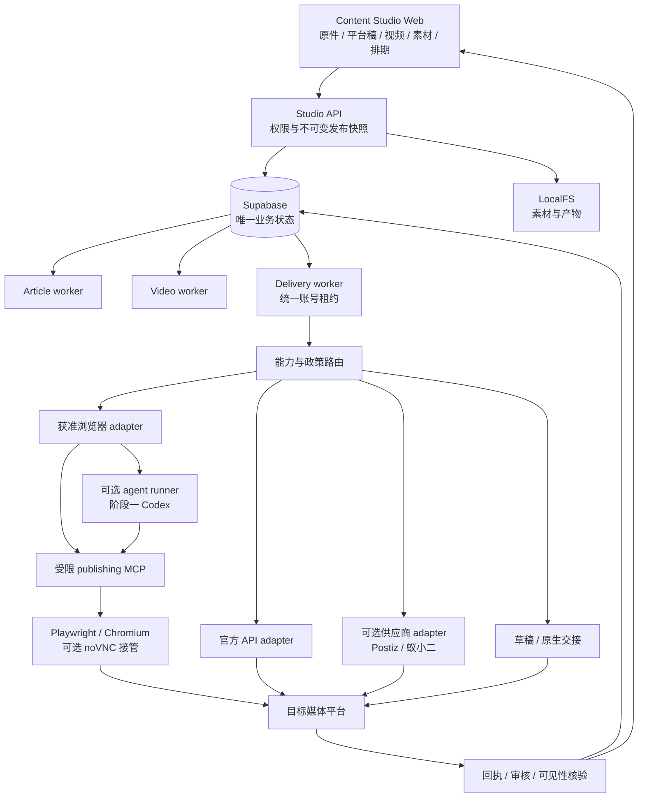
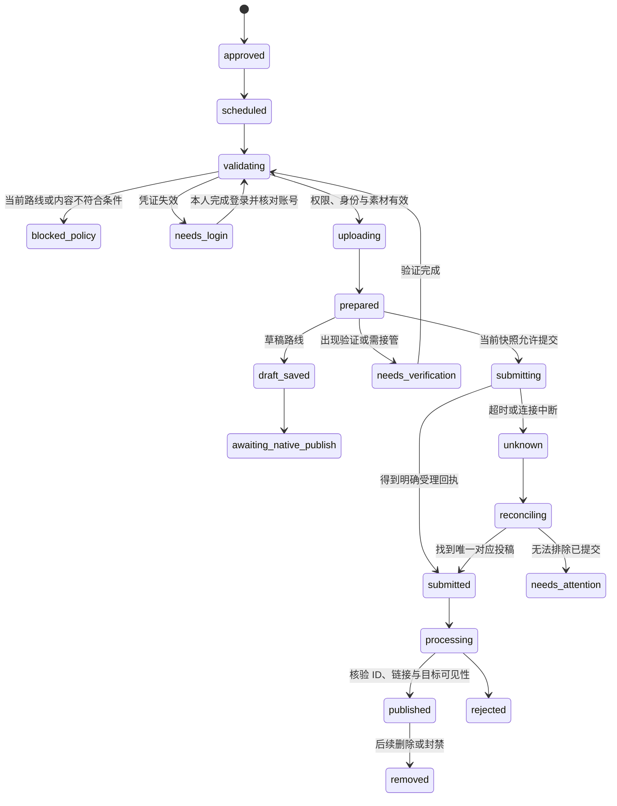

# 竞品与 Codex 浏览器发布报告：授权、Docker 执行与可恢复的一键发布

调研更新：2026-10-11；授权实测复验：2026-10-12。适用项目：Content Studio。阶段一以本地 Docker、Supabase、LocalFS 为基础；阶段二仅确定迁移方案，不在本轮部署云服务。

本轮重新核对竞品官方说明、平台权限文档、npm 包内文档和开源执行代码。下文区分“公开资料确认”“代码确认”“工程建议”“尚未实测”，不把支持列表、上传成功、草稿同步、任务提交当作公开发布成功。本轮未安装竞品客户端、未执行下载的 CLI、未申请账号权限，也未提交新的公开内容。

## 本轮实施状态：2026-10-11

后续按照本报告及关联调研交付了逐账号/格式能力矩阵、Reddit Postiz self-post 契约、Product Hunt 上线资料与版本合并、知乎稿件、Bilibili 专栏分流和不可变 HTML/JSON 内容包。187 项回归、真实 Docker/Supabase 六渠道交接及指定 Chrome profile 的 Web 保存通过。详情见 [六平台升级与验收](publishing-capabilities-upgrade-2026-10-11.zh-CN.md)。

这不代表 P0–P4 全部完成：完整 Postiz 自托管、WechatSync 远端草稿桥接、Docker 浏览器发布服务和新平台官方授权尚未接入；没有新的外部公开提交。下文“Docker Codex 可调用浏览器”是已研究的可实现设计，不是当前安装的运行能力。账号实测与最终注册/扫码阻塞见 [accounts](accounts.md)。

### 2026-10-12 授权与浏览器复验补充

Product Hunt 注册/onboarding 已完成，刷新后真实账号与产品 URL 表单仍可用，但尚无用户的真实公开产品 URL，未创建 launch。Reddit 已登录，既有 `DevPlatform Actions` 的 Submit Content 授权不等于本项目已接入获准 publisher；当前 Postiz integrations 请求明确缺少密钥。知乎和 Bilibili 专栏入口仍要求手机/App登录，微信沿用历史工具限制。

小红书创作后台新增观察到 [Builder hub / Red Skill](https://creator.xiaohongshu.com/new/skill-hub)：页面描述上传 Skill 经审核后添加到笔记或评论。这是附件分发入口，没有证据证明一般笔记的第三方自动发布 API 或浏览器自动化授权。不得因为出现“Skill”字样就解除本项目发布阻塞。

现有 YouTube 官方 OAuth read-only 频道检查通过，现有公开视频在指定 Chrome profile 完整播放到 46/46 秒并出现 Replay。本轮没有新发布或授权扩张；六个优先平台仍没有自动发布连接。逐项证据与所需操作见 [升级实测表](publishing-capabilities-upgrade-2026-10-11.zh-CN.md#2026-10-12-全授权指令后的实测复验)及 [账号报告](accounts.md)。

## 1. 直接结论

**可以让 Docker 中的 Codex 调用容器内浏览器，登录后上传素材、填写内容和执行发布。**实现方式是 Linux Codex CLI/App Server + MCP 工具 + 独立浏览器服务，而不是把 Mac 桌面的 Computer Use 插件搬进容器。首次扫码、短信、双重验证和后续风控验证仍可能需要本人接管；已有 Mac Chrome 登录不会自动进入 Docker。

**无法诚实承诺“任意个人账号、所有平台、长期无人值守、绝不封号”。**主要障碍是平台接入权限、内容规则、登录挑战、网页变动、审核及发布回执，而不只是浏览器能不能点击。国内平台也并非全部没有 API：微信公众号、抖音、快手、Bilibili、微博都有不同范围的官方能力，但开放条件、账号类型和支持的内容类型不同。

在本项目“开源优先、低维护、本地 Docker、文章与视频独立”的约束下，推荐：

> Content Studio 保持唯一内容与作业管理入口；发布网关按实际账号能力选路；官方 API 为主，供应商集成为可替换选项，浏览器执行为有条件的补充；Codex 用于网页理解、辅助填写和异常定位，稳定步骤由确定性适配器执行；所有路线统一核验平台回执。

这是基于公开实现与本项目约束的综合推荐，没有公开、可比的故障率与封号率数据足以证明某一个方案是“全行业第一”。

## 2. “一键发布”和“授权”实际指什么

### 2.1 一键只是统一入口，后面可能走五种不同机制

| 机制 | 实际执行 | 用户如何接入 | 稳定性与边界 |
| --- | --- | --- | --- |
| 平台官方 API | 服务端上传、提交、查询结果 | 创建/审核应用，目标账号授予写权限 | 优先采用；仍受额度、资格、内容规则与审核限制 |
| 供应商 API/CLI/MCP | 我们调用供应商，供应商再投递 | 用户连接供应商账号，另给我们的应用供应商凭证 | 减少接入维护，但依赖供应商；其 API 不等于底层平台官方 API |
| 浏览器登录态下的后台接口 | 扩展/适配器调用网站编辑器使用的 HTTP 接口 | 用户在浏览器正常登录，工具使用会话、CSRF 等 | 有 HTTP 接口，但通常没有公开第三方授权契约；易随后台改版失效 |
| DOM/可视浏览器自动化 | 浏览器上传文件、填字段、点击发布 | 容器浏览器扫码/登录并保存私有会话 | 技术覆盖广；需核对平台允许范围、处理验证、维护页面适配 |
| 草稿同步/移动端分享/通知 | 内容进入草稿或原生 App，用户完成提交 | 浏览器登录或 App 授权 | 可完成一键准备；应明确标成“待用户发布”，不能宣传为全自动公开发布 |

WechatSync 的开源代码体现第三种机制；小红书 MCP 的发布代码体现第四种；Buffer 同时公开了自动和通知两种投递模式。[WechatSync 微信适配器](https://github.com/wechatsync/Wechatsync/blob/a98e42865387285afcc027c61836488748f3b30f/packages/core/src/adapters/platforms/weixin.ts)、[小红书 MCP 发布代码](https://github.com/xpzouying/xiaohongshu-mcp/blob/7797fd375aba02dcd33afe143f6bee13e5870859/xiaohongshu/publish.go)、[Buffer API](https://developers.buffer.com/reference.html)

### 2.2 必须拆开四层授权

1. **账号所有者授权**：用户允许 Content Studio 代表指定账号处理指定内容。
2. **平台应用权限**：平台允许该应用调用相应的发布能力；OAuth 登录、获取用户资料通常不等于取得发布权限。
3. **具体操作权限**：账号类型、内容类型、商业场景、自动化方式符合相应规则；允许上传视频不代表允许发文章，允许草稿不代表允许提交。
4. **执行凭证**：token、供应商 API Key 或浏览器会话仍有效，并对应正确的账号。

拥有第 1 层和第 4 层，不会自动获得第 2、3 层。Google 登录也只是部分平台注册入口，不能代替各平台的发布权限、手机号绑定、实名或管理员授权。

供应商的 OAuth 可再分为两次：用户先连接其社交平台账号，再允许我们的应用访问供应商。Postiz 的 OAuth/Public API 是后一层应用集成；平台账号仍须完成对应连接。[Postiz 集成说明](https://postiz.com/blog/direct-postiz-integration-oauth-api)

## 3. 竞品如何实现：核查结果与选型

| 产品/项目 | 公开确认的实现 | 授权与发布边界 | 本项目建议 |
| --- | --- | --- | --- |
| Buffer | 社交账号连接、服务端排期；API 区分 automatic 与 notification | 部分功能需推送通知后由用户在原生 App 完成；未找到覆盖目标国内媒体的证明 | 国际平台产品流程参考；不能作为国内通用发布引擎 |
| Hootsuite | 连接社交账号、排期、直发或移动通知、失败记录 | 权限及功能受社交网络限制，账号连接也会失效 | 借鉴能力展示、重新连接和失败恢复；不能以“支持一键”推导所有格式直发 |
| Postiz | 开源 provider、OAuth、素材上传、排期、结果查询；官方 agent/MCP | 自托管仍需自己的平台应用凭证与平台批准；托管版接入也要核对实际权限范围 | 国际渠道首选评估对象；优先薄适配，避免直接替换我们的内容工作台 |
| 蚁小二 | 内置浏览器连接账号；`yxer` 管理账号、素材、表单和发布任务；本机客户端/云发布两条路径 | 商业闭源执行服务；每个平台和内容类型应分别验收；公开案例包含公众号入草稿后人工发布 | 国内商业替代选项，重点评估 Linux CLI + 云发布；不作为必须依赖的本地开源核心 |
| 易媒助手 | Windows 客户端，多账号保持登录、发布队列、网页后台操作相关帮助 | 未找到可公开审计的逐平台执行代码或通用自托管 Linux 发布 API | 功能参考及商业备选；目前不适合作为全部 Docker 化的核心依赖 |
| WechatSync | Chrome 扩展使用已有登录态；CLI/MCP 通过桥接调用扩展；适配器保存草稿并上传图片 | 官方明确草稿模式，不自动正式发布；只做文章/图片；后台私有接口权限须另核对 | 文章草稿同步候选；不得用于填补“公开发布成功”状态 |
| social-auto-upload | Python/Playwright 多平台上传，保存登录状态；B站视频路径使用 `biliup` | CLI 和 adapter 为当前重点；历史 Web 界面不是维护主线；不同平台成功检查不同 | 视频上传流程与窄适配器候选，逐个平台做故障与回执验收 |
| xiaohongshu-mcp | Go/Rod + MCP + Docker；扫码、图文/视频网页发布 | 非官方浏览器接入；当前成功判定偏弱；上游 Docker 固定 AMD64 | 有条件的技术验证参考，不能直接标为已批准、跨架构稳定发布服务 |
| multi-publisher | Electron UI、Playwright worker、持久化浏览器与本地发布记录 | 样本较小；与现有 Supabase/Web/Docker 结构重叠 | 参考交互，暂不作为成熟核心依赖 |

上述结论来自 [Buffer 通知发布](https://support.buffer.com/en-us/articles/using-notification-publishing-gvZQiMxVa2)、[Hootsuite 发布故障说明](https://help.hootsuite.com/s/article/troubleshoot-failure)、[Postiz 源码](https://github.com/gitroomhq/postiz-app)、[蚁小二官方工作流](https://xueyuan.yixiaoer.cn/article/46560)、[蚁小二公众号案例](https://xueyuan.yixiaoer.cn/article/46285)、[易媒官网](https://yimeizhushou.com/)、[易媒帮助中心](https://yimeizhushou.com/help.html)、[WechatSync 官网](https://www.wechatsync.com/)、[social-auto-upload](https://github.com/dreammis/social-auto-upload)、[小红书 MCP](https://github.com/xpzouying/xiaohongshu-mcp)、[multi-publisher](https://github.com/atxinsky/multi-publisher)。竞品宣称的支持数量不等于独立验证的稳定渠道数量。

### 3.1 Postiz：可审计的官方平台 API 路线

本轮实际读取 provider：Reddit 走官方 authorize/token、`oauth.reddit.com/api/submit`，并有已提交内容查找逻辑；X provider 使用平台 API SDK，并在当前代码中采用 OAuth 1.0a 用户授权。不能把所有 provider 都概括成同一种 OAuth 2.0 流程。[Reddit provider](https://github.com/gitroomhq/postiz-app/blob/91c91f633a0175fb3914dba64c932928c514b72a/libraries/nestjs-libraries/src/integrations/social/reddit.provider.ts)、[X provider](https://github.com/gitroomhq/postiz-app/blob/91c91f633a0175fb3914dba64c932928c514b72a/libraries/nestjs-libraries/src/integrations/social/x.provider.ts)

自托管接入需要配置平台应用和匹配的 redirect URI。安装 Postiz 不会替我们完成 Reddit 当前的访问批准，也不会赋予 X 写入权限。其自托管教程应与实时平台政策一起核对。[Postiz Reddit 配置](https://docs.postiz.com/self-host/providers/reddit)、[Reddit Responsible Builder Policy](https://support.reddithelp.com/hc/en-us/articles/42728983564564-Responsible-Builder-Policy)

选择托管版可以减少部署与 provider 维护，但不能默认其平台许可覆盖我们的全部商业用途。选择自托管版则增加自身应用审核、凭证管理及基础设施维护。项目采用 AGPL-3.0；复用与修改须保留相应许可义务，服务拆分并不是自动免除许可义务的依据。

### 3.2 蚁小二：本轮取得了真实 CLI 包契约

本轮只读核查 npm 的 `@yixiaoermail/cli@3.2.27`，**没有安装、执行其二进制，也没有连接用户账号**。包内包含 Go 二进制下载启动器、平台 schema 和 reference 文档，许可证为 `UNLICENSED`，未提供公共源码仓库。启动器声明 Linux AMD64/ARM64 目标；这只证明分发目标，不是容器运行验收。[npm 包](https://www.npmjs.com/package/@yixiaoermail/cli)、[只读包版本元数据](https://registry.npmjs.org/@yixiaoermail/cli/3.2.27)

包内真实文档包含如下命令结构，已超出上轮只读到官方文章伪代码的证据范围：

```text
yxer accounts list 小红书 --json
yxer validate 哔哩哔哩-Open video payload.json
yxer publish video 哔哩哔哩-Open payload.json --dry-run
```

一般发布文档还描述 `--publish-channel local --client-id`，并提供独立的 `bilibili-open.video.schema.json`。**Bilibili-Open 与普通 Bilibili 表单是不同分支**；schema 名称仍不能单独证明当前用户已获官方投稿权限。[版本固定的公开包](https://registry.npmjs.org/@yixiaoermail/cli/-/cli-3.2.27.tgz)

客户端连接账号、CLI API Key、目标平台会话是不同凭证。本机发布要求相应客户端在线；CLI 能在 Linux 运行不代表客户端也能完整地在 Linux 容器运行。云发布会引入供应商服务与素材传输。公开资料和包文档没有完整披露各渠道的底层执行方式、合同许可、成功率与会话保存机制，这部分不能靠推断补齐。[蚁小二工作流说明](https://xueyuan.yixiaoer.cn/article/46560)

接入前需取得实际账号/内容类型支持矩阵、素材处理与删除约定、任务查询回执、失效恢复方法；单平台验收通过后再提供供应商选项。它可以缩短商业落地时间，但不满足“全部能力开源且本地自托管”的目标。

### 3.3 WechatSync：浏览器会话与后台草稿接口

本轮代码核查发现：

- 微信适配器调用网页后台 `operate_appmsg` 保存稿件，返回编辑/草稿 URL；它使用浏览器端 token 与会话，不是官方 `api.weixin.qq.com` 的 `freepublish` 接口。
- B站文章适配器调用后台专栏草稿接口，并返回编辑 URL。
- 知乎适配器创建、更新文章草稿。
- CLI 与 Chrome 扩展通过 WebSocket 桥接；扩展执行平台请求。

这正是“国内没有对该开发者开放通用发布 API 时，工具仍能同步”的一种实现：**复用已登录创作者后台的会话与内部 HTTP 协议**。它仍可能受使用条款、CSRF、会话过期和接口改版影响；将该协议封装为 MCP 也不会变成官方授权 API。[微信代码](https://github.com/wechatsync/Wechatsync/blob/a98e42865387285afcc027c61836488748f3b30f/packages/core/src/adapters/platforms/weixin.ts)、[B站代码](https://github.com/wechatsync/Wechatsync/blob/a98e42865387285afcc027c61836488748f3b30f/packages/core/src/adapters/platforms/bilibili.ts)、[知乎代码](https://github.com/wechatsync/Wechatsync/blob/a98e42865387285afcc027c61836488748f3b30f/packages/core/src/adapters/platforms/zhihu.ts)、[CLI 桥接](https://github.com/wechatsync/Wechatsync/blob/a98e42865387285afcc027c61836488748f3b30f/packages/cli/README.md)

因此，它既支持把公众号文章作为来源，也存在微信目标草稿适配器；不能误写成“只读公众号来源”。但当前官网明确要求用户检查草稿后发布，不能把它作为公开发布引擎。Docker 里只有 CLI 不够，还要有已安装扩展并登录的浏览器。[WechatSync 官方说明](https://www.wechatsync.com/)

### 3.4 小红书 MCP / social-auto-upload / biliup：技术能投递，验收仍有差距

小红书 MCP 的实际代码导航到创作者发布页、上传图片、填写标题正文与元信息，最后点击发布。扫码工具能提取登录二维码并等待登录，无头模式也能完成扫码登录流程；它不是必须依赖 Mac GUI。[发布实现](https://github.com/xpzouying/xiaohongshu-mcp/blob/7797fd375aba02dcd33afe143f6bee13e5870859/xiaohongshu/publish.go)、[登录实现](https://github.com/xpzouying/xiaohongshu-mcp/blob/7797fd375aba02dcd33afe143f6bee13e5870859/xiaohongshu/login.go)

重要限制：该版本 `waitPublishSuccess` 以页面 URL 离开发布表单判定成功。跳转并不足以证明获得笔记 ID、审核通过或对公众可见。其 Dockerfile 固定 `GOARCH=amd64` 和 Linux x64 浏览器，且数据目录采用宽权限；需要解决 ARM64 支持、目录权限和回执核验后，才能纳入本项目的可移植验收。作者的“未封号”经验不是平台授权或统计保证。[版本固定的 Dockerfile](https://github.com/xpzouying/xiaohongshu-mcp/blob/7797fd375aba02dcd33afe143f6bee13e5870859/Dockerfile)

social-auto-upload 的小红书和抖音路径采用 Playwright 与持久化登录状态；部分发布流程有具体成功页检查，不能假设不同适配器返回值语义一致。B站视频所用 `biliup` 代码调用 `member.bilibili.com` 创作后台接口；这是未公开给任意应用的投稿协议实现，不能与 Bilibili Open OAuth 接入混为一谈。[小红书 uploader](https://github.com/dreammis/social-auto-upload/blob/0012d2c355f88f683cc38dde2a2db209e14091bc/uploader/xiaohongshu_uploader/main.py)、[抖音 uploader](https://github.com/dreammis/social-auto-upload/blob/0012d2c355f88f683cc38dde2a2db209e14091bc/uploader/douyin_uploader/main.py)、[biliup 投稿实现](https://github.com/biliup/biliup-rs/blob/56df872972f02c8ae55d47d364e7a1e534026dd5/crates/biliup/src/uploader/bilibili.rs)

不能把仓库中的隐藏自动化特征、模拟停顿等做法当作“不封号方案”。本项目选择依据是允许的接入方式、真实账号权限、维护能力与可靠回执。

## 4. 各平台如何取得发布权限

### 4.1 中国媒体平台

| 平台 | 官方能力与获得路径 | 无相应 API 权限时 | 项目选路 |
| --- | --- | --- | --- |
| 微信公众号 | 自有账号使用开发者 AppID/Secret 与接口权限；多客户产品走微信开放平台第三方平台，由管理员授权 | 登录后台同步草稿/原生提交；浏览器会话不会恢复被回收的官方发布权限 | 有资格且后台显示权限时走官方 API；否则明确草稿/人工路线 |
| 小红书 | 商业、电商、账号连接、分享等开放能力不能直接等同于任意账号服务器直发笔记 | 技术上存在内部接口与网页自动化，但未证明当前账号获得机器发布许可 | 维持当前策略门禁，原生提交；明确获得许可后才开自动路线 |
| Bilibili | 官方开放平台有视频稿件分发、查询等能力；身份审核、应用接入及用户授权需完成 | `biliup` / 浏览器可实现创作后台上传，但不能据此称官方授权 | 视频优先申请 Open；专栏另做能力核查，不能套用视频权限 |
| 抖音 | 申请 `video.create`，平台开通后用户 OAuth 授权；每次创建须让用户明确感知 | 分享 SDK/原生上传，或在允许范围内评估浏览器辅助 | 官方发布优先；投稿意识与确认保留在 Web |
| 快手 | 注册应用、取得相应发布能力，并获用户视频发布 scope | 创作者后台上传与扫码会话；是否允许第三方自动化需另核对 | 官方 API 优先；异步发布必须查询结果 |
| 微博 | 当前官方 CLI 提供 OAuth/设备授权；需开发者认证、服务资格/额度 | 原生发布；不要依据旧 API 教程假设账号已能写入 | 作为新增国内官方接口候选；AI 内容声明纳入表单 |
| 今日头条 | 抖音开放平台权限表列出头条视频能力，需对应应用与用户权限；不能推导长文通用直发 | 平台后台或草稿适配器 | 视频与文章分别验收 |
| 百家号、知乎、搜狐号、大鱼号、网易号等 | 本轮未取得“面向该用户、该内容类型可直接申请”的完整通用发布契约 | 扩展草稿同步、合作服务商或原生发布；闭源竞品底层方式需询证 | 标成“权限/能力待核验”，不笼统写“绝无 API”，也不默认开放机器发文 |
| 微信视频号 | 与公众号属于不同内容和接入域；公众号图文 API 不能代发视频号 | 有独立创作者后台上传实现，例如 social-auto-upload 的视频流程 | 独立视频适配器与账号能力，不复用公众号发布权限 |

官方依据：[微信公众号发布能力](https://developers.weixin.qq.com/doc/offiaccount/Publish/Publish.html)、[微信第三方平台](https://developers.weixin.qq.com/doc/oplatform/Third-party_Platforms/2.0/product/Third_party_platform_appid.html)、[B站开放文档入口](https://openhome.bilibili.com/doc)、[B站视频详情查询](https://openhome.bilibili.com/doc/4/d9554788-dcef-f139-6217-b487d41c3826)、[抖音权限说明](https://open.douyin.com/platform/resource/docs/accession-guide/type-and-permission)、[抖音创建视频](https://open.douyin.com/platform/resource/docs/openapi/video-management/douyin/create/create-video/)、[快手网站 OAuth](https://open.kuaishou.com/platformDocs/develop/web-app.html)、[快手异步发布](https://open.kuaishou.com/platformDocs/openAbility/contentManagement/createAVideo)、[微博官方 CLI 手册](https://open.weibo.com/cli/quickstart)。

### 4.2 微信：不能再用“公众号都有 API”概括

本轮搜索阅读器无法打开部分微信文档，但通过公开 HTTPS 页面重新取得了当前正文。官方发布能力页将接口归入服务号文档，并明确：**2025 年 7 月起，个人主体、企业主体未认证及不支持认证的账号被回收相关发布接口调用权限**。因此，认证状态是重要条件，但也不能仅凭“已认证”就推断任意类型公众号拥有所有权限；必须查看该账号后台权限及实际调用结果。[官方发布能力](https://developers.weixin.qq.com/doc/offiaccount/Publish/Publish.html)

自有合格账号路线：管理员查看开发接口权限 → 配置服务器出口 IP 白名单等必要设置 → 获取服务端 access token → 上传图片/封面 → `draft/add` → 用户批准对应稿件 → `freepublish/submit` → 查询 `freepublish/get` 或接收完成事件 → 记录文章 ID、永久链接和实际状态。[草稿箱](https://developers.weixin.qq.com/doc/offiaccount/Draft_Box/Add_draft.html)、[提交发布](https://developers.weixin.qq.com/doc/service/api/public/api_freepublish_submit)、[发布状态](https://developers.weixin.qq.com/doc/service/api/public/api_freepublish_get)

`publish_id` 是任务 ID，不能当作已发布文章 ID。状态接口区分发布中、原创失败、审核失败、成功及成功后删除/封禁；提交成功后仍可能失败。另需区分“发表文章取得链接”与“向粉丝群发”，不能在产品中偷换成同一操作。[状态接口](https://developers.weixin.qq.com/doc/service/api/public/api_freepublish_get)

多用户云产品路线：申请并认证平台型第三方平台 → 配置授权与事件回调 → 用户管理员扫码授权 → 服务端换取并维护 authorizer token → 在账号本身拥有的权限范围内代调用。普通公众号网页 OAuth 获取访客身份，不是公众号后台运营授权；第三方平台授权也不会赋予授权账号原本没有的接口权限。[第三方平台概述](https://developers.weixin.qq.com/doc/oplatform/Third-party_Platforms/2.0/product/Third_party_platform_appid.html)

### 4.3 小红书：分享、账号登录、机器发布是三回事

本轮重新从官方协议页面使用的公开合同接口取得现行正文。用户协议更新日期为 2026-03-23，§4.1 限制未经平台开发、授权或许可的第三方工具登录或使用；社区规范 §4.4.3 列入批量、高频、机器发布等异常模式。可见浏览器、Codex、账号本人授权均未在这些条款中取得明确自动化豁免。[用户协议](https://agree.xiaohongshu.com/h5/terms/ZXXY20220331001/-1)、[社区规范](https://agree.xiaohongshu.com/h5/terms/ZXXY20221213003/-1)

上述用户协议还区分境内小红书和境外 rednote；账号适用协议需按实际注册地区确认，不能直接把境内条款视为所有境外账号的完整契约。此处不因此推导境外账号获机器发布许可。

官方分享 SDK、账号授权与电商开放能力各有用途。本轮未获得可以供该账号任意内容服务器直发笔记的完整公开契约；分享 SDK 是进入原生发布体验的路线，不等同无人值守发布。[分享开放平台](https://agora.xiaohongshu.com/doc/js)、[账号平台](https://openaccount.xiaohongshu.com/docs/api-reference)

合理可落地结果是：先提供素材、排版、版本预览和原生发布交接；向平台或明确持许可的服务商确认自动化允许范围后，才启用对应浏览器/接口执行器。用户选择工具可以表达账号授权，但不能替代平台许可。本项目现有 `AGENTS.md` 的政策边界继续生效。

### 4.4 抖音、快手、B站：有 API，但账号登录不够

抖音权限表将 `video.create` 列为需要申请、默认关闭的权限。创建视频还要求用户授权，且代用户创建时，每次操作须让用户明确感知；API 返回后存在审核期。产品应记录用户明确选择的账号、稿件和计划，不把一次登录解释为永久默许所有后续自动发文。[权限表](https://open.douyin.com/platform/resource/docs/accession-guide/type-and-permission)、[创建视频](https://open.douyin.com/platform/resource/docs/openapi/video-management/douyin/create/create-video/)

快手官网直接说明视频发布为异步，返回不代表已显示在用户页面，应按 `photo_id` 查询确认；网站应用 OAuth 的 scope 必须包含所需发布能力。已上传文件但未通过视频校验，也可能不能正式发布。[快手授权](https://open.kuaishou.com/platformDocs/develop/web-app.html)、[创建视频](https://open.kuaishou.com/platformDocs/openAbility/contentManagement/createAVideo)

B站官方入口提供身份认证、应用和授权管理，公开视频详情文档返回稿件与分享链接等信息。本轮取得开放能力存在的官方证据，但未登录审核后台，也未核验本账号可获具体 scope、额度和视频投稿接口。不能把公开文档存在写成“已申请成功”。[开放平台](https://open.bilibili.com/doc/main)、[单稿详情](https://openhome.bilibili.com/doc/4/d9554788-dcef-f139-6217-b487d41c3826)

### 4.5 国际平台

| 平台 | 推荐接入 | 必须核对的限制 |
| --- | --- | --- |
| YouTube | 沿用已有 Data API/OAuth 实现，支持上传后回读视频资源 | OAuth 授权、账号和实际隐私/处理状态分别验证；不能用“OAuth 客户端存在”当授权或公开发布完成 |
| X | 获准用途走官方 API 或符合许可范围的 provider | 官方禁止脚本操作网站的非 API 自动化；自动发布趋势话题另有明确限制，不能改用 Codex 点击规避 |
| Reddit | 先取得当前访问批准，再通过官方 API/获准服务商接入 | 政策覆盖 bots、AI agents、非人操作账号；要求注册、透明身份及用途，商业数据使用另需书面批准；各 subreddit 规则仍适用 |
| TikTok | 官方 Content Posting API 或权限覆盖该用途的获审 provider | App scope 通过和 Direct Post 审计不是同一门槛；未审计限制私密账号及 SELF_ONLY，原始指南不接受只给自己/团队管理账号上传的内部工具作为预期用途 |

依据：[YouTube 上传接口](https://developers.google.com/youtube/v3/docs/videos/insert)、[X 自动化规则](https://help.x.com/en/rules-and-policies/x-automation)、[Reddit Builder Policy](https://support.reddithelp.com/hc/en-us/articles/42728983564564-Responsible-Builder-Policy)、[TikTok 直接发布入门](https://developers.tiktok.com/docs/en/content-posting-api-get-started)、[TikTok 内容分享指南](https://developers.tiktok.com/docs/en/content-sharing-guidelines)。

**YouTube 文档更新纠正：**本轮官网 `videos.insert` 正文明确表示，未验证 API 项目上传的视频不再因此被限制为私密。不能继续把旧教程中的 2020 年未验证项目私密限制当作当前统一规则。OAuth 应用验证、项目其他要求、账号设置和实际视频状态仍须分别检查；这一文档变化不是本项目新增公开发布验收。[当前接口正文](https://developers.google.com/youtube/v3/docs/videos/insert)

TikTok 则仍明确规定未审计客户端的私密限制，并要求展示创作者信息、预览、可编辑文案、用户主动选择隐私及上传同意。仅供自己使用的本地工具不能默认能通过公开 Direct Post 审计；可选择获准用途的供应商或原生发布交接，并核对其服务条款。[TikTok 分享指南](https://developers.tiktok.com/docs/en/content-sharing-guidelines)

X 的趋势话题自动发布限制需要作为内容来源门禁；对符合其他规则的原创信息类顶层帖，不应错误套用 AI 自动回复机器人的额外审批。当前项目已经规定 X 网站自动化不是获准路线。[X 自动化规则](https://help.x.com/en/rules-and-policies/x-automation)

## 5. Docker 中 Codex 调用浏览器：如何实现

### 5.1 三种可行部署形态

| 形态 | 工具来源与登录环境 | 优点 | 不足/选择 |
| --- | --- | --- | --- |
| Mac 桌面 Codex + 现有 Chrome | 桌面 Computer Use，Mac 浏览器会话 | 人可看到过程，适合一次性调试和接管 | 依赖宿主桌面，不满足全部运行组件在 Docker 的目标；保留为可选辅助 |
| Docker Codex + 浏览器 MCP | CLI/App Server 调用 MCP；Linux 浏览器独立登录 | 可移植、可从 Web 创建任务、与作业状态整合 | 需增加浏览器和账号会话管理；作为主要目标 |
| Docker worker + 官方 API/供应商 CLI | 确定性 API/CLI 执行，Codex 辅助诊断 | 最低模型调用成本，便于限流、回执和恢复 | 受接口权限与供应商范围限制；能使用时优先 |

OpenAI 官方文档支持 STDIO 和 Streamable HTTP MCP，App Server 可嵌入自有应用并流式回传工具与任务事件。浏览器能力来自额外配置的工具，不来自 Codex 可执行文件本身。当前文档已删除 `codex mcp-server` 命令，新的嵌入方案应使用 App Server，而不是采用过时教程。[MCP](https://learn.chatgpt.com/docs/extend/mcp?surface=cli)、[App Server](https://learn.chatgpt.com/docs/app-server)、[CLI 命令说明](https://learn.chatgpt.com/docs/cli/reference)

### 5.2 浏览器能力选择

**默认执行能力：Playwright + Microsoft Playwright MCP。**适合基于 DOM/可访问性快照导航、填写和上传。发布任务通过受限工具层调用，不默认把所有通用浏览器操作暴露给生成文章的 agent。MCP 支持 `--user-data-dir`、storage state、连接 CDP 和文件上传工具。[版本固定的配置与工具文档](https://github.com/microsoft/playwright-mcp/blob/b8b4183e099f136cbec0388a6088d4aa2f6b9685/README.md)

**登录分两种情况：**

- 平台支持网页二维码：无头浏览器提取二维码，Web 展示，用户手机确认；登录后回读账号 ID。无需为了每次扫码启动完整远程桌面。
- 需要完整页面交互、短信或其他验证：提供有界的可视浏览器会话，让用户在 Web 接管，完成后交还发布 worker。

微软现成 MCP Docker 镜像当前只支持无头 Chromium，不能写成它自带 noVNC/可视登录。可视模式推荐评估维护成熟的 `SeleniumHQ/docker-selenium` standalone Chromium，复用其 Xvfb/noVNC；薄桥接创建浏览器会话，取得 CDP 地址后供 Playwright/MCP 连接。WebDriver 用于会话生命周期，页面执行只交给一个控制器；跨容器 CDP、共享 profile、上传路径和重连需在试点中验收，不能把两套工具简单并列视为已集成。[MCP Docker 限制](https://github.com/microsoft/playwright-mcp/blob/b8b4183e099f136cbec0388a6088d4aa2f6b9685/README.md#docker)、[Selenium Docker 与 noVNC](https://github.com/SeleniumHQ/docker-selenium/blob/b8c2fda186f98ce421c7df5f93e34034544c8e40/README.md)

Chromium 应作为跨架构首选；使用 Google Chrome 镜像时查验所固定版本的 AMD64/ARM64 矩阵，不沿用“Linux Chrome 永远不支持 ARM64”的旧结论。Selenium 当前文档已说明较新 Chrome 的 ARM64 支持及驱动差异；当前项目尚未验收这些浏览器镜像。不要以 AMD64 模拟运行成功作为 Apple Silicon 原生兼容验收。[Selenium 架构说明](https://github.com/SeleniumHQ/docker-selenium/blob/b8c2fda186f98ce421c7df5f93e34034544c8e40/README.md#experimental-multi-arch-amd64aarch64armhf-images)

**WechatSync 是另一种工具服务**：它依赖浏览器扩展，与无头/扩展兼容性须独立验证；不能仅把其 CLI 加进 model-runner 就称 Docker 草稿同步完成。[扩展桥接](https://github.com/wechatsync/Wechatsync/blob/a98e42865387285afcc027c61836488748f3b30f/packages/cli/README.md)

### 5.3 登录与凭证生命周期

1. Web 点击“连接账号”，创建专属于平台与账号的会话；Google/Supabase及测试平台操作仍使用用户指定身份 `radarxai@gmail.com`。国内平台按其手机号/实名/管理员验证流程接入，不能默认都支持 Google 注册。
2. 在容器专用浏览器正常登录；需要人工步骤时标记 `needs_login` / `needs_verification`，Web 提供该会话接管入口。
3. 登录后从平台读取不可变账号标识，与所选目标核对；“页面显示头像”不足以防止发错账号。
4. 会话存于私有、未跟踪的本地挂载目录；token 服务端保管，不返回前端、不写入模型提示词。活动 profile 需保持可供浏览器读取，备份使用加密；不能声称普通 bind mount 自带加密。
5. 每次发布前检查会话、平台权限和目标身份；过期时停止写操作，续接原任务。授权撤销后立即阻止后续投递。
6. profile 与账号实行租约/串行控制；同一个 persistent profile 不能同时由多个浏览器实例打开。文章与视频共用账号序列化域。[Playwright MCP profile 约束](https://github.com/microsoft/playwright-mcp/blob/b8b4183e099f136cbec0388a6088d4aa2f6b9685/README.md)

不要挂载整个 Mac Chrome profile、Keychain 或用户主目录。宿主 Chrome 与 Linux profile 并非可直接复制的稳定接口，会话可能有加密、设备绑定或过期；迁移机器后的重新登录应是产品支持的正常流程。扫描二维码、短信、设备授权是验证，不是可永久免除的发布手续。

### 5.4 Codex 接入 Web 的方式

第一阶段继续复用已有 Linux Codex 服务做内容生成；发布另建角色受限的 publisher runner。一次性辅助可用 `codex exec` 配置 MCP，持续 Web 交互与接管则优先 App Server 的 `thread/start`、`turn/start` 和事件流。命令仍须遵守当前安装版本、sandbox 和授权配置，不能由页面任意提交 shell 命令。[App Server](https://learn.chatgpt.com/docs/app-server)

核心只传不可变 job/snapshot ID、指定账号和允许动作。页面内容作为不可信输入，不能更改目标账号、批准快照或工具权限；通用 MCP 的任意 JavaScript、网络响应正文及 profile 文件读取不直接开放给发布 agent，需要的动作封装在领域 adapter。凭证由 adapter 使用，Codex 不接触 token。Web 展示可读进度和经过脱敏的操作证据；模型声称“已发布”不能直接更新数据库为成功。通过领域工具限制账号、文件、域名和提交动作；遇到未知页面先停止本次写入并保留现场，不允许 agent 自行换账号、变更隐私或反复重投。

第二阶段把 executor 抽象为可替换实现：Codex App Server、其他支持工具调用的模型、确定性 publisher 均使用同一发布协议。这样核心内容、排期、权限与回执不依赖 Mac，也不依赖 Codex 桌面应用；如果继续选择 Codex CLI 执行，仍保留其模型服务/凭证/额度依赖，不能宣传为完全离线运行。

## 6. 推荐技术架构

以下为升级目标，**并非现有部署已经具备的浏览器服务**。



### 6.1 复用哪些开源项目

| 能力 | 首选 | 为什么 | 集成成本/限制 |
| --- | --- | --- | --- |
| 国际 API provider | Postiz | provider 数量、可审计 OAuth 与投递代码、agent 接口 | 完整自托管较重；AGPL；自行接入权限。按实际缺口选薄适配或独立服务 |
| 容器浏览器工具 | Playwright / Playwright MCP | 维护成熟，文件上传、会话、快照、CDP | 不是账号授权服务；需要我们的任务边界和发布回执 |
| 可视接管 | Selenium Docker standalone Chromium/noVNC | 避免自建整套 Xvfb/VNC 运维 | 仅需要可视验证的会话启用；CDP 桥接和 profile 持久化仍要实现并测试 |
| 文章草稿 | WechatSync | 图片/HTML 多平台适配、现成扩展/CLI | GPL-3.0；登录态后台接口；只承诺草稿能力 |
| 国内视频流程参考 | social-auto-upload | 可复用各平台窄 uploader 与 CLI 契约 | MIT；会话、权限、回执与浏览器兼容须补验收 |
| 小红书技术试点 | xiaohongshu-mcp | 已有 MCP 工具、扫码和网页发布实现 | Apache-2.0；许可门禁、AMD64及弱回执问题先解决 |
| B站非官方上传参考 | biliup-rs | 现成上传与投稿协议实现 | MIT；不是 Open API；不启动其自带另一套业务数据库 |

许可依据各仓库根目录 LICENSE；Selenium 项目说明为 Apache-2.0。[Postiz](https://github.com/gitroomhq/postiz-app/blob/91c91f633a0175fb3914dba64c932928c514b72a/LICENSE)、[WechatSync](https://github.com/wechatsync/Wechatsync)、[Playwright MCP](https://github.com/microsoft/playwright-mcp)、[Selenium license](https://github.com/SeleniumHQ/docker-selenium/blob/b8c2fda186f98ce421c7df5f93e34034544c8e40/LICENSE.md)

已有验证的 YouTube 等官方 adapter 继续使用，不为已有渠道额外增加供应商依赖；Postiz 用于新增渠道缺口评估。不把多个上游 Web、排期器和发布历史拼成多个权威系统。完整 Postiz 若作为独立服务采用，应另行评估它自己的运行依赖和数据库布局；不得默认现有 Supabase 直接兼容，更不能默默引入第二个 PostgreSQL/Redis 作业权威。供应商排期与 Studio 排期选一个所有者，禁止两边重复触发。

### 6.2 推荐目录与运行数据结构

```text
src/
  core/publishing/          # Capability, snapshot, policy and receipt contracts
  server/publishing/        # Account connection and delivery APIs
  workers/delivery/         # Account lease, routing and reconciliation
  integrations/publishers/  # Official, vendor, browser and draft adapters
  agents/publisher/         # Replaceable Codex/App Server orchestration
  web/publishing/           # Per-platform preview, account state and handoff
infra/
  docker/publisher/         # Restricted publisher runtime image
  docker/browser/           # Browser lifecycle and optional visible session
  compose/                  # Optional publisher/browser Compose profiles
docs/
  accounts.md               # Actual account access and operator instructions
  publishing-competitors-and-codex-browser-2026-10-11.md
```

这是责任边界建议，实施时按当前模块结构做最小增量，不要求为了目录树搬动全部代码。运行数据继续位于被忽略的本地根目录：`media/`、`generated/`、`browser-profiles/`、`publisher-evidence/`、`encrypted-backups/`。浏览器只读挂载该任务需要的素材；账号会话与媒体目录分离。

Supabase 记录账号能力、授权状态、发布快照、attempt、远端媒体引用、平台回执和操作事件；本地保存物理文件。浏览器控制端口只在 Compose 私网可达，接管经已认证的 Studio 网关；本地入口绑定 loopback，不能公开暴露 CDP、默认无保护 noVNC 或 Docker socket。固定镜像/包版本，升级后先做试点，不在真实发文时自动更新 `latest`。

## 7. 一键发布流水线与故障恢复

### 7.1 不可变内容快照

用户在 Web 选择原件/平台适配稿和目标账号后，批准具体 revision、素材 hash、标题、正文、话题、隐私、声明、排期。批准后原件更新可以产生新平台版本，但不悄悄更改已经排队的发布快照。用户微调的平台稿保留手动修改与差异；新版本需重新确认后替换尚未提交的作业。

视频是独立稿件和显式生成动作，使用独立视频素材/封面/字幕；可以关联原件 revision，但不因更新文章就自动重做视频。文章和视频在同一账号发布时共享租约与限流。

### 7.2 作业状态建议



`draft_saved`、`awaiting_native_publish`、`submitted`、`processing`、`published` 必须分别展示。私密测试成功可以记录为私密发布成功，但不得计入用户要求的公开发布成功率。

### 7.3 避免重复发布，不能只靠重试

- 使用内部 operation ID 和唯一约束，防止两个 worker 执行同一授权快照；若平台没有幂等接口，不能承诺 exactly-once。
- 账号租约续期、fencing token 与提交前身份检查共同防止旧 worker 或人工接管后的并发写入；Supabase 租约本身不能撤销已经发到平台的 HTTP 请求。
- 上传阶段可以依据明确响应做限次重试；进入最终提交后若结果未知，先查询平台/供应商任务或创作后台记录，不能立刻再点一次发布。
- 用远端 ID、上传关联 ID、账号、时间窗、标题、媒体和内容摘要交叉对账；仅标题相同不能视为唯一匹配。无法判定则保留 `unknown/needs_attention`。
- 人工接管同样要暂停 agent 写操作；接管结束后再次确认账号和稿件，不在旧截图上继续点击。

### 7.4 回执最少记录什么

| 字段 | 用途 |
| --- | --- |
| job/attempt/snapshot ID | 关联执行与已批准内容 |
| platform + immutable account ID | 核对发布到正确账号 |
| remote media ID / publish task ID / post ID | 区分上传、受理和最终内容 |
| requested/actual visibility | 核对私密、公开、定时是否符合要求 |
| platform URL + observed status/time | 证明平台对象和审核/处理状态 |
| approved content/media hash + adapter version | 回溯哪份稿件、哪版代码执行 |
| redacted evidence + error classification | 人工恢复和质量评估 |

优先官方查询或平台 webhook；webhook 仍需验签、去重、处理乱序，并定时回读补漏。本地需要平台可访问的回调时，可以在 Docker 中提供限定回调路径的 HTTPS 接入，不公开整个 Studio、浏览器和 profile。网页执行则需打开创作后台核对目标稿件；截图、跳转和成功提示作为辅助证据，不能单独生成已发布记录。

## 8. 如何降低封号与发布失败风险

不存在通过“更像人点击”获得的免封保证。可操作的方案是：

1. 使用平台允许的接入方式，记录应用/账号/内容类型的实际范围与确认日期；平台规则更新后重核。
2. 用户知道并能控制具体稿件、账号和排期；需要平台要求的每次同意时在 Web 明确收集，不能只依赖登录时的一次授权。
3. 原件基于可靠来源生成，平台版本做实质适配；避免多账号、跨社区同质灌水、无关话题和虚假互动，遵守内容版权及 AI/商业声明要求。
4. 按平台实际额度限流与退避；遇到权限、验证或政策错误即暂停，不能用换账号、换 IP 或换协议继续规避。
5. 实际身份回读、会话隔离、素材完整性验证、重复提交控制、发布后回读共同降低工程事故。

官方依据包括 [X 自动化规则](https://help.x.com/en/rules-and-policies/x-automation)、[Reddit Builder Policy](https://support.reddithelp.com/hc/en-us/articles/42728983564564-Responsible-Builder-Policy)、[小红书社区规范](https://agree.xiaohongshu.com/h5/terms/ZXXY20221213003/-1)、[抖音能力使用规范](https://partner.open-douyin.com/docs/resource/zh-CN/dop/operation-standard/platform-capabilities/usage-spec)、[微博 AI 发布声明](https://open.weibo.com/cli/quickstart)。这些措施减少可避免风险，不保证审核、推荐或账号永不受限。

## 9. 按项目现状分阶段落地

### 9.1 已有基线与本轮新增结论

当前项目已有 Docker 内容生成服务、文章/视频作业、Supabase 和本地文件管理。读取 `src/core/model-executor.ts` 确認 model runner 是结构化生成调用；现有研究文档也没有已完成的容器浏览器发布桥接验收。本轮只更新调研报告，**不把新架构标成已经编码或已公开发文**。账号的实时权限仍须从 `docs/accounts.md` 和对应平台重新核验，过往登录状态不代表现在有效。

本轮相比旧报告新增/纠正：真实 `yxer` 包契约；WechatSync 的微信目标草稿与内部 HTTP 路线；小红书 MCP 的 AMD64 限制和弱成功判定；微信发布权限回收；YouTube 当前文档对未验证项目限制的变更；Playwright MCP 无头镜像与可视登录服务的差异；各路线统一回执和未知提交恢复。

### 9.2 建议实施次序和通过条件

| 顺序 | 实施内容 | 完成条件 |
| --- | --- | --- |
| P0 | Web 发布能力矩阵与 snapshot、account lease、attempt/receipt 协议 | 每个账号/格式清楚显示自动、草稿、人工或阻塞；未授权不能误路由 |
| P1 | 沿用 YouTube 官方 adapter；新增有资格的微信/B站官方接入试点 | 上传、提交、查询、隐私/公开状态分别通过；没有相应账号资格时准确显示缺口 |
| P2 | 国际平台 Postiz 接入评估；国内供应商可选适配 | 一个账号、一个格式完整取得真实平台 ID/URL；确认用途、权限、依赖与费用 |
| P3 | Docker 浏览器会话服务、MCP 工具、Web 扫码/接管 | 登录、过期、重启、文件上传、账号核对、租约与拒绝不允许路线均通过 |
| P4 | 在允许范围内做一个国内浏览器试点 | 明确许可、正式回执和可见性验证；不满足时保留草稿/原生交接能力 |
| P5 | 断网/崩溃/未知提交/重复任务/账号失效/审核失败恢复 | 无重复发文、无错账号、无虚假成功；完整保留失败与人工恢复记录 |
| P6 | 干净电脑迁移和多日运行验收 | AMD64/ARM64 按声明实测；除首次账户授权/验证外无需 Mac 专用依赖 |

先对一个获准渠道做端到端验证，再扩大渠道；不能把“小红书网页点击成功”当成其他平台全通。验收至少涵盖文章图文、视频封面字幕、各平台字段以及一次失败后恢复，而非只测 happy path。连续运行时长与成功率目标应先按渠道设定，再收集实际数据，本轮没有行业可比数值可直接采用。

### 9.3 云端迁移方案，仅确定可行性

保持 Studio API、Supabase 业务契约和 publisher 协议；LocalFS 抽象可迁移到对象存储，但必须先做引用/hash 迁移验证。浏览器成为可独立扩缩的账号会话 worker，需租户隔离、密钥保护、配额、接管入口和事件回执。OAuth callback 域名、凭证、平台白名单和服务器出口须按生产环境重新注册，不能把本地凭证随目录复制当迁移完成。

官方 API 和获准 provider 是生产主线；需要持续网页登录的渠道仍有验证码与会话维护成本，可保留客户自有浏览器连接或受控远程浏览器。把 Mac 去掉、把 Codex 换成其他 agent，都不会消除平台批准与登录挑战。当前不部署生产服务，不把云路线研究作为本地阶段验收。

## 10. 仍不能完成的事项及具体原因

| 事项 | 原因 | 如何补齐 |
| --- | --- | --- |
| 任意个人公众号全自动公开发布 | 当前官方发布接口资格不普遍开放，个人等账号有明确回收限制 | 检查实际账号类型/认证/权限；合格账号申请接入，否则原生发布 |
| 当前小红书账号持续无人值守直发 | 存在技术实现，但未获明确机器发布许可；条款有第三方工具和异常发布限制 | 确认适用协议、账号资格和平台/获许可服务商允许范围；未取得前保留原生交接 |
| X 用 Codex 浏览器发帖 | 平台明确禁止非 API 网站自动化，趋势自动发帖还有额外限制 | 适合的内容走获准 API；受限趋势稿由本人真实原生发布 |
| Reddit 仅登录就让 agent 自动发帖 | 当前政策需要访问批准、注册与透明身份；社区仍可限制推广/自动帖子 | 申请相符用途的访问，核验服务商覆盖与 subreddit 规则 |
| 自用 TikTok 工具保证通过公开 Direct Post 审计 | 官方预期用途排除只供自己/团队账号上传的内部工具，未审计有私密限制 | 评估合规获审 provider 或原生交接；产品化后按面向用户的真实业务申请 |
| 一份 CLI 配置让所有中国媒体立刻可发布 | 平台、格式、账号资格和会话不同；供应商支持矩阵也有差异 | 按账号与格式验收，并展示缺口；不隐藏草稿/人工状态 |
| 只安装 Codex 就拥有容器浏览器/桌面工具 | 执行器、MCP、浏览器、凭证与回执均是独立能力 | 完成 P3 服务与工具桥接，不能沿用桌面插件的隐含能力 |
| 承诺永不封号、无需人工续登 | 平台审核、验证、规则更新和内容风险不能由本系统控制 | 做可观测与可恢复运行，清楚呈现需要本人操作的节点 |

## 附录：本轮核查的源码快照

这些版本用于让实现证据可重现，不表示已经在本项目安装。Star 数是 2026-10-11 公共 GitHub API 的时点数据，只用于衡量关注量，不代表稳定性、许可或成功率。

| 仓库 | 核查提交 | Stars | 重点证据 |
| --- | --- | ---: | --- |
| gitroomhq/postiz-app | `91c91f633a0175fb3914dba64c932928c514b72a` | 37,012 | X/Reddit provider 的授权、提交和查找 |
| wechatsync/Wechatsync | `a98e42865387285afcc027c61836488748f3b30f` | 6,431 | 微信/B站/知乎草稿 adapter，CLI 扩展桥接 |
| dreammis/social-auto-upload | `0012d2c355f88f683cc38dde2a2db209e14091bc` | 15,406 | Playwright 上传、登录态和 B站 runtime |
| xpzouying/xiaohongshu-mcp | `7797fd375aba02dcd33afe143f6bee13e5870859` | 16,200 | 发布跳转检查、二维码、Docker 架构 |
| microsoft/playwright-mcp | `b8b4183e099f136cbec0388a6088d4aa2f6b9685` | 38,011 | profile、CDP、上传工具与 Docker 限制 |
| SeleniumHQ/docker-selenium | `b8c2fda186f98ce421c7df5f93e34034544c8e40` | 8,657 | noVNC、镜像与架构矩阵 |
| biliup/biliup-rs | `56df872972f02c8ae55d47d364e7a1e534026dd5` | 1,072 | 创作后台上传/投稿协议 |

供应商闭源执行、登录后才能看到的申请资格、未成功读取的开放文档细节均已保留为未知；没有用营销文案推导官方许可，也没有进行封号率或全平台无人值守的实测。
