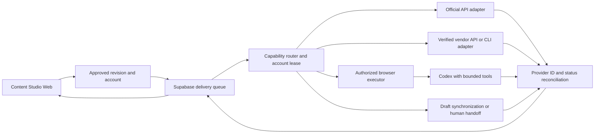
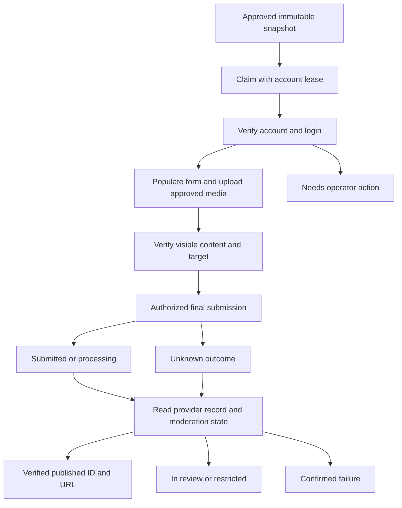

# One-click publishing: competitor evidence and a local Codex execution plan

Research date: 2026-10-11. This is feasibility research, not an installed integration or a new publication test. Existing automatic publishing remains paused. Vendor claims and code inspection are distinguished from owner-account acceptance.

## Outcome

Local Docker plus Codex operating an authorized Chrome session is technically feasible. The existing Docker model executor does not have the desktop application's Computer Use connection or the host browser session. A durable execution bridge is still required to turn a Web publication request into an agent task and a reconciled platform receipt.

A one-click interface can dispatch different mechanisms per account: an official platform API, a vendor publishing API/CLI, a controlled browser executor, or a draft handoff. These mechanisms have different authorization, lifecycle, reliability and acceptance requirements. A tool-level API does not prove that its underlying channel uses an official platform API.

## Competitors and reusable capabilities

| Product | Publicly established mechanism | Boundary | Fit for Content Studio |
| --- | --- | --- | --- |
| Buffer | API has explicit automatic and notification scheduling modes; automatic mode uses publishing workers, notification mode requires a person to finish in the social application | Unsupported features/channels can use notification publishing; its listed channel set does not establish Chinese-platform coverage | Reference for clear capability labels and per-channel fallback |
| Postiz | Connected integrations, OAuth, media upload, scheduling/status APIs, and official MCP/CLI for agents | Self-hosted Reddit requires platform app credentials; an available provider adapter does not supply account or platform approval | Preferred evaluation candidate for supported international channels |
| Yixiaoer / 蚁小二 | Vendor documents an embedded browser for account login and the `yxer` CLI for account discovery, media, validation, preview and delivery; `clientId` selects local-client dispatch, otherwise cloud dispatch | Exact per-platform transport and permissions are not disclosed in the articles; its own example puts WeChat content in drafts for human final publication | Candidate for a thin vendor adapter when its actual account/content matrix passes acceptance |
| Yimei / 易媒助手 | Vendor markets a desktop client, multi-account distribution, scheduling and queueing | Public product pages do not establish the backend mechanism of each channel; no supported developer API was verified here | Benchmark product; do not infer or promise an integration from marketing alone |
| WechatSync / 文章同步助手 | Open-source browser extension uses existing browser login, uploads images and saves articles as drafts; CLI/MCP/SDK are documented | Explicitly does not automatically publish; audio/video synchronization is not supported | Article draft synchronization candidate, separate from public delivery |
| social-auto-upload | Current upstream README identifies browser-based upload adapters, CLI/skills and a Bilibili path using `biliup` | Current README warns that its historical Web frontend is not the main line and is not guaranteed runnable; automated upload is not proof of platform authorization | Inspect narrowly scoped upload adapters rather than replacing the studio UI |
| xiaohongshu-mcp | Source has Rod browser navigation, image upload, title/body editing and publish-button execution; upstream provides Docker and MCP | Unofficial browser automation; success currently relies on leaving the publish form, which alone does not prove a public note or final moderation outcome | Technical reference, gated by permission and stronger receipt verification |
| multi-publisher | Open-source Electron + Playwright + persistent Chrome sessions, per-platform workers and publication history | Small project; its anti-detection and safety marketing is not verified acceptance or platform authorization | Architecture example rather than a mature default dependency |

Sources: [Buffer API modes](https://developers.buffer.com/reference.html), [Buffer notification publishing](https://support.buffer.com/en-us/articles/using-notification-publishing-gvZQiMxVa2), [Postiz OAuth/Public API](https://postiz.com/blog/direct-postiz-integration-oauth-api), [Postiz MCP](https://postiz.com/mcp), [Postiz self-hosted Reddit](https://docs.postiz.com/self-host/providers/reddit), [Yixiaoer workflow](https://xueyuan.yixiaoer.cn/article/46560), [Yixiaoer agent example](https://xueyuan.yixiaoer.cn/article/46285), [Yimei product](https://yimeizhushou.com/), [WechatSync](https://www.wechatsync.com/), [social-auto-upload](https://github.com/dreammis/social-auto-upload), [Xiaohongshu publish implementation](https://github.com/xpzouying/xiaohongshu-mcp/blob/main/xiaohongshu/publish.go), [multi-publisher](https://github.com/atxinsky/multi-publisher).

Read-only npm registry checks confirmed that `@yixiaoermail/cli` (3.2.27), `@wechatsync/cli` (1.1.0) and `postiz` (2.0.16) exist at research time. No package was installed or executed, and these versions are observations rather than proposed pins. The Yixiaoer article includes pseudocode and explicitly says its example command names are not real CLI subcommands; the actual help/schema must be inspected before implementation.

## Codex execution options

### Desktop session for supervised local publication

Docker remains the authority for content, approvals and jobs. Codex Desktop uses Computer Use to inspect the workbench and an allowed Chrome session, populate a platform form, handle ordinary editor differences and verify its result. The desktop agent must receive the approved account and immutable content version, not select whichever draft happens to be visible.

Official OpenAI documentation confirms desktop Computer Use can operate macOS/Windows apps and Chrome where enabled. The built-in browser has its own profile, separate from ordinary Chrome. Its documentation currently says automated file uploads are unsupported there; existing Chrome/native file-picker capability must be independently tested for the intended platform. Do not assume a Google sign-in in Chrome transfers to the built-in browser or to a container.

This route suits low-volume supervised acceptance. A Web button does not automatically start a desktop Codex task merely because both applications are running. Desktop session ownership, task initiation, browser control and completion callbacks need an explicit supported integration or an operator-initiated agent task.

Sources: [OpenAI Computer Use](https://learn.chatgpt.com/docs/computer-use?surface=app), [OpenAI browser](https://learn.chatgpt.com/docs/browser?surface=app).

### CLI/App Server plus a publishing tool

A Docker agent can call an authenticated publishing API, a documented CLI, or a configured MCP browser/publishing server. Codex supports local STDIO and Streamable HTTP MCP. App Server supports embedding Codex sessions into a custom application; actual publication capabilities still come from separately supplied tools.

The current model container is a structured-generation service. Installing Codex in it does not give it host macOS Accessibility, the Computer Use plugin, or host Chrome cookies. Add a separately authorized publisher worker/tool rather than mounting the full host home or browser profile into the model container.

Sources: [OpenAI MCP](https://learn.chatgpt.com/docs/extend/mcp?surface=cli), [OpenAI App Server](https://learn.chatgpt.com/docs/app-server).

### Docker-contained browser

A separate Linux browser service with an operator-visible login surface and a private profile bind directory is a portable engineering option. It requires fresh account login and separate platform acceptance; host Chrome login is not inherited. This is a proposed architecture, not a tested component of the current deployment.

Prefer explicit per-platform adapters for repeatable steps. Use an agent for bounded page interpretation and recoverable UI differences. Retain human intervention for login challenges and permission-sensitive actions. Do not implement proxy rotation, fingerprint concealment, CAPTCHA bypass or account replacement as a substitute for permission.

## Proposed execution architecture

The browser executor may be an optional desktop companion for stage one or a separately containerized browser worker. Core services remain portable Docker services. If every component must be containerized, the second design is required; controlling the owner's existing Mac Chrome necessarily uses a host-side execution capability.

Retain one authoritative delivery queue. Vendor scheduling needs a recorded delegated task ID and cancellation/status reconciliation; do not leave both the local worker and vendor scheduler able to independently resubmit the same job. Permit account-level serialization across article/video jobs and reject stale approvals.

A proposed durable browser lifecycle is:

Screenshots and the absence of an exception do not prove delivery. Keep a remote post identifier, actual target account, moderation/visibility state, final URL and timestamps. An unknown result must query the existing attempt before any new submission. Screenshot evidence must exclude private account information and credentials.

## Platform-specific decisions

- YouTube: retain the implemented official API; using a browser for uploads would add failure modes without filling the current API gap.
- Reddit: evaluate an approved hosted integration or an approved own application via Postiz. Current Reddit policy explicitly includes AI agents and non-human accounts; browser interaction is not an exemption. Hosted provider permission must cover this exact account/use, while self-hosted provider code requires its own credentials/access.
- X: use an authorized API route for allowed content. X explicitly prohibits non-API website automation and automated trending-topic posts. Do not implement Codex UI clicking as a workaround.
- Xiaohongshu: browser/MCP technical implementations exist. Current owner-account permission for sustained automated publication is unverified. Preserve the existing repository policy gate; evaluate draft assistance or a channel with documented permission, not a blanket promise of unattended publication.
- WeChat Official Accounts: evaluate the actual account's draft/publication API capabilities and a vendor draft route. Official documentation pages could not be fetched during this research, and no owner-account interface permission was inspected; endpoint/account eligibility must remain unverified. Video Accounts / 视频号 and Official Accounts / 公众号 are distinct targets.
- Bilibili: the public developer portal describes identity/application approval and distribution capabilities. Exact endpoint scopes and the owner account's eligibility remain unverified. A `biliup` or browser implementation is not proof of official API approval. Distinguish video submission from long-form article publication.

Sources: [Reddit Responsible Builder Policy](https://support.reddithelp.com/hc/en-us/articles/42728983564564-Responsible-Builder-Policy), [X Automation Rules](https://help.x.com/en/rules-and-policies/x-automation), [Bilibili developer portal](https://open.bilibili.com/doc/main). Existing Xiaohongshu policy evidence and owner-account gaps are recorded in [platform policy review](platform-policies-v2.zh-CN.md) and [accounts](accounts.md); the dynamic agreement pages returned no readable body in this pass, so no new permission conclusion was established.

## Implementation order and acceptance

1. Add a delivery capability matrix in Web: automatic API, verified provider, browser assistance, draft-only or manual; include content type and actual account authorization. Keep submitted/in-review/public states separate.
2. Expose bounded Studio job operations to the executor: fetch approved snapshot, claim/renew lease, report draft or receipt, mark operator-required, and reconcile an existing attempt. Keep approvals and credential handling outside model-written content.
3. Execute one supervised publisher pilot at a time. For international channels, first evaluate the existing official YouTube route and Postiz. For Chinese article workflows, verify WechatSync draft support and Yixiaoer account/content coverage; no installation or purchase is authorized by this report.
4. For each pilot, test media upload, exact account identity, expired login, platform validation, duplicate click/restart recovery, unknown outcome, moderation and public readback. Only a route that passes can receive the Web automatic-publication label.
5. Implement a portable browser worker only for allowed routes that need it. Keep the desktop companion optional and replaceable; do not route every publication through free-form screenshot reasoning.

Open items: vendor channel-by-content matrix and underlying transport/permission, token/session lifetime, callback/status schema, pricing/redistribution terms, actual owner-account acceptance, and restart recovery. Browser control cannot guarantee absence of restrictions or bans. Current research does not authorize new platform grants, purchases or live publications.
