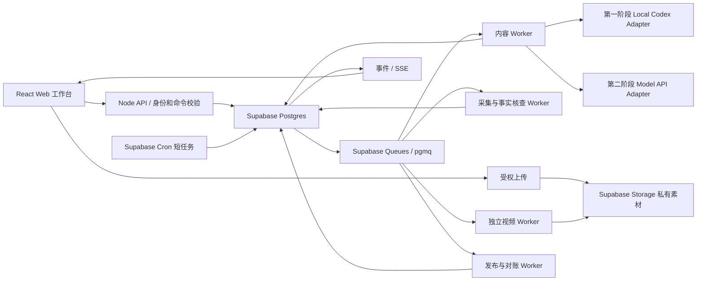
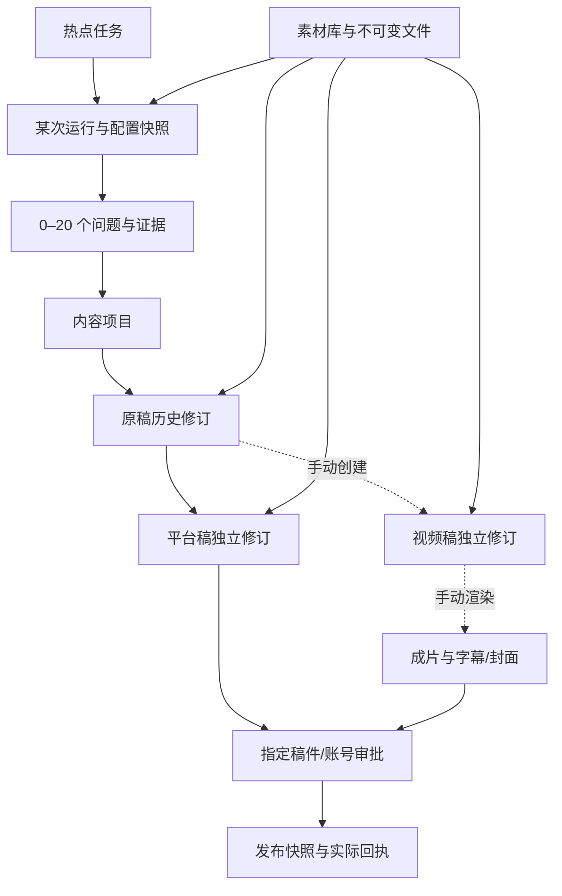

# Content Studio：本地与生产技术架构（2026-10-10）

这是根据现有代码和当前官方文档形成的设计建议，尚未部署或实现。对应 [Web 功能方案](web-product-design.zh-CN.md) 与 [产品调研](research-web-workflows-2026-10-10.zh-CN.md)。不存在适用于所有团队、平台和预算的“全球唯一最佳技术栈”；本项目的首选应是：保持同一个内容领域模型与 Web 操作流程，本地使用受限 Codex Worker，生产替换为模型 API Worker；应用数据库始终使用 Supabase。

## 1. 已核查的基础与需要改变的部分

现有 `src/core/generator.ts` 通过独立进程执行本机 `codex exec --ephemeral --ignore-user-config --sandbox read-only --output-schema`，生成来源 Brief、原稿和平台版本。它限制环境变量，使用临时目录和 Zod 校验。现有提示明确没有真实媒体输入，禁止伪造 `mediaPaths`，因此“上传图片”目前不等于模型看过图片。

现有架构中的本地 JSON 文件支持单机操作；可选 Supabase 是整个工作区 JSON 的 CAS 存储，不是适合素材历史、独立版本、多人编辑、租户权限和任务查询的关系模型。现有 30 秒发布轮询仅在进程运行、Mac 清醒时执行，不是用户自定义热点任务 scheduler。

应用仍处于第一阶段，不能把设计中的云架构、队列或模型替换写成已经上线。重构后的一个核心用例是：用户在 Web 下达“只把小红书标题改得更具体、保留已锁定素材”的任务，工作流生成一个候选修订，领域层保存该版本、校验来源与长度，并将结果推送回页面。Codex 不需要拥有发布或数据库管理权限。

## 2. 推荐基线：统一模型，分离控制服务与 Worker

业务状态以 Supabase 为准，队列里只放 `jobId`、任务类型、必要追踪字段，不放全文、原始图像或凭据。初期可使用一个 Node Worker 进程执行不同任务，按任务类型限制并发；不是一开始部署四套微服务。视频 CPU 作业后续独立扩容，发布按目标账号串行。

Web API 收到长任务后返回 `202 + jobId`；页面刷新、断网或关闭浏览器不会丢任务。UI 通过 SSE 订阅有限的业务事件与进度，重连使用事件序号继续读取；原始 Codex stderr、内部工具执行日志和凭据不得显示给用户。生产也可用 Supabase Realtime 广播权限受控的状态事件，但 Realtime 是通知通道，持久业务记录仍从数据库读取。

## 3. 第一阶段：一台 Mac、Codex、本地 Web

推荐保留 React/Vite + Express + TypeScript/Zod，不为上线预案重写前端。增加本地任务 Worker 和独立运行的 scheduler 组件；`launchd` 负责启动/重启进程，Web 页显示 Worker 是否在线、最后心跳与下次执行时间。Apple 官方资料将 `launchd` 作为后台程序管理机制，采用它避免依赖浏览器保持打开；Mac 睡眠与断网仍必须由产品记录为错过执行，不能承诺持续在线。

如需要数据库，选择已有指定 Supabase 的开发项目，迁移为关系表；本地单人 Auth 可以暂时采用同源本地会话，数据访问走本地服务，不能把数据库 secret key 交给浏览器。上传素材可先放本机私有目录，通过统一 Storage Adapter 操作，随后转 Supabase Storage；如果第一阶段已经启用云素材库，使用 Supabase Storage 也不等于已经开始 SaaS 上线。

Codex 使用现有 `exec` 作为可靠起点，增加 `--json` 后仅转换允许的进度事件；结构化结果持久化后再应用到稿件。图片由本地服务解析 assetId、确认归属，复制选定原图或生成限尺寸副本到任务临时目录，采用本机 CLI 实际支持的图像输入参数，须通过版本能力检测与一次真实图片理解测试。不要把任意用户 URL 或任意路径直接传给 Codex。

官方 App Server 支持 thread/turn、多模态、结构化输出与流式交互，但当前文档将 app-server 命令及 WebSocket transport 标为实验性且不支持生产部署；如果后续需要更深入交互，只在本地 stdio broker 中评估。浏览器始终调用项目自己的鉴权 API，不直接连 app-server，不提供任意 shell/文件操作接口，不在公网监听本机 Codex。

引用：[Apple launchd](https://developer.apple.com/library/archive/documentation/MacOSX/Conceptual/BPSystemStartup/Chapters/CreatingLaunchdJobs.html)、[Codex App Server](https://learn.chatgpt.com/docs/app-server)。

## 4. Scheduler：用户时间、时区和错过任务

产品数据应保存：`scheduleId`、IANA 时区（默认 Asia/Singapore）、用户选择的本地时间/频率、`nextRunAtUtc`、采集 prompt 版本、素材引用、信息源策略、最多 20 个问题、单次时间/调用预算、启用状态与错过执行策略。

全局 scheduler 每分钟扫描到期任务；用一个事务锁住到期记录、建立唯一的 `scheduleRun`、推进 nextRun、发送队列消息。运行唯一键为 `workspaceId + scheduleId + scheduledAtUtc`，同一次计划重复触发只返回既有记录。普通用户用“每天 09:00”而不是 cron 编辑器，界面显示下一次执行的本地时间和时区。

推荐默认错过策略是“恢复后补最近一次”，把其他错过槽记录为 skipped；允许用户改为“全部补跑（有上限）”或“跳过”。热点有有效期限，过期 queued 任务不应突然生成昨天的热点。当上次热点采集仍在运行时，合并下一次采集或记录 skipped，不能无限堆积。一次执行不足 20 个可信问题就返回真实数量和原因，不为了凑数输出。Scheduler 的 prompt 决定选题、过滤和关注角度，信息源策略决定实际采集范围，两者分别保存。

UTC 是存储和排序基础，IANA 时区是用户排程语义。DST 的不存在时间默认跳过并记录，重复时间默认只执行一次；全球用户上线前测试 DST。删除/禁用计划不会自动停止已经提交的平台发布，必须有独立任务取消入口。

Supabase Cron 可在 Postgres 里运行 SQL、数据库函数或短 HTTP 调用；官方建议最多 8 个任务同时运行、每个不超过 10 分钟。因此用一个短 dispatcher 生成工作任务，不为每个用户建立执行大模型/FFmpeg 的数据库 cron，也不让 DB cron 等待外部服务完成。

引用：[Supabase Cron](https://supabase.com/docs/guides/cron)。

## 5. 持久任务、并发、重试与取消

建议任务状态：`queued → running → succeeded`，分支为 `cancel_requested/cancelled`、`retry_wait`、`failed`、`needs_reconciliation`；编辑候选是否应用另由稿件状态管理。每个 Job 记录输入的 masterRevision、variantRevision、素材版本、promptVersion、providerRequestId、attempt、leaseToken、heartbeat、errorCode、实际用量。

Supabase Queues 基于 pgmq，官方的 exactly-once 表述仅限消息 visibility window，不是整个业务或外部发布恰好一次。消费使用 `read`，成功持久化结果再 archive；不用读时删除的 `pop` 作为需要可靠恢复的消费方式。长任务更新业务租约与 `pgmq.set_vt`；延迟的旧 Worker 不能用过期 leaseToken 覆盖新 Worker 结果。

模型调用、素材处理和事实采集可以根据已保存的步骤输出做有限指数退避，避免重复收费；schema 不合格可进行一次受控修复，持续失败向 Web 返回具体原因。Webhook 或 SSE 重复不能重复应用一个版本，结果写入要有唯一 actionId 和预期 revision。用户编辑发生在生成期间时，候选结果进入待合并而非覆盖当前内容。

发布保留现有更严格的 journal / approval / reconciliation 机制。外部 API 超时后结果未知，禁止把队列的通用重试直接套到 POST 发布请求；记录 `needs_reconciliation` 并读回同一请求/远端 ID。有 provider idempotency 支持就使用同一业务键；无支持时自有 ledger 仍无法单独排除“外部已接收、数据库未记下”的间隙。

取消模型作业需同时记录取消请求并终止本地子进程或调用 provider cancel；停止视频渲染后保留已完成资产。已经投递到平台的取消不能承诺撤回或删除，Web 显示“本地已停止，远端状态待核实”。

引用：[Supabase Queues](https://supabase.com/docs/guides/queues)、[PGMQ 扩展与 set_vt](https://supabase.com/docs/guides/queues/pgmq)、[Queues API](https://supabase.com/docs/guides/queues/api)。

## 6. 图片素材：上传与真正参与生成是两个环节

素材对象保存不可变内容 hash、bucket/path、MIME、尺寸、来源/作者/权利备注、用户标签、描述、上传者、可选 AI 描述。图片原件、缩略图、裁剪版、AI 新生成图分别是对象，避免覆盖同一个路径造成缓存和历史审计混乱。

“在 scheduler 选素材”保存的是资产 ID 和使用方式，例如品牌参考、背景参考、事实证据、指定成品配图。每次运行冻结资产版本；scheduler 编辑素材只影响下一次运行。热点采集阶段只有用户选择的参考素材参与选题上下文，不自动为所有候选反复付费识图；相关图像分析可按资产 hash+模型/指令版本缓存。

选题、原稿调优、单平台微调和视频分镜都复用同一个素材选择器。用户清楚看到“本次模型将看到 3 张图”以及“仅作为最终配图的 2 张图”，而不是所有被选图片都偷偷送入模型。视觉模型输出只是描述，不能将图片中的不确定事实当成新闻核查结果。

生产素材使用私有 Supabase Storage bucket，workspace 归属在数据库和 storage.objects RLS 中均验证。浏览器用已授权路径的短期上传权限直接传储存，服务器不为每一张图片中转全部 bytes。超过 6 MB 或网络不稳定时按官方建议采用 TUS/Uppy 断点续传；上传完成再校验类型/尺寸/hash，登记 usable 资产。短期签名下载 URL 用于预览或 provider 读取，不能当作永久资产标识，注意有效期必须覆盖预计 provider 读取窗口。

引用：[Supabase Storage 访问控制](https://supabase.com/docs/guides/storage/security/access-control)、[TUS 断点续传](https://supabase.com/docs/guides/storage/uploads/resumable-uploads)、[私有文件与签名 URL](https://supabase.com/docs/guides/storage/serving/downloads)。

## 7. 视频独立稿件与独立计算资源

按用户要求，创建原稿和平台文稿不会建立视频渲染任务。Web 需要明确的“创建视频稿”操作，生成一个 VideoProject：来源 masterRevision、旁白、分镜、字幕、画面 assetRefs、时长、比例、语言、声音与平台输出规格。用户改好这个独立脚本后再点击“生成视频”，建立单独 RenderJob；修改文字或分镜后旧视频标为过期，重新渲染需用户显式操作。

第一阶段可继续 FFmpeg 和本地已可用配音，但把当前直接拿 YouTube 文本当旁白改为独立视频脚本实体。生产阶段 FFmpeg + provider TTS + 素材合成可以先提供稳定、有字幕、有来源的解释视频；生成式视频 API 是另一个明确选项，按片段生成后再剪辑，不能把“图片+配音 MP4”称为真实镜头视频生成。

视频 Worker 运行 Docker/Linux，按 jobs 描述下载所需素材并使用临时工作目录，产出 MP4、封面、字幕与 manifest 到 Storage。供应商渲染回调先验签、记录事件，再更新真实 job 状态。Supabase Edge Functions 当前最大内存 256MB、每请求 CPU 2 秒、wall time 免费 150 秒/付费 400 秒，不应承载 FFmpeg 编码或长多步模型流程。

引用：[Supabase Edge Functions 运行限制](https://supabase.com/docs/guides/functions/limits)。

## 8. 第二阶段：无需 Mac/Codex 的生产版本

主方案是托管 Web 静态前端 + Node API/container worker + Supabase Postgres/Auth/Storage/Cron/Queues；大模型通过 provider API 调用，Linux FFmpeg 替代 macOS 依赖，发布使用审核通过的官方或已授权 publisher。第一阶段做统一 Adapter 合约即可，不要求马上迁移 Next.js、Kubernetes 或重型代理框架。

Supabase Auth 使用 Google 登录（测试/管理按用户指定 radarxai@gmail.com），生产不是把所有客户操作绑定到这个 Google 账号。每个账号属于自己的 workspace；业务表 RLS 验证 workspace membership。Supabase secret/service key 只能存在服务器和授权 Worker，不能进入浏览器 bundle 或 local Codex 生成环境。平台 OAuth 授权和 Web 登录是不同权限，不要把 Google 登录成功视为 YouTube 发布许可。

模型 Adapter 保持统一输入：来源事实包、原稿/目标版本、动作 prompt、选定图片、预期 revision、schema；统一输出：候选版本、引用关系、使用量、provider request ID。OpenAI Responses 的 Structured Outputs 可以约束 schema，图像输入支持 URL/base64/fileId 和多图，但事实正确性仍需自己的校验。长调用可以用 background response、保存响应 ID、查询/流式恢复和取消；Provider ID 不等同于产品 jobId，不替代应用的版本、成本和恢复日志。

引用：[Supabase Google Auth](https://supabase.com/docs/guides/auth/social-login/auth-google)、[RLS](https://supabase.com/docs/guides/database/postgres/row-level-security)、[OpenAI Structured Outputs](https://developers.openai.com/api/docs/guides/structured-outputs)、[图像理解](https://developers.openai.com/api/docs/guides/images-vision)、[Background mode](https://developers.openai.com/api/docs/guides/background)。

## 9. 是否采用 Trigger.dev / Temporal

| 选择 | 适合时机 | 本项目取舍 |
| --- | --- | --- |
| Supabase Cron + Queues + Node Worker | 初期较短、明确步骤的采集/写稿/渲染/发布 | 首选。复用唯一数据库、业务和消息同事务；需要自己维护少量 job 步骤、租约和恢复逻辑。 |
| Trigger.dev Cloud | 多步骤 AI 与视频逐渐复杂，希望降低 workflow 运维 | 可选托管 Worker/编排后端，业务数据依旧在 Supabase。其幂等键只防重复 trigger，不自动使 run 内远端副作用幂等；仍保留发布 ledger。不要同时维护两个产品 scheduler。 |
| 自托管 Trigger.dev | 有平台团队和运维预算 | 当前官方架构增加 Redis/Postgres，Cloud checkpoint 等能力不在 self-host 完整提供，违背本项目最简/数据库选择，因此暂不选。 |
| Temporal Cloud | 大量跨天任务、人审等待、多团队复杂工作流 | 可在复杂度证明需要时使用；应用自己运行 Activity Worker，workflow history 支持恢复。对当前单人第一阶段运维和设计成本过高；外部发布 Activity 仍可能重试，不能声称防止所有重复发帖。 |

官方 Trigger.dev 文档中，Cloud checkpoint 支持等待后恢复；当前免费新 schedule 有至少 60 分钟执行窗口且不支持每小时以上频率，这不符合用户指定时间的精确 scheduler 语义。即使后期采用 Trigger Cloud 执行长任务，也让 Supabase 保存产品计划并按到期事件触发，或使用明确验证的付费精确排程。任务设置 maxDuration 和调用预算，避免把宣传的“不超时”理解为无限运行的产品策略。

引用：[Trigger.dev 工作机制](https://trigger.dev/docs/how-it-works)、[幂等键与副作用](https://trigger.dev/docs/idempotency)、[自托管架构和能力差异](https://trigger.dev/docs/self-hosting/overview)、[schedule 时区和免费窗口](https://trigger.dev/docs/tasks/scheduled)、[maxDuration](https://trigger.dev/docs/runs/max-duration)、[Temporal Event History](https://docs.temporal.io/encyclopedia/event-history)、[Temporal Activities 与 Worker](https://temporal.io/how-it-works)。

## 10. 落地顺序和关键验收

1. 独立内容版本/任务/素材领域模型，保留当前已生成原稿和历史；迁移计划可重复运行且不合并掉旧发布快照。
2. Web 素材库、原稿/平台编辑与受限 AI 指令，验证一张选定图片真的成为模型输入，用户手改在并发生成中不丢失。
3. Scheduler 任务编辑、预览下一次执行、手动执行、每次 ≤20 个问题、错过策略和 run 历史；验证关闭 Web 页、进程重启、重复触发和失败恢复。
4. 独立视频稿、手动 RenderJob、预览/字幕/版本失效；原稿改变绝不自动产生付费视频。
5. 发布日历与不可变 ledger；当前稿件改动不改变已发布快照；超时未知状态不重复投递。
6. 第一阶段对选定真实平台完成生成、素材理解、编辑、审批、真实发布回执、重启和登录续期验收之后，再实现生产身份/租户/模型 API/Docker Worker，随后上线。

生产上线前的关键测试是业务正确性：两个用户的素材/稿件隔离；同一计划重复触发唯一执行；worker 崩溃后续跑；旧模型结果不覆盖新手改；更新原稿不会篡改已发布历史；来源事实改变会提示人工微调版本复核；未知发布状态不会盲重试。费用展示按实际 token、图片、配音、生成视频秒数与渲染时间记录，不在缺少账号价目表和测量时承诺固定生产成本。

## 11. 领域实体与关系：实施时的具体契约

| 实体 | 关键内容 | 不变量 |
| --- | --- | --- |
| ContentItem | workspaceId、topic/questionId、brief、currentMasterRevisionId | 一个内容项目统一聚合所有派生对象 |
| MasterRevision | itemId、序号、结构化正文、事实/来源 refs、prompt/asset snapshot | 历史不可变；接受修改通过新增修订和移动当前指针完成 |
| ChannelDraft / ChannelRevision | 平台、账号/内容类型、basedOnMasterRevisionId、lastGeneratedRevisionId、当前稿、syncMode、字段锁、适配 prompt、规则版本 | 不以 platform 名称作为全局唯一键；可同平台多账号/格式；覆盖须 expected revision |
| SchedulerTask / SchedulerRun | prompt、来源、IANA 时区、本地频率、nextRunUtc、assetRefs、maxQuestions；run 的 slot/config snapshot | 唯一执行槽；question 数量服务端 ≤20；改计划不改历史 |
| HotQuestion / Evidence | eventKey、问题、角度、来源 URL/时间、核验事实与缺口 | 热度与事实可信度分开；不能把模型建议当来源 |
| GenerationRun / Suggestion | scope、精确输入版本、prompt/素材、providerId、lease、结果、用量；建议的 expected revision | 结果到达不自动覆盖用户新编辑；接受操作具有唯一 actionId |
| Asset / AssetUsage | workspaceId、storageKey、hash、MIME/尺寸、原件/派生关系、来源、角色、使用对象 | 字节不可就地覆盖；对象跨工作区引用禁止；引用历史可追踪 |
| VideoProject / VideoRevision / RenderRun | 来源修订、独立脚本/场景、素材、声音、输出规格；render 的精确输入 manifest | 手动创建；文稿默认没有 VideoProject；旧 render 保持原样 |
| Approval / Publication / Receipt | channelRevisionId、accountId、素材 hash、规则版本、审批；排程/提交/平台 ID/URL/证据 | 绑定不可变稿件快照；未知状态先对账；发布历史不能随当前稿改写 |
| RunEvent / AuditEvent / Usage | 脱敏进度、状态转换、操作者、模型/渲染实际用量 | SSE/Realtime 只是通知；DB 事件才是可恢复的记录 |

关系概览：

正文采用有稳定 block ID 的结构化 JSON；编辑器可选 Tiptap 开源编辑核心，保存 JSON，不以任意 HTML 作为版本合并基础。Tiptap 官方推荐 JSON 以便解析和外部编辑。版本账本保存在 Supabase，不假定其商业协作/快照服务免费附带；单人阶段不引入 Yjs 或实时多人协作，确认团队需求后再评估。[Tiptap 持久化](https://tiptap.dev/docs/editor/core-concepts/persistence)

### 原稿提交与发布审批的原子边界

保存并同步原稿时，一个事务新增 MasterRevision、移动项目当前指针、立即标记依赖平台稿 stale/syncing、使受影响 Approval失效、hold尚未提交的Publication，并生成待执行适配任务。模型完成后才合并平台稿；不能在等待适配期间继续按旧审批发布。派发租约事务和最终提交前复核 basedOnMasterRevision/事实版本，和原稿提交共享协调锁或条件版本校验；一旦已经确认提交开始，原稿更新不改该快照，继续对账。不能用一次非原子“检查后调用”宣称消除了所有竞态。

### 本地状态和迁移边界

当前 JSON 模式仍可用于迁移演练和单机轻量运行。新增历史/任务查询需要数据库时，本地版也使用 Supabase 的个人开发工作区；“本地版”指计算由 Mac/Codex 执行，不等于使用云数据库时完全离线。第一阶段个人数据模型不意味着已经交付 SaaS，多租户 Auth/RLS/组织协作仍在第二阶段验收。

迁移为新增 schema version：备份旧状态；为每份 Draft 建 ContentItem、首个 MasterRevision 和各个 ChannelRevision；既有平台稿缺少原始生成基线时标记基线未知，第一次同步先生成建议，不假设它从未被微调；文件计算 hash并注册Asset；已有 Job 保留原 snapshot/hash/远端证据。先 dry-run 和校验引用数，再显式迁移，支持失败回滚。不要把旧视频旁白静默变成新视频任务；可导入为已有脚本并标出来源。

## 12. Web API 与事件边界

以下为拟议契约，不是当前已经可用的接口。全部新增修改操作均核验工作区和精确预期版本；版本竞争返回 409，页面保留用户尚未保存的输入并提供比较。

| 用例 | 拟议接口 | 结果 |
| --- | --- | --- |
| 管理任务 | `POST /api/scheduler-tasks`；`PATCH /api/scheduler-tasks/:id` | 保存配置与计划修订，预览未来执行时间 |
| 立即抓取 / 历史 | `POST /api/scheduler-tasks/:id/runs`；`GET /api/scheduler-runs/:id/questions` | 202 + runId；返回最多20个问题及来源状态 |
| 问题转项目 | `POST /api/content-items`，带 questionId/brief/assetIds | 新建项目，随后生成原稿；不自动发布 |
| 生成 / 精调 | `POST /api/generation-runs`，带 action、scope、prompt、assetIds、expected revision | 202 + runId；后台生成原稿/适配稿/修改建议 |
| 接受建议 | `POST /api/suggestions/:id/apply`，带 actionId/expected revision | 新增不可变修订，事务移动指针、作废对应审批和入队同步 |
| 手工保存 | `POST /api/content-items/:id/master-revisions` / `POST /api/channel-drafts/:id/revisions` | 创建新修订；不 PATCH 旧历史行；自动保存工作副本与正式提交分开 |
| 同步 / 冲突 | `POST /api/channel-drafts/:id/sync-runs` / `POST /api/merge-proposals/:id/apply` | 保存 B/L/N与冲突解决选择，保留人工修改 |
| 素材 | `POST /api/assets/upload-intents`；`POST /api/assets/:id/complete`；`GET /api/assets` / `:id/usages` | 本地或云 Storage Adapter；assetId / metadata，不返回服务器任意路径 |
| 视频稿 / 渲染 | `POST /api/video-projects`；`POST /api/video-projects/:id/render-runs` | 两个显式动作；独立输入版本和输出资产 |
| 运行观察与取消 | `GET /api/runs/:id`；`GET /api/events`；`POST /api/runs/:id/cancel` | Web重连读取DB，SSE携带事件序号，取消不伪造远端撤回 |
| 审批 / 发布 / 对账 | 为现有 jobs 接口加精确 channelRevision/approval 引用 | 保留发布协调器与已验证恢复语义，日历只是展示层 |

AI模型只返回候选业务数据；领域服务执行校验、保存和版本指针变更。收集资料的联网 Worker、处理文件的 renderer 与创作引擎分开能力；来源抓取只访问批准的公开来源，防止自定义 URL 意外访问本地/内网地址。生产浏览器使用用户权限的 Supabase Auth/RLS和上传授权，不通过具有无限权限的公共接口代理所有数据库操作；service key 绕过 RLS时，服务端仍必须核验成员关系。平台 token 按工作区与账号隔离，内容模型无法获得发布凭据。

## 13. 可直接落地的生产拓扑与替代条件

在“小团队、全球用户、需要持续运行 Node/FFmpeg、已有 Vite/Express”的条件下，优先 **Render Web Service + Background Worker + Supabase**。最小部署让 Express 同域服务 Vite 静态产物和 API，省去两域 Auth/CORS/SSE排障；Worker轮询 Supabase Queue，不必增加 Render Key Value/Redis。Render 官方说明 Background Worker 持续运行，可处理媒体与第三方 AI 调用；Web Service 支持 Express 与 Docker。[Render Worker](https://render.com/docs/background-workers)、[Web Service](https://render.com/docs/web-services)

流量变大时可把静态前端拆到 Cloudflare Pages/CDN，同时保持 API/Worker 与 Supabase 同地区。Cloudflare 有框架部署指导，但不把浏览器端 Vite构建误当作长任务 runtime。[Cloudflare Pages](https://developers.cloudflare.com/pages/framework-guides/)

上线前须把当前 server 的 loopback绑定与仅 localhost Host/Origin 检查改成明确的生产配置，补真实认证、上传策略、可信域、健康检查与优雅停机；不能把现有本地端口直接暴露公网。实际地区依据目标客户、平台 API 可达性、Supabase 地区及视频出网成本测试后选择，未实测不承诺全球低延迟。国内账号的可用连接和审批路线单独验收，境外部署不会自动解决。

Remotion 是复杂动画/时间轴模板的可选升级，能使用 React定义场景和服务端渲染；首版继续复用 FFmpeg，避免单为架构方案重写现有媒体系统。其许可证是 source-available，并非通用 MIT开源：当前个人/最多3人的组织有免费商业条件；需要 Company License 的自动化场景按render计费并有最低月费，采购时依据实际组织和用途重新核验，不笼统宣称 SaaS一律免费或一律必须付费。[Remotion renderer](https://www.remotion.dev/docs/renderer)、[许可 FAQ](https://www.remotion.dev/docs/license/faq)

## 14. 信息源、质量和成本的最佳投入顺序

发现优先复用当前官方地区 Trends RSS，加用户指定的官方/行业 RSS。可评估 GDELT做跨语言新闻覆盖，或授权搜索/新闻数据服务；搜索热度、报道量、地区覆盖与可信度分别展示，不能简单相加制造“全球第一”。GDELT 官方介绍其全球新闻覆盖与15分钟数据更新；这属于发现信号，不是事实背书。[GDELT](https://gdeltproject.org/)

Google Trends官方API当前入口仍标 Alpha/申请访问，需验证本账号权限；不可把尚未获得的API写成已接入。NewsAPI官方 `content` 字段最多200字符，所有方案均不提供全文；免费 Developer 有24小时延迟且仅开发/测试，生产不能照搬免费key实时研究。完整写作仍需取得允许使用的来源内容/摘录和独立核验。[Google Trends API](https://developers.google.com/search/apis/trends)、[NewsAPI Everything](https://newsapi.org/docs/endpoints/everything)、[NewsAPI方案限制](https://newsapi.org/pricing)

成本顺序：先廉价采集和去重，形成最多20个问题；用户选一个后才深入研究与精细写稿；每个平台独立适配，可缓存相同输入；只有手动选择才生成视频。缓存键包含原稿版本、prompt、平台规则、素材hash与引擎版本；新增事实不能误用旧结果。预算覆盖抓取/搜索、token、图像输入、配音、生成式视频片段、CPU编码和素材出网，错误重试也记录实际成本。超出既定上限暂停并显示原因，不自行扩大付费额度。

质量评测使用用户认可的真实题材、截图和风格样本，先比较事实引用准确性、人工修改保留率、平台校验通过率、编辑耗时和实际发布结果，再比较模型名字或“自动化率”。JSON schema只约束结构，不能保证事实或文案质量。上线还需实测备份恢复与跨租户访问；这比同时引入多个编排框架更优先。
