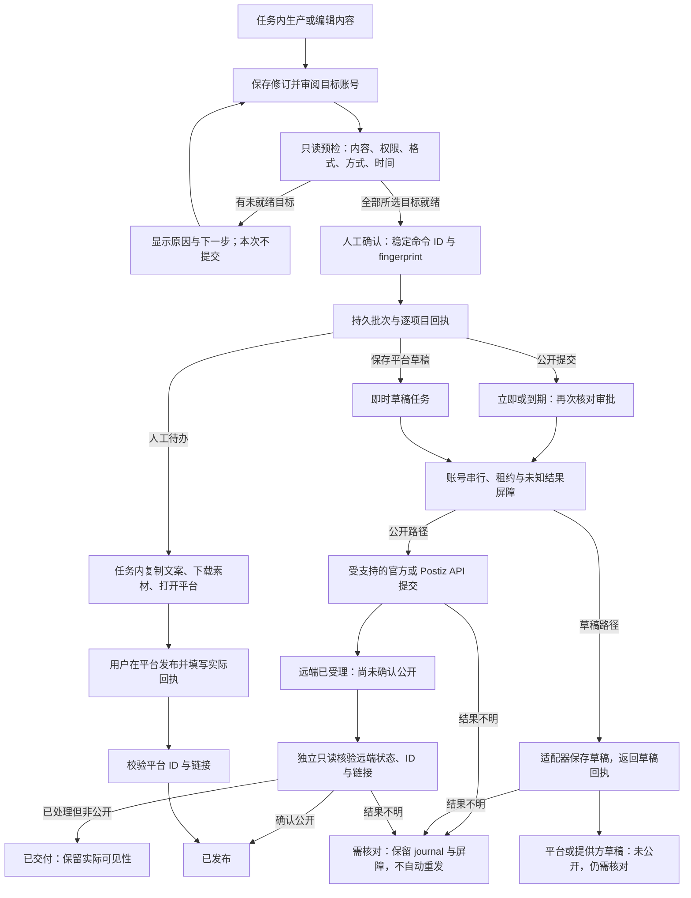

# Content Studio 工作流与插件升级 Coding Spec

日期：2026-10-21。依据 [竞品与代码审查](competitor-architecture-ux-review-2026-10-21.zh-CN.md)。本文件规定本轮实现与验收，完成情况另以实际测试记录为准。

## 1. 结果与产品流程

用户从工作台创建任务，在任务内完成内容、资料、发布、记录。全局发布管理和资料库提供跨任务视图，不另建内容身份。文章与视频保持独立域。保存草稿、人工待办、公开提交必须显示不同结果，只有远端 ID、平台链接及确认状态才能显示已发布。

主导航保留工作台、任务、发布、资料、设置。任务详情改为四标签；概览与本期选择并入页头，单次任务减少侧栏。编辑先显示正文，质量详情和专业设置折叠。创建流程保留三步和按类型的输入，首页入口直接指定 content/discovery/video。发布记录携带 task、episode、article、job 定位参数，服务端校验归属后才能显示。

逐账号选择一种交付方式，统一确认所选目标；未就绪目标不得被悄悄忽略。文章公开交付支持立即或指定时间，人工待办支持计划处理时间（不是通知服务承诺）；视频和平台草稿保持现有即时明确动作，未实现的排期不提供可用选项。新 V2 证据生产的自动公开限制继续生效。

### UI 前后变化对照

下表描述本轮界面契约；浏览器与实际激活插件的验收结果另见最终测试报告。

| 场景 | 调整前的问题 | 本轮变化与边界 |
| --- | --- | --- |
| 首页与创建 | 发现、文章、视频入口与默认类型可能不一致；切换类型容易丢失输入 | 首页入口指定创建类型，保留三步创建与切换前输入；高级选项折叠，生产与公开发布开关分别说明 |
| 任务与编辑 | 概览、期次侧栏和详情重复占用空间，正文被质量与技术信息挤到后面 | 页头承载任务与本期摘要，内容／资料／发布／记录四标签；单次任务减少期次侧栏，正文优先，证据和专业设置折叠；保留显式保存与修订冲突保护 |
| 发布与月历 | 多种交付动作分散；用户难以区分受理、草稿和公开；月历容易受列表分页截断 | 逐账号选择一种方式后统一确认，所选未就绪项阻止整批提交；回执显示具体账号与动作；月历独立统计并提供逐日分页，不将人工计划时间承诺为自动提醒 |
| 任务资料 | 尚无期次的任务资料不可见，媒体／知识附件主要显示 ID | 增加任务级资源入口；展示名称、类型和可用预览，区分任务附件与本期实际引用；追加资料不改写历史证据 |
| 设置与诊断 | 运行故障缺少统一日志入口，陈旧观察记录仍可能显示 running | 设置提供固定字段日志筛选、分页和有限导出；显示最后采样、运行观察状态与显式启停；不把 Pod Ready 或一次检查视为连续验收 |
| Chrome 插件 | 入口、状态、品牌与 Web 不一致，连接修复和模式切换混在一起 | 采集／待处理／账号三入口，采集恢复原 commandId；统一版本与品牌提示，独立管理连接修复、更新和模式切换；未知 journal 保留并继续阻止新写入，2.0.12 边界见第 4 节 |

## 2. 架构与技术选型

| 范围 | 选型与原因 | 实现位置 |
| --- | --- | --- |
| Web | 保留 React、TanStack Query、React Router、现有 token；避免第二套组件框架 | src/ui、src/contracts/studio-* |
| 服务 | 保留 Express、严格 TypeScript、Zod；预检和执行共用平台规则与交付动作校验 | src/core/delivery-errors.ts、delivery-preflight.ts、publication-intent.ts、postiz.ts、video-delivery.ts |
| 持久执行 | 现有 Supabase + pgmq/pg_cron，账号租约、屏障和稳定命令 ID | pipeline.ts、server/worker.ts、application/delivery-batches.ts |
| 月历 | 从现有权威 jobs 生成按日总数，月历不依赖50条列表页；每日详情分页 | application/delivery-calendar.ts、publishing-page.tsx |
| 资源 | 任务级资源无需 episode；返回安全名称、类型和媒体 URL | application/task-context.ts、contracts/workbench.ts |
| 插件 | Chrome MV3、现有双通道；配置幂等，连接独立恢复；storage.session 暂存未提交采集 | extension/src/mcp、studio、popup |
| 更新 | Chrome 官方 requestUpdateCheck / onUpdateAvailable；已解压模式版本提示与人工重载 | extension 更新模块；companion status.release |
| 日志 | 原生结构化 NDJSON，现有 data bind root，白名单字段；API聚合检索/导出 | core/diagnostics.ts、server/diagnostics-api.ts、ui/diagnostics-panel.tsx |
| 运行观察 | 现有 API 生命周期托管共享观察循环，显式启停；不依赖 host CLI 或新增容器 | core/runtime-observation.ts、scripts/runtime-observation.mjs、server/runtime-api.ts、server/index.ts |
| 部署 | 继续当前单应用 Kubernetes 实例和原 Supabase 服务；测试只运行临时退出的验证容器 | 现有 scripts/docker.sh、kubernetes.sh |

本轮新增数据库迁移 **0**、新增服务 **0**、新增第三方依赖 **0**。复用现有表、RPC、队列和容器职责；仓库已有迁移与已安装依赖仍是基线，不代表可以省略现有环境初始化。不增加 Redis、日志数据库、第二队列、后台更新容器或第二份权威媒体。月历读取当前 JSON jobs 的成本仍与工作区交付数量相关；未来关系表迁移另设门槛，本轮解决漏数而不重写存储。

### 本轮 API 契约

下列 `/api/` 路由沿用现有本机 Host／Origin 边界；工作区由服务端配置确定。UUID、任务／期次归属、修订和输入结构在服务端校验，客户端路由不是权限或数据身份依据。内部 Companion 路由使用单独的服务凭据边界，不能由普通网页直接调用。

| API | 读写性质 | 主要输入／结果 | 主要边界 |
| --- | --- | --- | --- |
| `GET /api/workspace/task-context/:kind/:id/resources` | 只读 | `kind = plan/article/video`，任务 ID；返回 links、captures、具名 resources | 无需 episode；只查任务级附件，最多 100 条，资源不可用时返回安全说明 |
| `GET /api/workspace/task-context/:kind/:id/episodes/:episodeId/resources` | 只读 | 已校验期次；任务级与该期附件 | 校验期次归属，不能借 episodeId 读取其他任务资料；不改变本期证据快照 |
| `POST /api/workspace/captures` | 写本地业务数据 | commandId、标题、公开 URL、摘录，可选 task／episodeId；返回采集结果 | 相同命令与相同内容复用；命令内容不一致拒绝；不执行平台发布 |
| `POST /api/workspace/resource-links`；`DELETE /api/workspace/resource-links/:id` | 写关联关系 | task、可选 episodeId、资源 kind／id；返回保存结果 | 先验证任务与资源；解绑只删除关联，保留资料库原件和已有引用 |
| `POST /api/workspace/deliveries/preflight` | 业务只读，虽然使用 POST | 1–100 个 DeliveryIntent；返回 eligible、fingerprint、issues、nextAction | 不审批、不入队、不刷新证据、不写远端；使用与执行一致的格式、动作及账号规则 |
| `POST /api/workspace/delivery-batches` | 写 Supabase 与队列 | commandId、1–100 个带 fingerprint 的目标；HTTP 202 与批次回执 | 同内容同账号只能一种动作；命令 ID 绑定规范化输入；worker 再次核对内容、账号和指纹，逐项记录受理或失败，202 不代表平台成功 |
| `GET /api/workspace/delivery-batches/:id` | 只读 | 当前工作区的批次 ID；各项目及最新交付状态 | 返回既有 job 的实际状态；accepted、draft_saved、published 含义分开，不能凭队列状态宣称已发布 |
| `GET /api/workspace/delivery-calendar` | 只读 | month（YYYY-MM）、有效 timezone；按日总数与状态计数 | 使用全部现有 jobs 聚合，独立于 50 条列表页；按 scheduledAt 的当地日期归属，排除平台草稿与已取消项 |
| `GET /api/workspace/delivery-calendar/day` | 只读 | month、timezone、day、可选 cursor；当日交付与 nextCursor | day 必须属于 month；每页 50 条，以 createdAt／id 稳定翻页；来源定位限定工作区，平台链接过滤敏感或不安全 URL |
| `GET /api/runtime/logs` | 只读 | 可选 level、service、jobId、requestId、cursor、limit；日志页与异常计数 | limit 默认 50、最大 200；固定目录、固定字段，14 天／32MiB 读取预算；不接受任意文件路径 |
| `GET /api/runtime/logs/export` | 只读下载 | 当前筛选／游标；JSON 附件及 nextCursor | 最多 200 条，与查询使用同一脱敏结构；不是全部原始容器日志导出 |
| `GET /api/runtime/observation` | 只读 | 当前工作区／版本的观察摘要 | freshness 和进程所有权决定状态；不自动启动、续期或补算旧窗口 |
| `POST /api/runtime/observation/start` | 写本地观察证据、启动 API 内循环 | 无用户路径／时钟参数；返回 started | 仅现有容器、有效 workspace 与固定 release；已有活动窗口时复用，未运行时新建独立窗口 |
| `POST /api/runtime/observation/stop` | 停止循环、保存中断证据 | 返回 stopped | 等待当前托管循环退出；不删除旧记录，不操作发布或生产队列 |
| `POST /internal/companion/status` | 只读内部 RPC | 返回 protocol、workbenchOrigin、methods、extensionRelease | 校验固定内部 Host、Bearer 服务凭据并拒绝 Origin；不返回凭据。插件通过已配对 Companion 通道读取，同源下载元数据不等于更新已安装 |

## 3. 发布契约与可靠性

DeliveryIntent 增加可选 scheduledAt（UTC ISO）、timezone（有效 IANA）。两者成对提供；无时间保持旧命令规范化与 hash 不变。当前 Web 时间输入固定为 Asia/Singapore（UTC+8），API 契约可接受有效 IANA 时区；这不表示界面已提供任意时区选择。时间进入预检 fingerprint 和持久 batch 输入；执行再次校验绑定内容/账号。公开排期只用于现有文章 API 路线，不能将原生人工交付伪装为自动发布。改期先取消未提交任务并重新审核；已接受、结果未知及 journal 存在的交付不自动改写。相同内容已有不同时间的任务时明确拒绝，立即提交也不能覆盖已有未来排期。

每个目标只有一种 action。混合批次可同时包含公开提交、平台草稿、人工待办，服务端拒绝同内容同账号重复动作。回执展示账号安全快照、平台、标题、修订、动作、计划时间、实际状态、失败原因和可用平台链接；预检给出下一步提示，原交付面板提供继续处理、核验或取消等适用操作。批次 accepted 不等于 published。

相同内容与账号的待执行任务跨批次复用时，也不能静默改变人工／系统交付方式。已有 awaiting_operator 不能作为系统提交任务受理；已有 scheduled 或 queued 不能作为人工待办受理。先处理或取消未提交任务，再重新审核另一种方式；已受理任务应核对平台结果。submitting、needs_reconciliation，以及未完成且保留上传 journal 的任务，拒绝重新选择方式或绕过原任务提交。保留原有特例：显式审阅可以接管尚未发送、无远端身份且无 journal 的规则授权任务；接管记录保留原授权审计信息。文章与视频共享 publication-intent 纯校验；视频 V1/V2 复用及 V2 审批后出现并发重复任务的路径再次检查动作。已取消但仍存留上传 journal 的历史任务不能当作可重发任务。

到期公开提交扫描遇到账号 busy 时，只推迟该候选项目，其他账号继续。核验与提交扫描分别尝试，即使扫描异常也不饿死已接受的只读核验；屏障不得删除以强行恢复。字数/格式预检与最终提交共享规则，稳定错误码区分不支持、待授权、身份不符、服务离线和内容不合格；未知错误继续脱敏。

### 任务与交付流程

到期公开提交扫描遇账号 busy 时，当前项目等待，其他账号继续；只读核验独立于提交扫描。草稿回执只确认草稿目的地，不自动升级为公开发布。人工回执明确保留由用户确认的平台事实，不伪装为 API 自动核验。

## 4. 插件更新与品牌一致性

产品名称、版本、状态语言、蓝色 token 与图标在 Web/插件统一。产品版本与上游开源来源分别展示，打包校验 manifest.version、version_name 与共享版本一致。

服务端 Companion status 发布 extensionRelease {version, downloadPath, notes, minCompanionProtocolVersion}。插件只接受同源下载路径；不下载执行远程脚本。商店安装由 Chrome 更新；收到可用版本后显示提示，应用更新前检查实际执行状态与持久记录是否可读取。没有真实执行且存储可读取时，允许保留 unknown journal 重载；活动执行或存储读取失败时禁止重载。已解压安装无法由 Chrome 商店机制自动升级，提示下载、替换固定安装目录、在扩展管理页重载，再核对实际 runtime.getManifest().version。版本差异提示不等于已完成升级。

采集、待处理、账号三个入口。采集 session 保存内容、选择任务和 commandId；失败/超时保持同一命令，确认成功后清除。列表独立搜索与分页，执行后刷新实际状态，未知结果只核验不重放。模式选择与断开连接分开，旧 journal 保留。

**2.0.12 恢复修复契约：本段以最终测试报告为准，不表示当前 Chrome 已激活或真实平台验收完成。** 已有有效本机 managed 连接可修复为另一个通过本机地址校验的 managed 连接，保留持久 journal；没有实际执行且存储可读时，不因存在 unknown journal 阻止连接修复和更新重载。恢复后允许状态读取、列表和已有结果核对；未解决或无法安全识别的 journal 作为全局草稿写入屏障，不能靠换连接、新命令或重载绕过。模式切换继续使用严格检查，有活动执行、未知记录或存储失败时均不能切换；首次配对也不能借连接修复分支绕过严格检查。上下文菜单按幂等方式创建／更新固定入口并同步品牌文字，重复安装事件或恢复不得生成重复菜单。维护恢复不删除 journal，不自动重放平台写入。

现有任务 brand profile 保留版本、受众、语气、用语与封面规则，并随 task snapshot 固定。视觉升级复用品牌 token，不覆盖既有编辑政策或伪造素材。新增跨任务全局品牌治理、多人审批和更多平台官方授权不在本次缺陷修复范围。

## 5. 日志收集与诊断

日志只接收固定 event 名称、level、服务角色、自动时间/事件ID，以及经校验的 requestId/jobId、HTTP状态、耗时和固定错误码。当前没有独立 taskId 字段；worker 的 jobId 保存队列消息所关联的工作 ID，可能是 operation 或 run ID，不能一概解释为发布 job ID。禁止自由文本正文、URL query、请求体、凭据、Cookie、环境变量、模型原文与堆栈进入收集接口。API请求与worker工作阶段使用同一结构；stdout提供容器原生日志，文件提供本地界面检索与导出。

每进程独立文件避免跨Pod互相覆盖。写入时按 1MiB 或 24 小时切分，随后依据文件段创建时间和工作区总量清理，保留限制为 14 天／32MiB；低流量持续追加不能刷新旧记录的保留期限。查询另按 record.at 排除超过 14 天的记录，停止写入时也不返回过期记录；物理文件清理在后续写入时执行。接口只在现有本机 Host/Origin 边界内可访问，读取固定日志目录，不接受用户文件路径。分页和过滤由服务端执行；损坏行跳过但报告，日志收集失败不能使正常业务操作失败。诊断面板显示时间、级别、服务、事件、关联工作ID和固定错误码对应的处理提示；按当前筛选与游标导出最多 200 条同一脱敏结构，不导出原始运行环境。

运行观察由现有 API 进程托管共享 runRuntimeObservation 循环，提供显式 start／stop；API 正常关闭时停止循环并保存中断状态，不通过 host CLI 或分离子进程运行。API 重启后，失去当前进程所有权的 managed 窗口立即显示 interrupted，不自动恢复计时。没有活动窗口时，新启动创建独立 UUID 目录并保留旧证据；重复启动不会创建第二个活动窗口。GET 只读取状态，不启动观察、不重置记录、不累加旧窗口时长。

观察记录绑定当前 workspace 与 release（version、sourceDigest、已采样的 builtAt）。读模型使用最后采样时间计算 freshness，超过 180 秒未采样的 running 显示 interrupted。只有状态 passed、accepted 为真、墙钟与单调时钟均达到 48 小时、至少 2881 次采样且就绪检查齐全，才显示运行观察通过。qualityAccepted 与 productionAccepted 始终为 false；运行就绪性观察不能代替内容质量、真实平台交付或生产发布验收。UI 提供启停和最后采样信息，每次重新开始都建立新的连续窗口。

## 6. 验收与回滚

1. A被屏障阻塞时B正常扫描，A原提交继续核验，无重复远端写。
2. 多次alarm不关闭健康Companion；单通道失联能恢复，未知业务不重放。
3. LinkedIn超限等输入在预检与执行一致拒绝，错误可操作。
4. 创建类型切换保留输入；首页发现/视频正确；跨页同一期不同文章定位正确。
5. 无期次任务资料立即可见；资源卡名称与范围清晰。
6. 多于50条月历总数完整，逐日列表分页；月份/时区校验。
7. 排期进入fingerprint/命令；混合批次不漏目标；回执有账号/动作；未知结果不可改期。文章与视频人工／系统交付双向切换明确拒绝，原方式重试保持幂等；覆盖 queued、unknown、journal、规则任务安全接管及视频审批后并发重复路径。
8. 插件popup重开恢复同一命令，版本一致、模式更新路径真实。
9. 日志过滤、分页、保留策略与敏感字段丢弃；无可控路径；损坏文件可诊断。低流量同进程隔 15 天追加时，旧记录不能续期。
10. 观察显式启动／停止、进程重启孤儿、陈旧采样和不完整通过声明均正确投影；停止后重新启动不累计旧时长，旧证据保留。生命周期测试不等于真实完成 48 小时观察。
11. Docker中typecheck/build/单元回归、插件build/package、真实Supabase隔离fixture与浏览器主要流程。真实平台写入不作为本轮测试。

更新现有运行实例前记录当前版本和备份；保持公开发布暂停、调度暂停及原账号/任务不变。失败回退原镜像，不能回退已提交的平台事实。最后交付记录必须区分：源码测试、现有实例部署、Chrome已激活版本、真实平台验收和48小时持续运行。

参考：[Chrome runtime](https://developer.chrome.com/docs/extensions/reference/api/runtime)、[Chrome扩展更新](https://developer.chrome.com/docs/extensions/develop/concepts/extensions-update-lifecycle)、[Supabase函数](https://supabase.com/docs/guides/database/functions)。
